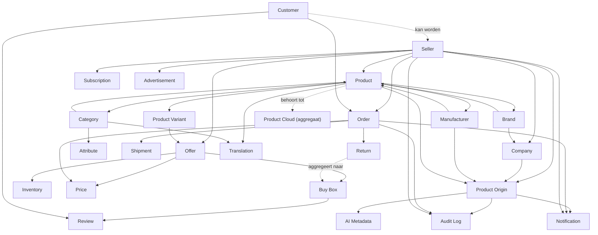

# EuropMade — Domain Model

**Status:** Concept v0.1 — eerste technische document van Sprint 2
**Doelgroep:** senior software engineers en architecten die het datamodel, de API's en de services van EuropMade gaan uitwerken
**Basis:** EuropMade Blueprint V2.1 (`blueprint/`), alle definitief bevroren functionele specificaties in `docs/03-functional-specs/` (met name Product Cloud Architecture, Product Cloud/Commerce Cloud/Buy Box, Partner Onboarding, Checkout, Orderbevestiging, Authenticatie, en de zes Sprint 1C-beheermodules), `docs/08-technical-blueprint/TB-01-System-Architecture.md`
**Nadrukkelijk:** dit document redeneert vanuit de businessregels van EuropMade, niet vanuit Medusa of enig ander e-commerce-pakket. Waar Medusa (of een ander pakket) later een vergelijkbaar concept blijkt te bieden, is dat een implementatiekeuze voor een volgend Sprint 2-document — hier telt uitsluitend wat het domein *vereist*.
**Scope:** uitsluitend het conceptuele domeinmodel. **Geen databasetabellen, geen SQL, geen API's, geen code** — die volgen in latere Sprint 2-documenten, gebouwd op dit fundament.

---

## Leeswijzer

Elk domeinobject hieronder wordt beschreven volgens hetzelfde vaste stramien: **Doel**, **Verantwoordelijkheid**, **Belangrijkste eigenschappen**, **Relaties**, **Lifecycle**, **Businessregels**. Waar een domeinobject al (gedeeltelijk) is vastgelegd in een bevroren functionele specificatie, wordt dat expliciet aangehaald — dit document herhaalt die bronnen dan in eigen woorden en brengt ze samen tot één samenhangend geheel, in plaats van ze te herhalen als losse citaten. Waar een domeinobject **nieuw** is (nog niet eerder als zodanig vastgelegd), staat dat er expliciet bij, met de businessredenering die aan de modellering ten grondslag ligt.

---

## 1. Seller

### Doel
Vertegenwoordigt elke partij die op EuropMade verkoopt of produceert — de overkoepelende rol boven een concreet Retailer-, Producent/Merkhouder- of Distributeur-account.

### Verantwoordelijkheid
Is de rolhouder die na een geslaagde Partner Onboarding-aanvraag ontstaat (Partner Onboarding, bevroren, §1.2: status "Goedgekeurd"). Een Seller is nooit een los, technisch begrip — het is altijd een rol op een al bestaand Consument-account (Partner Onboarding §1.2: "rollen worden toegevoegd aan het bestaande Consument-account").

### Belangrijkste eigenschappen
- Eén of meer rollen: Retailer, Producent/Merkhouder, Distributeur — optelbaar, nooit exclusief (Partner Onboarding §1.1: "rollen zijn optelbaar").
- Koppeling naar exact één Company (zie domeinobject 2).
- Verplichte 2FA vanaf goedkeuring (Authenticatie-spec, bevroren).
- Datum van goedkeuring, huidige status (zie Lifecycle).

### Relaties
- **1 Seller → 1 Company** (een Seller-rol wordt altijd gedragen door precies één bedrijfsentiteit; meerdere Companies achter één Seller-account is niet gemodelleerd — zie Businessregels).
- **1 Seller → N Product** (als eigenaar, via OwnershipRecord binnen Product Cloud) wanneer de rol Producent/Merkhouder is.
- **1 Seller → N Offer** wanneer de rol Retailer of Distributeur is.
- **1 Seller → N Order** (als aanbieder van een deelbestelling, zie domeinobject 15).
- **1 Seller → 0..1 Product Origin-claim per Product** (wanneer de rol Producent/Merkhouder of Distributeur is en een EU-productieclaim wordt ingediend).

### Lifecycle
Overerft het al bevroren Partner Onboarding-statusmodel: *Concept → Ingediend → In beoordeling → (Aanvullende informatie vereist → Opnieuw ingediend → In beoordeling) → Goedgekeurd/Afgekeurd.* Een Seller-rol bestaat pas ná "Goedgekeurd." Er bestaat **geen status ná Goedgekeurd** in de huidige, bevroren architectuur (Partner Center §4: "geen enkele status ná Goedgekeurd... bewuste, driemaal eerder vastgelegde keuze") — schorsen/deactiveren (Partner Lifecycle Management) is een expliciet, herhaaldelijk buiten scope gehouden onderwerp.

### Businessregels
- Een Seller-rol kan uitsluitend ontstaan via een geslaagde Partner Onboarding-aanvraag — nooit direct aangemaakt.
- Rol toevoegen aan een reeds actief Seller-account is een openstaand punt, geen huidig mechanisme (Partner Onboarding, "Openstaand punt").
- Een Distributeur heeft nooit zelfstandig productie-eigendom, uitsluitend verkooprechten namens een vertegenwoordigd merk, met verplicht autorisatiebewijs (Partner Onboarding §1.1).

---

## 2. Company

### Doel
De juridische bedrijfsentiteit achter een Seller — de plek waar bedrijfsgegevens, KvK-informatie en uitbetalingsgegevens leven.

### Verantwoordelijkheid
Draagt de gegevens die bij Partner Onboarding Stap 2 ("Bedrijfsgegevens") worden ingevoerd en die het Partner Center (bevroren) uitsluitend leesbaar toont, nooit bewerkt.

### Belangrijkste eigenschappen
- Bedrijfsnaam, KvK-/BTW-nummer (formaatvalidatie server-side, geen live registerkoppeling — bewuste MVP-keuze, Partner Onboarding).
- IBAN/uitbetalingsgegevens (checksum-gevalideerd, ongeacht EU-land).
- Vestigingsland (bepaalt mede het Region-toepassingsgebied).

### Relaties
- **1 Company → 1..N Seller-rollen** (een Company kan in theorie achter meerdere rollen van dezelfde Seller staan — Retailer én Producent tegelijk — maar niet achter meerdere, afzonderlijke Seller-accounts; zie Businessregels).
- **1 Company → 1 Product Origin per geclaimd Product** (als de rol Producent/Merkhouder/Distributeur betreft).

### Lifecycle
Ontstaat bij het invullen van Partner Onboarding Stap 2, wordt onderdeel van de aanvraag, en bestaat blijvend zodra de aanvraag is goedgekeurd. Geen zelfstandige levenscyclus los van de Seller-rol die het draagt.

### Businessregels
- Bedrijfsgegevens zijn, net als identiteitsdocumenten, gevoelige gegevens: elke inzage wordt gelogd (Partner Onboarding Beveiligingseisen, letterlijk hergebruikt in Partner Center §7).
- Eén Company-record per Seller-account in de huidige architectuur — een bedrijf dat via twee juridisch losse entiteiten wil verkopen, heeft daarmee twee losse Seller-accounts nodig (geen gemodelleerd concept van "sub-companies").

---

## 3. Brand

### Doel
Vertegenwoordigt het merk waaronder een product wordt verkocht — losstaand van wie het daadwerkelijk vervaardigt.

### Verantwoordelijkheid
Legt vast onder welke naam een product aan de klant wordt gepresenteerd, en wie de merkhouder is — relevant voor zowel productweergave als voor de Distributeur-autorisatiecontrole (Partner Onboarding §1.1: een Distributeur moet aantonen namens het merk te mogen verkopen).

### Belangrijkste eigenschappen
- Merknaam.
- Merkhouder-koppeling (welke Company/Seller de merkrechten draagt).
- Optioneel: een geverifieerde merkentiteit-koppeling (Product Cloud Architecture Deel 2.1: "merk + verwijzing naar geverifieerde merkentiteit indien beschikbaar").

### Relaties
- **1 Brand → N Product** (een merk voert doorgaans meerdere producten).
- **1 Brand → 1 Company** (de merkhouder).
- **1 Brand → 0..N Distributeur-autorisaties** (Distributeurs die namens dit merk mogen verkopen).
- **Brand ≠ Manufacturer** — expliciet losstaand (zie domeinobject 4).

### Lifecycle
Ontstaat impliciet zodra een Producent/Merkhouder een product onder een merknaam aanmeldt; wordt expliciet bevestigd bij een geslaagde Product Origin-claim (merk-eigendomsverklaring, Partner Onboarding §3).

### Businessregels
- Merk en fabrikant zijn **nooit** stilzwijgend hetzelfde — de architectuur staat contractproductie expliciet toe (Product Cloud Architecture Deel 2.1).
- Een merkclaim die niet overeenkomt met de bekende merkeigendom leidt tot een Claim-/Dispute-traject (zie domeinobjecten binnen Product Cloud), niet tot een stilzwijgende aanname.

---

## 4. Manufacturer

### Doel
Vertegenwoordigt de partij die een product daadwerkelijk vervaardigt — losstaand van het merk waaronder het wordt verkocht.

### Verantwoordelijkheid
Is de spil van de Product Origin-claim (Verified Made in Europe, Laag 2): de fabrikant, de productielocatie(s), en het land van productie bepalen samen of een product de "Made in Europe"-belofte waarmaakt.

### Belangrijkste eigenschappen
- Fabrikantnaam.
- Productielocatie(s) (adres, land) — minimaal één verplicht bij een Product Origin-claim (Partner Onboarding §3).
- Koppeling naar de Company die de fabrikant vertegenwoordigt (kan dezelfde zijn als de merkhouder, hoeft niet).

### Relaties
- **1 Manufacturer → N Product** (een fabrikant produceert doorgaans voor meerdere producten/merken).
- **1 Manufacturer ↔ 1 Product Origin** (per product, zie domeinobject 7).
- **0..N Manufacturer ↔ 1 Brand** (contractproductie: meerdere fabrikanten kunnen voor hetzelfde merk produceren).

### Lifecycle
Ontstaat bij het invullen van de Product Origin-gegevens tijdens Partner Onboarding Stap 3 of een latere Verification Center-aanvraag (Laag 2). Wordt bevestigd bij een geslaagde bedrijfs- of productverificatie.

### Businessregels
- Een productieclaim die afwijkt van het bij onboarding geverifieerde fabrikantprofiel vereist aanvullend bewijs (Product Cloud Architecture Deel 7.3) — anders geldt het als een fraude-signaal (Deel 9.3).

---

## 5. Product

### Doel
De centrale, onveranderlijke identiteit van "wat een product *is*" — volledig losstaand van wie het verkoopt.

### Verantwoordelijkheid
Draagt alle informatie die geldt ongeacht welke Seller het aanbiedt: titel, beschrijving, merk, fabrikant, categorie, media, documenten, en de eigendomsketen ervan (Product Cloud Architecture Deel 1.1/2.1, bevroren, letterlijk kernprincipe: "Product-identiteit is nooit afhankelijk van een verkopende partij").

### Belangrijkste eigenschappen
- `product_id` — onveranderlijk, nooit hergebruikt, overleeft elke eigendomsoverdracht of merge.
- Titel, beschrijving (gedeeld over alle Varianten).
- Merk- en fabrikant-koppeling (domeinobjecten 3/4).
- Categorie-koppeling(en) (domeinobject 9, meervoudig toegestaan).
- Media (minimaal één hoofdafbeelding vóór de status "Actief" bereikt kan worden).
- Documenten (compliance-afhankelijk verplicht, bijv. CE-certificaat).
- Optionele Productfamilie-koppeling (zuiver navigatie-/samenhangconcept, geen eigendoms- of verkoopimplicatie).

### Relaties
- **1 Product → N Product Variant.**
- **1 Product → 1 Brand, 1 Manufacturer.**
- **1 Product → 1..N Category.**
- **1 Product → 1 huidige eigenaar** (via OwnershipRecord, historisch meervoudig).
- **1 Product → 0..1 Product Origin** (Laag 2-claim).
- **1 Product → 0..1 Product Cloud-aggregaat** (zie domeinobject 8 — Product is het kernobject binnen dat aggregaat).
- **N Product ↔ N Offer** (via Variant/Identifier, nooit direct).

### Lifecycle
**Twee volledig orthogonale statusassen**, bewust nooit samengevoegd (Product Cloud Architecture Deel 8.1, ADR-0009):
1. **Levenscyclusstatus** (commercieel): Retailer Created → Concept gecontroleerd → Actief → Verified™ → Uitlopend → Niet meer leverbaar → Gearchiveerd.
2. **Publicatiestatus** (redactioneel, per versie): Concept → In review → Goedgekeurd → Gepubliceerd → Gearchiveerd → Verwijderd.

Daarnaast een derde as (Verificatiestatus, zie domeinobject Verification/Product Origin) en een vierde, **afgeleide** status (Visibility — nooit apart opgeslagen, berekend uit de andere drie plus Offer-aanwezigheid).

### Businessregels
- Een Product-ID wordt nooit hergebruikt, ook niet na een merge/split.
- Elke wijziging is een nieuwe ProductVersion, nooit een stille overschrijving (Deel 1.1/8.5).
- Een merge van twee Producten trekt de Verified-status van beide betrokken producten in (Deel 5.3/B8) en herwijst uitsluitend Identifiers, nooit Offer-records.

---

## 6. Technische productvariant

### Doel
Interne koppelrij van precies één zelfstandig Product Cloud-product naar identifiers en offers (ADR-0050). Geen commerciële uitvoering.

### Verantwoordelijkheid
Draagt geen eigen titel, specificaties of media. Kleur, maat, inhoud, vermogen, spanning, materiaal, uitvoering, batterij en bundel zijn productspecificaties of een ander product.

### Belangrijkste eigenschappen
- Geen commerciële variantas. Een historische `variant_type` is geen bedrijfsfunctie.
- Eén of meer Identifiers (GTIN/EAN/MPN, met `country_scope`) voor hetzelfde verkoopbare artikel.
- Geen variant-specifieke media.

### Relaties
- **1 Product → 1 technische Product Variant** voor nieuwe artikelen. Bestaande extra rijen blijven staan tot een latere implementatie.
- **1 technische variant → 1..N Identifier.**
- **1 technische variant ↔ N Offer** (elke Offer verwijst naar exact één EAN + Region).

### Lifecycle
Gebonden aan de levenscyclus van het bovenliggende Product — de technische variant heeft geen eigen goedkeurings- of publicatiestatus.

### Businessregels
- Een geldig GTIN/EAN is de sterkste matchsleutel (Deel 2.4) — EAN-13 wordt architecturaal behandeld als een GTIN-13-subtype, geen los identifier-systeem.
- Ontbreekt een geldig GTIN/EAN (reëel bij kleinere Europese producenten), dan is een MPN een eersteklas alternatief — geen product wordt slechter behandeld omdat het geen EAN heeft.

---

## 7. Product Origin

**Nieuw domeinobject** — voorheen uitsluitend impliciet aanwezig als een verzameling velden binnen Partner Onboarding Stap 3 en Verification Center; hier voor het eerst als eigen, expliciet domeinobject benoemd, omdat het in twee lagen (bedrijfs- én productniveau) terugkomt en dat verdient een eigen naam.

### Doel
Legt vast of, en op basis van welk bewijs, een product daadwerkelijk aan de "Made in Europe"-belofte voldoet.

### Verantwoordelijkheid
Draagt het **twee-laags Verified Made in Europe-model** (Product Cloud Architecture Deel 7.1): Laag 1 (bedrijfsniveau, Partner Onboarding) is een harde, niet-voldoende voorwaarde voor Laag 2 (productniveau, Verification Center).

### Belangrijkste eigenschappen
- Land van productie, productielocatie(s), fabrikant-koppeling, merk-eigendomsverklaring.
- Bewijsstukken (minimaal één, compliance-documenten waar categorie-verplicht).
- Koppeling aan de specifieke ProductVersion die is beoordeeld (nooit aan het Product in algemene zin — Deel 7.3, B2).

### Relaties
- **1 Product Origin ↔ 1 Product (via een specifieke ProductVersion).**
- **1 Product Origin ↔ 1 Manufacturer, 1 Brand.**
- **1 Product Origin ↔ 1 Seller/Company** (Laag 1-koppeling).

### Lifecycle
`Niet aangevraagd → Aangevraagd → In beoordeling → Geverifieerd/Afgewezen`, met een tussenstap "Aanvullende informatie vereist" (hergebruikt patroon uit Partner Onboarding, Deel 7.3). Periodieke hercontrole elke 6 maanden; intrekking bij mislukte hercontrole, fraudedetectie, verlopen document, geëscaleerd geschil, of automatisch bij een rollback/merge naar een andere ProductVersion.

### Businessregels
- Nooit een productverificatie zonder geslaagde bedrijfsverificatie (Laag 1 → Laag 2, harde afhankelijkheid).
- Een rollback naar de exact geverifieerde versie behoudt het badge; naar elke andere versie trekt het automatisch in.
- Handmatige eindbeslissing, altijd — AI ondersteunt met een reviewer-checklist en een productiedata-vergelijking, beslist nooit (Deel 7.4).

---

## 8. Product Cloud

### Doel
De architecturale bounded context die *alles* draagt wat over "wat een product is" gaat — expliciet losstaand van Commerce Cloud (domeinobject Offer/Buy Box), de belangrijkste architecturale grens in het hele platform (Deel 1.1).

### Verantwoordelijkheid
Is geen enkelvoudig object maar het **aggregaat** rond Product: Productfamilie, Product, Variant, Identifier, Attribuutwaarden, Media, Documenten, Categorie-koppelingen, OwnershipRecord, ProductVersion, Product Origin, en de moderatie-/matchinggerelateerde entiteiten (Claim, Dispute, MatchCandidate, MergeRecord/SplitRecord) die allemaal exclusief binnen deze grens leven.

### Belangrijkste eigenschappen
- Geen eigen velden — Product Cloud is de naam van de grens, niet van een record.
- Alle onderliggende entiteiten delen één principe: elke wijziging is een gebeurtenis met eigenaar, reden en tijdstip (Deel 1.1), nooit een stille overschrijving.

### Relaties
- **Product Cloud ⊥ Commerce Cloud** (orthogonaal, nooit vermengd — een Offer verwijst naar een Identifier/EAN, nooit naar een Product-object rechtstreeks).
- Bevat: Product, Product Variant, Product Origin, Category, Attribute (zie hieronder), plus de moderatie-/matchingentiteiten.

### Lifecycle
N.v.t. — een architecturale grens heeft geen eigen levenscyclus.

### Businessregels
- Deze grens wordt op geen enkel niveau doorbroken: niet in het datamodel, niet in de API, niet in de UI (TB-01 Deel 2, Domain Driven Design-principe).
- Elke toekomstige uitbreiding die de verleiding voelt om een prijs- of voorraadveld aan een Product Cloud-object toe te voegen, is per definitie een architecturale fout.

---

## 9. Category

### Doel
Structureert het volledige assortiment hiërarchisch, zodat producten vindbaar, filterbaar en vergelijkbaar zijn.

### Verantwoordelijkheid
Definieert niet alleen de indeling, maar ook — via de gekoppelde Attribute-definities — welke gegevens voor een product in die categorie verplicht of optioneel zijn.

### Belangrijkste eigenschappen
- Naam, hiërarchisch niveau (hoofdcategorie → subcategorie → sub-subcategorie).
- Gekoppelde, verplichte compliance-documenttypen (bijv. CE-certificaat verplicht voor GPSR-relevante categorieën).

### Relaties
- **1 Category → N Product** (een product hoort tot minimaal één, mag tot meerdere categorieën behoren).
- **1 Category → N Attribute-definitie.**
- **1 Category → 0..1 bovenliggende Category** (hiërarchie).

### Lifecycle
Beheerd uitsluitend door de Beheerder (platformbeheer, niet per-Seller aan te passen) — voorkomt fragmentatie.

### Businessregels
- Een categoriewijziging aan een product is een hoog-risico wijziging die altijd menselijke review vereist (Deel 8.4) — nooit uitsluitend AI-goedgekeurd.

---

## 10. Attribute

### Doel
Legt gestructureerde, vergelijkbare producteigenschappen vast — nooit vrije tekst.

### Verantwoordelijkheid
Is de architecturale voorwaarde voor betrouwbaar filteren én voor geautomatiseerde matching (Deel 2.5/5) — een vrij tekstveld is onbetrouwbaar te matchen, een gestructureerd attribuut wel.

### Belangrijkste eigenschappen
- Attribuutnaam, datatype (numeriek, keuzelijst, tekst-met-eenheid), verplicht/optioneel per categorie.
- Categorie-koppeling (een attribuutdefinitie hoort altijd bij exact één categorie-context).

### Relaties
- **1 Category → N Attribute-definitie.**
- **1 Product → N Attribute-waarde** (elk gebonden aan een attribuutdefinitie).

### Lifecycle
Attribuutdefinities zijn platformbeheer; attribuutwaarden op een product volgen de levenscyclus van de ProductVersion waarin ze zijn ingevuld.

### Businessregels
- Nooit per-Seller aan te passen — "Vermogen" versus "Wattage" versus "Power" als drie losse attributen voor hetzelfde begrip wordt hierdoor uitgesloten.

---

## 11. Inventory

**Grotendeels nieuw als zelfstandig domeinobject** — voorheen uitsluitend een veld binnen Offer; hier expliciet losgetrokken omdat voorraad een eigen levenscyclus en eigen businessregels heeft (reservering, revalidatie, Buy Box-uitsluiting).

### Doel
Legt vast hoeveel van een specifieke Offer beschikbaar is, en bewaakt dat een klant nooit meer kan bestellen dan er daadwerkelijk voorradig is.

### Verantwoordelijkheid
Voedt zowel de Buy Box (voorraad-op-nul sluit een Offer direct uit, sectie 3.4 van de bevroren Buy Box-spec) als de Winkelwagen (aantal-wijzigen met voorraadgrens, CMP-039).

### Belangrijkste eigenschappen
- Actueel voorraadaantal.
- Land/Region-scope (voorraad kan per land verschillen bij een Distributeur die regionaal levert).
- Laatst-bijgewerkt-tijdstip (relevant voor revalidatie bij Checkout/Winkelwagen).

### Relaties
- **1 Offer → 1 Inventory-record** (per Region waar die Offer geldig is).

### Lifecycle
Continu bijgewerkt door de Seller (handmatig of via een toekomstige koppeling); gecontroleerd op meerdere momenten in de klantreis (winkelwagen-opening, checkout-start, orderplaatsing — Checkout, bevroren).

### Businessregels
- Onvoldoende voorraad bij orderplaatsing leidt nooit tot een stilzwijgend gewijzigde bestelling — de klant krijgt een expliciete melding (Winkelwagen §5B, bevroren).
- Voorraad-nul sluit een Offer automatisch uit van de Buy Box-berekening, ongeacht hoe goed de overige factoren scoren.

---

## 12. Price

**Grotendeels nieuw als zelfstandig domeinobject** — voorheen uitsluitend een veld binnen Offer; hier losgetrokken omdat prijsberekening (BTW/OSS, verzendkosten, totaalprijs) een eigen, niet-triviale regelset kent die meerdere bevroren documenten raakt (Checkout, Orderbevestiging, Buy Box).

### Doel
Legt vast wat een klant voor een specifieke Offer betaalt — inclusief BTW en verzendkosten — en hoe die prijs zich verhoudt tot de Buy Box-berekening.

### Verantwoordelijkheid
Draagt de OSS-conforme BTW-berekening (Orderbevestiging Stap 5A, bevroren: label + info-icoon + bedrag, tariefuitsplitsing uitsluitend in een tooltip) en de totaalprijs die de Buy Box als hoogste-prioriteitsfactor gebruikt (sectie 3.1 hierboven).

### Belangrijkste eigenschappen
- Basisprijs, verzendkosten, BTW-tarief (afhankelijk van OSS-regels en bestemmingsland).
- Totaalprijs (het bedrag dat daadwerkelijk in de Buy Box wordt vergeleken — nooit uitsluitend de productprijs).
- Prijshistorie/-wijziging (relevant voor de "prijs is fixed op het moment van orderplaatsing"-regel, Winkelwagen §5B).

### Relaties
- **1 Offer → 1 actuele Price.**
- **1 Order(regel) → 1 vastgezette Price-snapshot** (nooit een levende verwijzing — een prijs die na plaatsing wijzigt, raakt een al geplaatste order nooit).

### Lifecycle
Continu bijgewerkt door de Seller; bevroren op het moment van orderplaatsing (snapshot, consistent met het al bevroren Orderbevestiging-principe dat orderdata een snapshot is, geen levende Product Cloud/Commerce Cloud-verwijzing).

### Businessregels
- De Buy Box vergelijkt altijd de totale prijs die de klant betaalt (incl. verzendkosten), nooit uitsluitend de productprijs.
- Elke prijsberekening gebeurt server-side (ADR 0005) — nooit client-side afgeleid of aangepast.

---

## 13. Buy Box

### Doel
Bepaalt, per combinatie van Variant/EAN × Region, welke Offer als standaardaanbieder aan de klant wordt getoond.

### Verantwoordelijkheid
Weegt meerdere factoren tot één winnaar, uitsluitend op basis van wat het beste is voor de klant — nooit op basis van platformbelangen (advertenties, commissies zijn uitdrukkelijk uitgesloten als factor).

### Belangrijkste eigenschappen
- Factoren, in vastgelegde relatieve prioriteit (exacte weging configureerbaar, Beheerder-instelling, altijd openbaar gepubliceerd):

| Factor | Relatieve prioriteit |
|---|---|
| Prijs (incl. verzendkosten, totaalprijs) | Hoogste |
| Levertijd | Hoog |
| Klantwaardering (verkopersreview-score, nooit productreview) | Hoog |
| Voorraadbeschikbaarheid | Middel |
| Betrouwbaarheid/Performance Score (annuleringen, retourpercentage, reactiesnelheid, geschillen) | Middel-laag |
| Retourprestaties | Laagste |

- Tiebreaker bij gelijke score: performance-track-record + eerlijke rotatie (ADR-0004).

### Relaties
- **1 Buy Box-berekening ↔ N Offer** (alle Offers voor dezelfde Variant/EAN × Region).
- **1 Buy Box-uitkomst ↔ 1 Review-aggregaat (verkopersreview)** (domeinobject 18).
- **1 Buy Box-uitkomst ↔ 1 Inventory-status per Offer** (voorraad-nul sluit uit).

### Lifecycle
Herberekend bij elke relevante wijziging (prijs, voorraad, review-score) — geen vaste periodieke cyclus, een levende berekening.

### Businessregels
- Uitsluitend server-side berekend, nooit client-side (ADR 0005) — dit is de kern van de architecturale vertrouwensbelofte richting partners.
- Geen advertentie, commissie of ander platformbelang mag ooit als factor worden toegevoegd (bevroren ontwerpprincipe, H8.5).
- De actuele weging is altijd openbaar en real-time zichtbaar voor partners (Buy Box-positie-indicator) — nooit een verborgen instelling.

---

## 14. Customer

### Doel
Vertegenwoordigt de koper — Bezoeker (gast) of Klant (met account).

### Verantwoordelijkheid
Draagt identiteits-, contact- en (bij een account) sessiegegevens, en is de enige rol die nooit een Seller-rol combineert (een Consument die Producent wordt, krijgt een aanvullende rol op hetzelfde account, geen nieuw Customer-record).

### Belangrijkste eigenschappen
- E-mailadres (geverifieerd/niet-geverifieerd — bepalend voor toegang tot Partner Onboarding).
- Optioneel: 2FA-status (verplicht zodra een Seller-rol wordt toegevoegd).
- Adresgegevens (lever-/factuuradres, kan meervoudig zijn).

### Relaties
- **1 Customer → N Order** (als koper).
- **1 Customer → N Review** (product- en/of verkopersreviews).
- **1 Customer → 0..N Seller-rol** (optelbaar, zelfde onderliggend account).

### Lifecycle
Gast (geen account) → Geregistreerd, niet-geverifieerd → Geregistreerd, e-mail-geverifieerd. Wachtwoordwijziging invalideert alle sessies (Authenticatie-spec, bevroren).

### Businessregels
- E-mailverificatie is niet blokkerend voor winkelen, wél verplicht vóórdat Partner Onboarding kan starten (Authenticatie-spec §1.8/Partner Onboarding §1.8, wederzijds bevroren).
- Server-side sessiebeheer, altijd — nooit een uitsluitend client-side aanname over ingelogd-zijn.

---

## 15. Order

### Doel
Legt vast wat een Customer heeft besteld, bij welke Seller(s), en tegen welke voorwaarden — als een onveranderlijke snapshot ná plaatsing.

### Verantwoordelijkheid
Ontstaat uit een Winkelwagen ná succesvolle betaling, en wordt server-side gesplitst in exact één Order per aanbieder (Checkout, bevroren: "één betaaltransactie, meerdere orders").

### Belangrijkste eigenschappen
- Ordernummer (uniek per gesplitste deelbestelling).
- Betaalstatus (Betaald / Betaling wordt verwerkt).
- Bevroren prijssnapshot (Price, domeinobject 12), leverings-/factuuradres, gekozen verzendmethode.
- OrderSet-referentie (uitsluitend weergavecontext — geen eigen Product Cloud/Commerce Cloud-concept, Orderbevestiging Stap 1).

### Relaties
- **1 Order → 1 Customer, 1 Seller (aanbieder).**
- **1 Order → N Orderregel → 1 Product Variant + 1 Price-snapshot elk.**
- **N Order ↔ 1 OrderSet** (gedeelde betaling, meerdere aanbieders).
- **1 Order → 0..1 Shipment** (domeinobject 16).
- **1 Order → 0..N Return** (domeinobject 17).

### Lifecycle
Ontstaat bij succesvolle serversplitsing ná betaling. Betaalstatus: Betaald / Betaling wordt verwerkt. Uitzonderingsstatus: mislukte ordersplitsing ná succesvolle betaling (zeldzaam, vereist handmatige Beheerder-afhandeling — Order Management Center, bevroren). Er bestaat in de huidige, bevroren architectuur **geen fulfilment-/verzendstatus** (die volgt via Shipment, hieronder, expliciet nog niet gebouwd).

### Businessregels
- Een Order bestaat nooit vóór een geslaagde betaling en de daaropvolgende, server-side splitsing.
- Betaling wordt nooit teruggeboekt zonder expliciete melding, ook niet bij een mislukte ordersplitsing (Checkout, bevroren edge case).
- Elke order-mutatie (bijv. een uitzonderingsgeval markeren als afgehandeld) wordt gelogd met een verplichte reden.

---

## 16. Shipment

**Nieuw domeinobject — nog niet functioneel gebouwd.** Orderbevestiging noemt track & trace expliciet als **toekomstige** functionaliteit ("plek voor de toekomstige T&T-code"); dit document modelleert het conceptueel, vooruitlopend op die latere bouw, zodat het datamodel er nu al rekening mee houdt.

### Doel
Vertegenwoordigt de fysieke verzending van een Order (of een deel ervan) naar de klant.

### Verantwoordelijkheid
Zou de brug vormen tussen een geplaatste Order en de daadwerkelijke, fysieke aflevering — inclusief track & trace-informatie.

### Belangrijkste eigenschappen (voorlopig, conceptueel)
- Verzendmethode (al vastgelegd op Order-niveau bij Checkout).
- Track & trace-code (nog niet geïmplementeerd).
- Verwachte en daadwerkelijke leverdatum.

### Relaties
- **1 Order → 0..N Shipment** (een Order kan in theorie in meerdere zendingen worden afgeleverd — nog niet functioneel uitgewerkt welke situaties dit vereisen).

### Lifecycle
Nog niet vastgelegd — dit is nadrukkelijk een **open ontwerpkeuze** voor een volgend Sprint 2-document, geen aanname die hier wordt ingevuld.

### Businessregels
- Nog niet vastgelegd. Dit domeinobject markeert uitsluitend de plek in het domeinmodel waar toekomstige fulfilment-/verzendlogica landt, zonder die logica hier te verzinnen.

---

## 17. Return

**Nieuw domeinobject — nog niet functioneel gebouwd.** Retourbeheer is expliciet Sprint 2-scope in de roadmap ("nog niet gebouwd"); dit document modelleert het conceptueel op basis van wat de Buy Box al wél als factor gebruikt (retourprestaties), zonder het proces zelf te verzinnen.

### Doel
Vertegenwoordigt een door de klant geïnitieerd retourverzoek op een (deel van een) Order.

### Verantwoordelijkheid
Zou de basis vormen voor de retourprestatie-metriek die de Buy Box al als (laagste-prioriteits) factor gebruikt (sectie 13) — het onderliggende proces zelf is nog niet vastgelegd.

### Belangrijkste eigenschappen (voorlopig, conceptueel)
- Reden voor retour.
- Status (aangevraagd/onderweg/ontvangen/verwerkt — nog niet formeel vastgelegd).
- Gekoppelde Order(regel).

### Relaties
- **1 Order → 0..N Return.**
- **N Return (per Seller, geaggregeerd) → 1 Buy Box-factor** ("Retourprestaties").

### Lifecycle
Nog niet vastgelegd — open ontwerpkeuze.

### Businessregels
- Nog niet vastgelegd. De enige al bevroren regel die dit domeinobject raakt, is indirect: retourprestaties tellen mee in de Buy Box-weging (sectie 13) — het retourproces zelf is hier niet uitgevonden.

---

## 18. Review

**Grotendeels nieuw als expliciet domeinobject** — de bevroren Buy Box-spec maakt al een scherp onderscheid tussen "verkopersreview" en "productreview" (sectie 3.1: "uitsluitend de verkopersreview... nooit de productreview, want die zegt niets over déze specifieke aanbieder"); dit document formaliseert dat onderscheid als twee subtypen van hetzelfde domeinobject.

### Doel
Legt de waardering van een Customer vast — over een Product (algemene productkwaliteit) of over een Seller (verkoopervaring bij die specifieke aanbieder).

### Verantwoordelijkheid
Voedt twee, strikt gescheiden doelen: een Productreview informeert andere kopers over het product zelf; een Verkopersreview voedt de Buy Box-weging voor die specifieke Seller.

### Belangrijkste eigenschappen
- Type (Product- of Verkopersreview — nooit inwisselbaar).
- Score, tekst, datum.
- Koppeling naar de Order die de review mogelijk maakte (voorkomt niet-kopers-reviews).

### Relaties
- **1 Customer → N Review.**
- **1 Product → N Productreview.**
- **1 Seller → N Verkopersreview.**
- **N Verkopersreview (geaggregeerd) → 1 Buy Box-factor.**

### Lifecycle
Nog niet in detail vastgelegd (het "Mijn reviews"-scherm staat als Post-MVP in de roadmap) — dit domeinobject legt uitsluitend het al wél door de Buy Box veronderstelde onderscheid vast.

### Businessregels
- Een Verkopersreview mag nooit de Buy Box-positie van een ander product beïnvloeden — uitsluitend van Offers van dezelfde Seller.
- Een Productreview beïnvloedt de Buy Box nooit, ongeacht de score.

---

## 19. Advertisement

**Nieuw domeinobject, expliciet buiten MVP-scope (ADR-0003).** Gemodelleerd op conceptueel niveau omdat de vraag ernaar stelt, met de bevroren uitsluiting nadrukkelijk herhaald.

### Doel
Zou een betaalde, zichtbaarheidsverhogende plaatsing van een product of Seller vertegenwoordigen (Sponsored Products).

### Verantwoordelijkheid
Zou moeten worden gescheiden van de Buy Box-berekening — de Buy Box-spec legt al vast dat "advertenties/commissies/eigen belang nooit als factor mogen worden toegevoegd" aan de Buy Box zelf (sectie 3, bevroren ontwerpprincipe). Een Advertisement zou dus uitsluitend zichtbaarheid *naast* of *rond* organische resultaten mogen beïnvloeden, nooit de Buy Box-winnaar zelf.

### Belangrijkste eigenschappen (voorlopig, conceptueel)
- Budget, looptijd, gekoppeld Product/Seller.
- Plaatsingscontext (nog niet vastgelegd).

### Relaties
- **1 Seller → 0..N Advertisement.**
- **Advertisement ⊥ Buy Box** (expliciet geen relatie — bevroren scheidingsprincipe).

### Lifecycle
Nog niet vastgelegd — ADR-0003 sluit dit expliciet uit van de MVP.

### Businessregels
- Mag nooit de Buy Box-uitkomst beïnvloeden (bevroren, ADR-0003 en de Buy Box-spec zelf).
- Verder geen enkele businessregel vastgelegd — dit blijft een open ontwerpkeuze voor ná de MVP.

---

## 20. Subscription

**Volledig nieuw domeinobject — niet eerder in enige bevroren specificatie benoemd.** Opgenomen omdat de opdracht dit vraagt; hier expliciet als tentatief gemarkeerd, met de businessredenering die tot deze eerste modellering leidt, in plaats van een stellige aanname.

### Doel
Zou een terugkerend commercieel abonnement vertegenwoordigen — meest aannemelijk een Seller-abonnementsvorm (tiered plans met verschillende commissie-/functieniveaus), aansluitend bij het in de Blueprint benoemde verdienmodel (commissie + eventueel bannerplatform, `00-context/blueprint-reference.md`).

### Verantwoordelijkheid
Nog niet vastgelegd welk verdienmodel-onderdeel dit precies dient — dit is uitdrukkelijk een **open ontwerpkeuze**, geen bevroren beslissing.

### Belangrijkste eigenschappen (voorlopig, conceptueel)
- Plan/tier-naam, looptijd, gekoppelde Seller.
- Eventuele functiebeperkingen of -uitbreidingen per tier (nog niet vastgelegd).

### Relaties
- **1 Seller → 0..1 actief Subscription-record** (voorlopige aanname, geen bevroren regel).

### Lifecycle
Nog niet vastgelegd.

### Businessregels
- Geen enkele businessregel is hier vastgelegd — dit domeinobject is uitsluitend een plaatshouder, geen ontwerpbeslissing. Een volgend Sprint 2-document moet eerst bepalen óf, en zo ja welk, abonnementsmodel EuropMade daadwerkelijk hanteert, vóórdat dit object verder wordt ingevuld.

---

## 21. Translation

**Nieuw domeinobject — niet eerder expliciet gemodelleerd**, hoewel de noodzaak ervan al impliciet volgt uit de 6-landen-launch (Blueprint, `tech-stack.md`: Medusa Region-model over NL/BE/DE/FR/ES/IT).

### Doel
Zou de gelokaliseerde inhoud van een Product, Categorie of ander klantgericht object per taal/land vertegenwoordigen.

### Verantwoordelijkheid
Zou moeten borgen dat een Duitse klant een Duitse producttitel/-beschrijving ziet, een Franse klant een Franse — zonder de onderliggende, taalonafhankelijke Product-identiteit te dupliceren.

### Belangrijkste eigenschappen (voorlopig, conceptueel)
- Taalcode, gekoppeld brontekstveld (titel, beschrijving, categorienaam, e.d.).
- Vertaalstatus (bijv. handmatig/automatisch vertaald — nog niet vastgelegd).

### Relaties
- **1 Product → N Translation** (één per ondersteunde taal/veld-combinatie).
- **1 Category → N Translation.**

### Lifecycle
Nog niet vastgelegd.

### Businessregels
- Geen enkele businessregel is hier vastgelegd. Met name de vraag of vertaling een Seller-verantwoordelijkheid is, een platformdienst, of AI-ondersteund (en zo ja, met welke mens-in-de-lus, consistent met het platformbrede AI-ondersteunt-mens-beslist-principe) is een open ontwerpkeuze.

---

## 22. AI Metadata

### Doel
Draagt de context, aanbevelingen en betrouwbaarheidsscores die AI aanlevert ter ondersteuning van een menselijke beslissing — nooit de beslissing zelf.

### Verantwoordelijkheid
Is de gestandaardiseerde "bijlage" bij elk domeinobject waarvoor AI-ondersteuning is vastgelegd: MatchCandidate (productmatching), Claim/Dispute (claimbeoordeling), ModerationCase (moderatie), Product Origin (verificatie) — telkens hetzelfde principe: AI ondersteunt, mens beslist (Blueprint H9.7, platformbreed, zonder uitzondering).

### Belangrijkste eigenschappen
- Type aanbeveling (matchvergelijking, consistentiecontrole, risicoclassificatie, fraude-signaal).
- Betrouwbaarheidsscore/toelichting.
- Gekoppeld domeinobject en gekoppelde beslissing (voor auditeerbaarheid: welke AI-aanbeveling hoorde bij welke uiteindelijke, menselijke beslissing).

### Relaties
- **1 MatchCandidate → 0..1 AI Metadata.**
- **1 Claim/Dispute → 0..1 AI Metadata.**
- **1 ModerationCase → 0..1 AI Metadata.**
- **1 Product Origin-aanvraag → 0..1 AI Metadata.**

### Lifecycle
Ontstaat bij elke AI-ondersteunde beoordeling, blijft gekoppeld aan het domeinobject en de audit-trail ervan — nooit zelfstandig gewijzigd.

### Businessregels
- Nooit een vooraf ingevulde beslissing — uitsluitend een aanbeveling, in elke UI-weergave expliciet als zodanig gelabeld.
- Wordt altijd samen met de menselijke uitkomst bewaard, zodat achteraf te beoordelen is hoe vaak een AI-aanbeveling werd gevolgd of afgewezen (basis voor toekomstige kwaliteitsverbetering van de AI-ondersteuning zelf — geen huidige, bevroren functionaliteit).

---

## 23. Audit Log

### Doel
De centrale, doorzoekbare tijdlijn van alles wat er ooit met een domeinobject is gebeurd.

### Verantwoordelijkheid
Legt bij elke ingrijpende gebeurtenis (Product Cloud Architecture Deel 3.1/8.5) vast: wie, wanneer, wat, en — waar van toepassing — de reden. Aanvullend, buiten Product Cloud, ook toegepast op gevoelige leeshandelingen (Partner Center §7, Order Management Center §7) — een verduidelijking dat dit generieke logformaat ook op andere domeinen dan uitsluitend Product Cloud wordt toegepast, zonder dat het zelf een Product Cloud-entiteit is.

### Belangrijkste eigenschappen
- Actor (wie), tijdstip, actietype, gekoppeld domeinobject, reden (verplicht bij een negatieve/ingrijpende beslissing).

### Relaties
- **1 Audit Log-item ↔ 1 willekeurig ander domeinobject** (Product, Claim, Dispute, Seller, Company, Order, Product Origin, e.a. — universeel koppelbaar).

### Lifecycle
Uitsluitend toevoegend (append-only) — nooit gewijzigd of verwijderd.

### Businessregels
- Elke staat-wijziging is een gebeurtenis met een eigenaar, een reden en een tijdstip — nooit een stille overschrijving (Deel 1.1, het meest fundamentele, platformbrede principe in de hele architectuur).
- Ook een bewuste "geen actie"-beoordeling (bijv. bij Moderation) is zelf een beslissing en wordt gelogd.

---

## 24. Notification

### Doel
Informeert een Customer, Seller of Beheerder over een voor hen relevante gebeurtenis.

### Verantwoordelijkheid
Vertaalt een interne gebeurtenis (claim-uitkomst, verificatie-uitkomst, wijzigingsvoorstel-uitkomst, moderatie-escalatie, e.a.) naar een gerichte, herkenbare melding — nooit een stille beslissing (platformbreed principe, meermaals bevroren herhaald: "nooit stilzwijgend").

### Belangrijkste eigenschappen
- Type, ontvanger, korte tekst, tijdstip, gekoppeld domeinobject (deep link).
- Gelezen/ongelezen-status.

### Relaties
- **1 Customer/Seller/Beheerder → N Notification.**
- **1 Notification ↔ 1 brongebeurtenis** (Claim-uitkomst, Product Origin-uitkomst, Order-uitzondering, e.a.).

### Lifecycle
Ontstaat bij de brongebeurtenis, blijft bestaan tot gelezen (geen automatische verwijdering vastgelegd).

### Businessregels
- Elke ingrijpende, negatieve of statuswijzigende beslissing genereert een notificatie aan de betrokkene — nooit een stille wijziging.
- Een notificatie zelf muteert nooit een ander domeinobject — uitsluitend een deep link ernaartoe.

---

## 25. Offer

**Nieuw domeinobject, later toegevoegd** — geconstateerd als ontbrekend gat tijdens het opstellen van het logische datamodel (`docs/08-technical-blueprint/02-database-model.md`, "Geconstateerde inconsistenties" #1): Offer werd al herhaaldelijk als vanzelfsprekend bestaand verondersteld in de relaties van Product Variant, Inventory, Price en Buy Box, zonder ooit zelf een goedgekeurde sectie te hebben gekregen. Dit vult dat gat, met terugwerkende kracht formeel goedgekeurd, zonder enige eerder vastgelegde regel elders in dit document te wijzigen.

### Doel
Vertegenwoordigt wat één Seller voor één Product Variant, in één Region, daadwerkelijk te koop aanbiedt — het punt waar Product Cloud (wat een product *is*) en Commerce Cloud (wie het *verkoopt*) elkaar raken, zonder dat de twee vermengen.

### Verantwoordelijkheid
Is de enige plek waar een Seller zich aan een specifieke Identifier/Variant koppelt om te verkopen. Draagt zelf geen prijs- of voorraadgegevens — die leven, zoals al vastgelegd, in de losse Inventory- (domeinobject 11) en Price-domeinobjecten (domeinobject 12) — maar is de noodzakelijke schakel waar beide aan hangen.

### Belangrijkste eigenschappen
- Koppeling aan exact één Seller.
- Koppeling aan exact één Identifier (nooit direct aan een Product — de Product Cloud/Commerce Cloud-scheiding blijft absoluut, Deel 1.1).
- Koppeling aan exact één Region.
- Status (actief/ingetrokken).

### Relaties
- **1 Seller → N Offer.**
- **1 Identifier → N Offer** (de kern van het Buy Box-model: meerdere Sellers bieden dezelfde EAN aan).
- **1 Offer → 1 Inventory.**
- **1 Offer → 1 Price.**
- **N Offer → 1 Buy Box-berekening** per Variant/EAN × Region.

### Lifecycle
Ontstaat wanneer een Seller een Product Variant aan zijn assortiment toevoegt; ingetrokken wanneer de Seller het aanbod stopt. Geen levenscyclus los van de onderliggende Seller/Product Variant.

### Businessregels
- Een merge van twee Producten (Product Cloud) herwijst uitsluitend Identifier-rijen, nooit Offer-rijen (al impliciet vastgelegd bij Product, domeinobject 5; hier expliciet herhaald bij Offer zelf).
- Een Offer zonder geldige Inventory/Price telt niet mee in de Buy Box-berekening.

---

## 26. Coupon

**Nieuw domeinobject — noodzakelijk gemaakt door de definitieve Affiliate-scopewijziging** (`03-functional-specs/affiliate-platform/spec.md` sectie 4). Bewust minimaal gehouden: geen generiek kortingenplatform, uitsluitend wat coupon-tracking vereist.

### Doel
Een unieke code die aan een Affiliate is gekoppeld, gebruikt als cookie-loze attributieroute voor een conversie.

### Verantwoordelijkheid
Maakt attributie mogelijk zonder trackingcookie — relevant wanneer een bezoeker geen cookietoestemming geeft (`gdpr-compliance/spec.md`).

### Belangrijkste eigenschappen
Unieke code, koppeling aan exact één Affiliate, geldigheidsstatus.

### Relaties
- **1 Affiliate → 0..N Coupon.**
- **1 Coupon → 0..N Conversion** (elke Order die de code gebruikt).

### Lifecycle
Actief zolang de Affiliate actief is; geen apart intrekkingsproces buiten het blokkeren van de Affiliate zelf.

### Businessregels
- Een Coupon-code is platformbreed uniek.
- Geen generieke korting gekoppeld aan een Coupon in dit domeinobject — uitsluitend attributie, geen prijswijziging (dat zou een nieuw, apart kortingenplatform vereisen, expliciet buiten deze scopewijziging).

---

## 27. Affiliate

**Nieuw domeinobject — direct gevolg van de definitieve MVP-scopewijziging** (`03-functional-specs/affiliate-platform/spec.md`).

### Doel
Vertegenwoordigt een externe partij die via trackinglinks/coupons bezoekers naar EuropMade verwijst en commissie verdient op conversies.

### Verantwoordelijkheid
Is, net als Seller, altijd een rol op een al bestaand Consument-account (zelfde patroon, domeinobject 1).

### Belangrijkste eigenschappen
Koppeling aan Customer, koppeling aan Company (hergebruik van hetzelfde patroon als Seller — IBAN voor uitbetaling), goedkeuringsstatus.

### Relaties
- **1 Customer → 0..1 Affiliate-rol.**
- **1 Affiliate → N AffiliateLink, N Coupon.**
- **1 Affiliate → N Commission, N Payout.**

### Lifecycle
`Ingediend → In beoordeling → Goedgekeurd/Afgekeurd` — zelfde statusverloop-patroon als Seller/Partner Onboarding (domeinobject 1).

### Businessregels
- Ontstaat uitsluitend via een geslaagde aanvraag, nooit direct aangemaakt (zelfde regel als Seller).
- Een Affiliate mag zichzelf niet als koper attribueren (fraude-signaal, aansluitend op het bestaande Moderation-patroon).

---

## 28. AffiliateLink

**Nieuw domeinobject.**

### Doel
Een unieke trackinglink naar een product-, categorie- of homepage-URL, aangemaakt door een Affiliate.

### Verantwoordelijkheid
Draagt de affiliate-identificerende parameter die een Click mogelijk maakt.

### Belangrijkste eigenschappen
Doel-URL, unieke trackingparameter, koppeling aan Affiliate.

### Relaties
- **1 Affiliate → N AffiliateLink.**
- **1 AffiliateLink → N Click.**

### Lifecycle
Ontstaat op aanvraag van de Affiliate; geen vervaldatum op de link zelf (uitsluitend op de resulterende Click, zie domeinobject 29).

### Businessregels
Geen aanvullende regels boven wat al bij Affiliate geldt.

---

## 29. Click

**Nieuw domeinobject.**

### Doel
Registreert dat een bezoeker een AffiliateLink heeft gevolgd, met een attributieperiode.

### Verantwoordelijkheid
Is de bron van waarheid voor link-gebaseerde conversie-attributie (in tegenstelling tot coupon-gebaseerde attributie, domeinobject 26).

### Belangrijkste eigenschappen
Tijdstip, koppeling aan AffiliateLink, attributieperiode-vervaldatum, geanonimiseerd bezoekerskenmerk.

### Relaties
- **1 AffiliateLink → N Click.**
- **1 Click → 0..1 Conversion.**

### Lifecycle
Ontstaat bij het volgen van de link; wordt na de attributieperiode niet meer bruikbaar voor een nieuwe Conversion (blijft historisch bewaard).

### Businessregels
- Server-side geregistreerd, nooit uitsluitend client-side (consistent met het platformbrede server-side-autoriteitsprincipe).
- Vereist cookietoestemming (`gdpr-compliance/spec.md`) — zonder toestemming ontstaat geen Click, uitsluitend de Coupon-route blijft dan beschikbaar.

---

## 30. Conversion

**Nieuw domeinobject.**

### Doel
Registreert dat een Order aan een Affiliate is toe te schrijven, via een Click óf een Coupon.

### Verantwoordelijkheid
Is de directe aanleiding voor een Commission-toekenning.

### Belangrijkste eigenschappen
Koppeling aan Order, koppeling aan Click óf Coupon (nooit beide tegelijk), tijdstip.

### Relaties
- **1 Order → 0..1 Conversion.**
- **1 Conversion → 1 Commission.**

### Lifecycle
Ontstaat bij `OrderSplit` (Sprint 2-event) wanneer een geldige Click of Coupon van toepassing is.

### Businessregels
- Een Conversion die hoort bij een later geretourneerde Order, trekt de bijbehorende Commission in (`returns-and-refunds/spec.md` sectie 6).

---

## 31. Commission

**Nieuw domeinobject — gedeeld tussen Affiliate- en Seller-context** (`finance/spec.md`).

### Doel
Legt de commissietoekenning vast: platformcommissie op elke Order (Seller, vast 10%) én affiliate-commissie op een Conversion.

### Verantwoordelijkheid
Is de brongegevens voor Payout (domeinobject 33) en Invoice (domeinobject 32).

### Belangrijkste eigenschappen
Bedrag, percentage, ontvanger-type (Platform/Seller/Affiliate), koppeling aan Order of Conversion.

### Relaties
- **1 Order → 1 platform-Commission.**
- **1 Conversion → 1 affiliate-Commission.**

### Lifecycle
Ontstaat bij Order-voltooiing; wordt teruggedraaid bij een retour (`returns-and-refunds/spec.md`).

### Businessregels
Server-side berekend, nooit client-side afgeleid.

---

## 32. Invoice

**Nieuw domeinobject** (`finance/spec.md`).

### Doel
Een factuur-/kwitantieregistratie: klant-factuur per Order, of Seller-commissiefactuur per periode.

### Verantwoordelijkheid
Voldoet aan de wettelijke factureringsplicht bij B2C/B2B-verkoop binnen de EU.

### Belangrijkste eigenschappen
Type (Klant-factuur/Seller-commissiefactuur), koppeling aan Order of aan Seller+periode, BTW-uitsplitsing.

### Relaties
- **1 Order → 1 klant-Invoice.**
- **1 Seller → N periodieke commissie-Invoice.**

### Lifecycle
Ontstaat bij Order-voltooiing (klant-factuur) of periodiek (Seller-commissiefactuur). Nooit met terugwerkende kracht gewijzigd — een correctie is een nieuwe, aanvullende factuurregel (creditnota-patroon).

### Businessregels
Volgt het platformbrede "nooit stilzwijgend overschrijven"-principe.

---

## 33. Payout

**Nieuw domeinobject — gedeeld tussen Seller- en Affiliate-uitbetaling** (`finance/spec.md`, consistent met hoe Review al Product-/Verkopersreview in één object combineert).

### Doel
Een periodieke uitbetalingsregistratie naar het IBAN van een Seller of Affiliate.

### Verantwoordelijkheid
Verwerkt het netto-bedrag (na commissie-inhouding) naar de ontvanger.

### Belangrijkste eigenschappen
Ontvanger-type (Seller/Affiliate), bedrag, periode, status.

### Relaties
- **1 Seller → N Payout.**
- **1 Affiliate → N Payout.**

### Lifecycle
Periodiek (cadans: nog niet vastgesteld, `finance/spec.md` sectie 7). Nooit uitgevoerd binnen de wettelijke retourtermijn van de onderliggende orders.

### Businessregels
Afhankelijk van de nog te kiezen PSP (Sprint 2 ADR-01, ongewijzigd).

---

## 34. Message

**Nieuw domeinobject** (`messaging-reviews-qa/spec.md`).

### Doel
Een bericht tussen Klant en Seller, gekoppeld aan een specifieke Order.

### Verantwoordelijkheid
Eén reeks Messages met hetzelfde Order-id vormt de conversatie — geen apart Conversation-object nodig.

### Belangrijkste eigenschappen
Koppeling aan Order, afzender, tekst, tijdstip.

### Relaties
- **1 Order → N Message.**

### Lifecycle
Ontstaat bij verzending; geen wijziging achteraf.

### Businessregels
Uitsluitend binnen de context van een gedeelde Order — geen vrije, ongerichte messaging tussen willekeurige gebruikers.

---

## 35. ConsentRecord

**Nieuw domeinobject — direct gevolg van de cookietrackingvereiste van het Affiliate Platform** (`gdpr-compliance/spec.md`).

### Doel
Legt vast of een bezoeker toestemming heeft gegeven voor trackingcookies.

### Verantwoordelijkheid
Is de voorwaarde voor het ontstaan van een Click (domeinobject 29) — zonder ConsentRecord met toestemming, geen cookie-gebaseerde attributie, uitsluitend de Coupon-route (domeinobject 26).

### Belangrijkste eigenschappen
Bezoekerskenmerk (geanonimiseerd), toestemmingsstatus, tijdstip.

### Relaties
- **1 ConsentRecord → 0..N Click** (indirect, via de voorwaarde die het stelt).

### Lifecycle
Ontstaat bij het tonen van de cookiebanner; kan door de bezoeker worden ingetrokken.

### Businessregels
Rechtmatige grondslag-eis (`gdpr-compliance/spec.md` sectie 3) — geen trackingcookie zonder geldige, actieve toestemming.

---

## Relatie-overzicht

Onderstaand overzicht toont alle hoofdrelaties tussen de 35 domeinobjecten in één samenhangend geheel (25 oorspronkelijk + 10 nieuw door de Affiliate-scopewijziging).

| Domeinobject | Belangrijkste relaties (samengevat) |
|---|---|
| Seller | 1 Company, N Product (als eigenaar), N Offer, N Order, 0..1 Product Origin-claim, 0..1 Subscription |
| Company | 1..N Seller-rollen, 1 Product Origin per geclaimd product |
| Brand | N Product, 1 Company (merkhouder), 0..N Distributeur-autorisaties |
| Manufacturer | N Product, 1 Product Origin per product |
| Product | N Product Variant, 1 Brand, 1 Manufacturer, 1..N Category, 1 eigenaar (OwnershipRecord), 0..1 Product Origin |
| Product Variant | N Identifier, N Offer |
| Product Origin | 1 Product (via ProductVersion), 1 Manufacturer, 1 Brand, 1 Seller/Company |
| Product Cloud | Aggregaat rond Product, Variant, Product Origin, Category, Attribute + moderatie-/matchingentiteiten |
| Category | N Product, N Attribute-definitie, 0..1 bovenliggende Category |
| Attribute | N Attribute-waarde per Product, gebonden aan 1 Category |
| Inventory | 1 Offer, 1 Region-scope |
| Price | 1 Offer (actueel), 1 Order-snapshot (bevroren) |
| Buy Box | N Offer, 1 Review-aggregaat (verkopersreview), 1 Inventory-status per Offer |
| Customer | N Order, N Review, 0..N Seller-rol |
| Order | 1 Customer, 1 Seller, N Orderregel, 1 OrderSet, 0..1 Shipment, 0..N Return |
| Shipment | 1 Order (conceptueel, nog niet gebouwd) |
| Return | 1 Order, aggregeert naar 1 Buy Box-factor |
| Review | 1 Customer, 1 Product óf 1 Seller (nooit beide tegelijk) |
| Advertisement | 1 Seller, expliciet geen relatie met Buy Box |
| Subscription | 1 Seller (tentatief, open ontwerpkeuze) |
| Translation | 1 Product of 1 Category, N talen |
| AI Metadata | 0..1 per MatchCandidate/Claim/Dispute/ModerationCase/Product Origin-aanvraag |
| Audit Log | Universeel koppelbaar aan elk ander domeinobject |
| Notification | 1 ontvanger (Customer/Seller/Beheerder), 1 brongebeurtenis |
| Offer | 1 Seller, 1 Identifier, 1 Inventory, 1 Price, N → 1 Buy Box-berekening |

---

## Besluitstatus

Per domeinobject: de **Status** (Definitief/Voorlopig/Open), de primaire **Bron**, en of het object nog gevalideerd moet worden vóórdat een volgend Sprint 2-document (datamodel, API's) erop voortbouwt.

- **Definitief** — de onderliggende businessregels zijn al bevroren vastgelegd; dit document past ze uitsluitend samen tot één domeinobject.
- **Voorlopig** — de kernregels zijn (deels) bevroren, maar de objectgrens zelf, of een deel van de eigenschappen/relaties, is hier voor het eerst als zodanig samengesteld en verdient bevestiging.
- **Open** — er is geen bevroren regel; het domeinobject is uitsluitend een plaatshouder voor een nog te nemen besluit.

| # | Domeinobject | Status | Bron | Moet nog gevalideerd worden? |
|---|---|---|---|---|
| 1 | Seller | Definitief | Bestaande documentatie | Nee |
| 2 | Company | Definitief | Bestaande documentatie | Nee |
| 3 | Brand | Definitief | Bestaande documentatie | Nee |
| 4 | Manufacturer | Definitief | Bestaande documentatie | Nee |
| 5 | Product | Definitief | Bestaande documentatie | Nee |
| 6 | Product Variant | Definitief | Bestaande documentatie | Nee |
| 7 | Product Origin | Voorlopig | Bestaande documentatie + Nieuw ontwerp Sprint 2 | Ja — de objectgrens zelf (samenvoeging van Laag 1 + Laag 2 tot één object) is hier voor het eerst zo benoemd |
| 8 | Product Cloud | Definitief | Bestaande documentatie | Nee |
| 9 | Category | Definitief | Bestaande documentatie | Nee |
| 10 | Attribute | Definitief | Bestaande documentatie | Nee |
| 11 | Inventory | Voorlopig | Bestaande documentatie + Nieuw ontwerp Sprint 2 | Ja — losgetrokken uit Offer, nog niet eerder als zelfstandig object bevestigd |
| 12 | Price | Voorlopig | Bestaande documentatie + Nieuw ontwerp Sprint 2 | Ja — losgetrokken uit Offer, nog niet eerder als zelfstandig object bevestigd |
| 13 | Buy Box | Definitief | Blueprint + Bestaande documentatie | Nee |
| 14 | Customer | Definitief | Bestaande documentatie | Nee |
| 15 | Order | Definitief | Bestaande documentatie | Nee |
| 16 | Shipment | Open | Nieuw ontwerp Sprint 2 | Ja — geen enkele regel bevroren, expliciet toekomstige functionaliteit |
| 17 | Return | Open | Nieuw ontwerp Sprint 2 | Ja — geen enkele regel bevroren, expliciet toekomstige functionaliteit |
| 18 | Review | Voorlopig | Bestaande documentatie + Nieuw ontwerp Sprint 2 | Ja — onderscheid product-/verkopersreview is bevroren, de rest (moderatie, zichtbaarheid) niet |
| 19 | Advertisement | Open | Blueprint + Bestaande documentatie (uitsluitend voor de uitsluiting zelf, ADR-0003) | Ja — bewust buiten MVP, geen enkele regel ingevuld |
| 20 | Subscription | Open | Nieuw ontwerp Sprint 2 | Ja — bestaat als concept nog niet in enige bevroren bron |
| 21 | Translation | Open | Nieuw ontwerp Sprint 2 | Ja — noodzaak volgt impliciet uit het Region-model, maar is nooit uitgewerkt |
| 22 | AI Metadata | Voorlopig | Bestaande documentatie + Nieuw ontwerp Sprint 2 | Ja — het platformbrede principe (AI ondersteunt, mens beslist) is definitief; het object zelf als generieke "bijlage" is hier voor het eerst zo samengevat |
| 23 | Audit Log | Definitief | Bestaande documentatie | Nee |
| 24 | Notification | Definitief | Bestaande documentatie | Nee |
| 25 | Offer | Voorlopig | Bestaande documentatie + Nieuw ontwerp Sprint 2 | Ja — later toegevoegd na constatering tijdens het opstellen van het logische datamodel (`02-database-model.md`); de onderliggende regels (Buy Box, Checkout) waren al bevroren, de objectgrens zelf is hier voor het eerst formeel benoemd |
| 26 | Coupon | Open | Nieuw ontwerp (Affiliate-scopewijziging) | Ja — nieuw domeinobject, geen enkele regel eerder vastgelegd |
| 27 | Affiliate | Open | Nieuw ontwerp (Affiliate-scopewijziging) | Ja — nieuw domeinobject |
| 28 | AffiliateLink | Open | Nieuw ontwerp (Affiliate-scopewijziging) | Ja — nieuw domeinobject |
| 29 | Click | Open | Nieuw ontwerp (Affiliate-scopewijziging) | Ja — nieuw domeinobject, direct gekoppeld aan het al Kritieke AVG/GDPR-ADR |
| 30 | Conversion | Open | Nieuw ontwerp (Affiliate-scopewijziging) | Ja — nieuw domeinobject |
| 31 | Commission | Open | Nieuw ontwerp (Finance) | Ja — nieuw domeinobject |
| 32 | Invoice | Open | Nieuw ontwerp (Finance) | Ja — nieuw domeinobject |
| 33 | Payout | Open | Nieuw ontwerp (Finance) | Ja — nieuw domeinobject, afhankelijk van de nog te kiezen PSP (ADR-01) |
| 34 | Message | Open | Nieuw ontwerp (Berichten/Reviews/Q&A) | Ja — nieuw domeinobject |
| 35 | ConsentRecord | Open | Nieuw ontwerp (GDPR-scopewijziging) | Ja — nieuw domeinobject, direct gekoppeld aan het al Kritieke AVG/GDPR-ADR |

**Samenvatting:** 14 van de 35 domeinobjecten zijn **Definitief**, 6 zijn **Voorlopig**, 15 zijn **Open**. De tien nieuwe objecten (26–35) zijn allemaal Open — dit is een directe, verwachte consequentie van de definitieve Affiliate-scopewijziging: dit domein bestond simpelweg nergens vóór deze afronding. Van de 21 objecten die nog validatie vereisen, zijn er tien volledig nieuw (geen bevroren regel bestaat), en blijven de vijf oorspronkelijke Open-objecten (Shipment, Return, Advertisement, Subscription, Translation) ongewijzigd — met dien verstande dat Return inmiddels een functionele uitwerking heeft gekregen (`returns-and-refunds/spec.md`), zonder dat het Sprint 2-domeinobject zelf al is bijgewerkt naar Definitief (dat vereist eerst een technisch vervolgdocument, niet deze functionele spec alleen).

---

## Openstaande ontwerpkeuzes

Zie de Besluitstatus-tabel hierboven voor het volledige overzicht per object. De vijf domeinobjecten zonder enige bevroren regel (Status: Open) vereisen elk een apart, later Sprint 2-besluit vóórdat ze in een datamodel, API of code worden uitgewerkt:

- **Shipment** — volledige lifecycle en businessregels.
- **Return** — volledig retourproces (aanvraag, beoordeling, terugbetaling).
- **Advertisement** — plaatsingsmechaniek, budgetmodel (bewust post-MVP, ADR-0003).
- **Subscription** — bestaat dit concept überhaupt in het beoogde verdienmodel, en zo ja: welke tiers/voorwaarden.
- **Translation** — eigenaarschap van vertalingen (Seller, platform, AI-ondersteund) en kwaliteitsborging.
