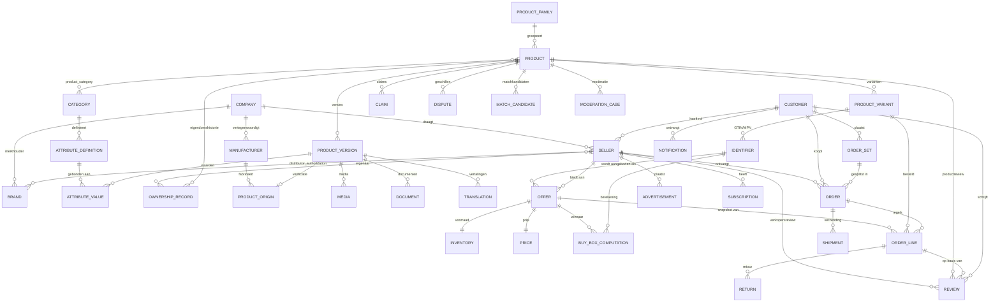

# EuropMade — Database Model (logisch)

**Status:** Concept v0.2 — tweede technische document van Sprint 2. **Bijgewerkt na de definitieve Affiliate-scopewijziging:** nieuw Deel G (10 tabellen: Coupon, Affiliate, AffiliateLink, Click, Conversion, Commission, Invoice, Payout, Message, ConsentRecord) toegevoegd, gebaseerd op `01-domain-model.md` §26–35. Totaal nu **47 tabellen** (37 oorspronkelijk + 10 nieuw). Delen A–F zijn ongewijzigd.
**Uitgangspunt:** uitsluitend het goedgekeurde domeinmodel (`docs/08-technical-blueprint/01-domain-model.md`) — geen enkel nieuw domeinbegrip, geen enkele nieuwe businessregel die daar niet al (al dan niet als "Voorlopig" of "Open") in staat.
**Scope:** het **logische** datamodel — tabellen, kolommen, sleutels, cardinaliteit, businessregels. **Geen SQL, geen Prisma, geen ORM, geen code.** Datatypes zijn conceptueel (bijv. "tekst," "geheel getal," "datum/tijd"), geen kolomlengtes of database-specifieke typen.
**Nadrukkelijk:** dit is geen Medusa-datamodel en geen Shopify-datamodel — elke tabel is afgeleid van de businessregels in het domeinmodel, niet van een bestaand e-commerce-pakket.
**Conventie:** elke tabelnaam in `snake_case`, enkelvoud. Elke primaire sleutel heet `id`. Elke foreign key heet `<tabelnaam_enkelvoud>_id`. Waar relevant: `created_at`/`updated_at` (technische tijdstempels, niet te verwarren met de functionele Audit Log) en `deleted_at` (soft delete, uitsluitend waar het domeinmodel dat vereist).

---

## Leeswijzer

Niet elk domeinobject uit `01-domain-model.md` wordt precies één tabel — sommige (bijv. **Product Cloud**) zijn een architecturale grens, geen record, en leveren hier meerdere tabellen op. Sommige domeinobjecten vereisen, om relationeel correct te zijn, een extra tabel die het domeinmodel zelf niet apart benoemde (bijv. `identifier`, `media`, `attribute_value`) — dat is een normale, verwachte stap van domeinmodel naar datamodel, geen afwijking. Waar dit gebeurt, staat de herkomst expliciet vermeld. Waar het ontwerpen van dit datamodel een gat of spanning in het domeinmodel blootlegde, wordt dat **niet stilzwijgend opgelost** — zie het hoofdstuk "Geconstateerde inconsistenties" aan het einde. (De eerdere bevinding rond het ontbreken van "Offer" als domeinobject is inmiddels verwerkt: Offer is per `01-domain-model.md` nu domeinobject #25.)

Elke tabel wordt beschreven volgens hetzelfde stramien: **Doel**, een metadatablok (PK/unieke constraints/FK's/indexen/cardinaliteit/soft delete-versiebeheer), een kolomtabel, en **Businessregels**.

---

# Deel A — Identiteit & Partners

## A.1 `customer`

**Doel:** de enige identiteitstabel voor elke natuurlijke persoon die met EuropMade interacteert — Bezoeker (gast, geen record), Klant, of de persoon achter een Seller-rol (Domeinmodel §14 Customer, §1 Seller: "een Seller is altijd een rol op een al bestaand Consument-account").

| | |
|---|---|
| **Primaire sleutel** | `id` |
| **Unieke constraints** | `email` (uniek, case-insensitive) |
| **Foreign keys** | geen |
| **Indexen** | `email` |
| **Cardinaliteit** | 1 `customer` → 0..N `order` (als koper), 0..N `review`, 0..1 `seller` |
| **Soft delete/versiebeheer** | Soft delete (`deleted_at`) — een account wordt nooit hard verwijderd zolang er gekoppelde orders/reviews bestaan (traceerbaarheid) |

| Kolom | Datatype (conceptueel) | Verplicht | Toelichting |
|---|---|---|---|
| `id` | identifier | Ja | — |
| `email` | tekst | Ja | Geverifieerd/niet-geverifieerd via `email_verified_at` |
| `email_verified_at` | datum/tijd | Nee | `null` = niet geverifieerd |
| `password_hash` | tekst | Ja | Nooit leesbaar opgeslagen |
| `two_factor_enabled` | ja/nee | Ja | Verplicht `true` zodra een `seller`-rol actief is |
| `created_at` / `updated_at` / `deleted_at` | datum/tijd | Ja/Ja/Nee | Technische tijdstempels |

**Businessregels:**
- E-mailverificatie is niet blokkerend voor winkelen, wél verplicht vóórdat een Seller-rol kan ontstaan (Domeinmodel §14/§1).
- Een wachtwoordwijziging invalideert alle actieve sessies (buiten dit datamodel — sessiebeheer is geen persistente tabel maar een technisch, kortlevend gegeven, zie Geconstateerde inconsistenties).

---

## A.2 `company`

**Doel:** de juridische bedrijfsentiteit achter een Seller (Domeinmodel §2).

| | |
|---|---|
| **Primaire sleutel** | `id` |
| **Unieke constraints** | `chamber_of_commerce_number` + `country_code` (samengesteld, uniek) |
| **Foreign keys** | geen |
| **Indexen** | `chamber_of_commerce_number` |
| **Cardinaliteit** | 1 `company` → 1..N `seller` (Domeinmodel: "een Company kan achter meerdere rollen van dezelfde Seller staan, niet achter meerdere, afzonderlijke Seller-accounts") |
| **Soft delete/versiebeheer** | Soft delete — nooit hard verwijderd zolang een gekoppelde `seller` bestaat |

| Kolom | Datatype (conceptueel) | Verplicht | Toelichting |
|---|---|---|---|
| `id` | identifier | Ja | — |
| `legal_name` | tekst | Ja | Bedrijfsnaam |
| `chamber_of_commerce_number` | tekst | Ja | Formaatvalidatie, geen live registerkoppeling (Domeinmodel §2) |
| `vat_number` | tekst | Nee | BTW-nummer |
| `country_code` | tekst (ISO-3166) | Ja | Vestigingsland |
| `iban` | tekst | Ja | Checksum-gevalideerd, ongeacht EU-land |
| `created_at` / `updated_at` / `deleted_at` | datum/tijd | Ja/Ja/Nee | — |

**Businessregels:**
- Elke inzage van dit record wordt gelogd in `audit_log` (gevoelige gegevens, Domeinmodel §2).
- Eén `company`-record per Seller-account in de huidige architectuur — geen "sub-company"-concept.

---

## A.3 `seller`

**Doel:** de rol-toekenning die een `customer` tot verkopende/producerende partij maakt (Domeinmodel §1).

| | |
|---|---|
| **Primaire sleutel** | `id` |
| **Unieke constraints** | `customer_id` (uniek — één Seller-rolrecord per account, rollen zelf zijn optelbare vlaggen binnen dat ene record) |
| **Foreign keys** | `customer_id` → `customer.id`, `company_id` → `company.id` |
| **Indexen** | `customer_id`, `company_id`, `status` |
| **Cardinaliteit** | 1 `customer` → 0..1 `seller`; 1 `company` → 1..N `seller`; 1 `seller` → 0..N `product` (als eigenaar, via `ownership_record`), 0..N `offer`, 0..N `order` (als aanbieder) |
| **Soft delete/versiebeheer** | Geen — er bestaat geen status ná "Goedgekeurd" in de bevroren architectuur (Domeinmodel §1: Partner Lifecycle Management is expliciet buiten scope); dit datamodel voegt daarom geen schorsings-/deactiveringsveld toe |

| Kolom | Datatype (conceptueel) | Verplicht | Toelichting |
|---|---|---|---|
| `id` | identifier | Ja | — |
| `customer_id` | identifier (FK) | Ja | — |
| `company_id` | identifier (FK) | Ja | — |
| `is_retailer` | ja/nee | Ja | Optelbare rolvlag |
| `is_producer_or_brand_owner` | ja/nee | Ja | Optelbare rolvlag |
| `is_distributor` | ja/nee | Ja | Optelbare rolvlag |
| `onboarding_status` | opsomming | Ja | Concept / Ingediend / In beoordeling / Aanvullende informatie vereist / Goedgekeurd / Afgekeurd |
| `approved_at` | datum/tijd | Nee | Datum van goedkeuring |
| `created_at` / `updated_at` | datum/tijd | Ja/Ja | — |

**Businessregels:**
- Een `seller`-record ontstaat uitsluitend via het onboarding-statusverloop tot "Goedgekeurd" — nooit direct aangemaakt.
- Minimaal één rolvlag moet `true` zijn.
- Een Distributeur (`is_distributor = true`) heeft nooit zelfstandig producent-eigendom — dit wordt niet als constraint afgedwongen op deze tabel, maar op `ownership_record` (zie A.9).

---

## A.4 `brand`

**Doel:** het merk waaronder een product wordt verkocht (Domeinmodel §3).

| | |
|---|---|
| **Primaire sleutel** | `id` |
| **Unieke constraints** | geen (merknamen kunnen wereldwijd overlappen; onderscheid loopt via `owner_company_id`) |
| **Foreign keys** | `owner_company_id` → `company.id` (nullable — een merk is niet altijd al aan een geverifieerde merkhouder gekoppeld) |
| **Indexen** | `name`, `owner_company_id` |
| **Cardinaliteit** | 1 `brand` → N `product`; 1 `brand` → 1 `company` (merkhouder, optioneel); 1 `brand` → 0..N distributeur-autorisaties (zie A.5) |
| **Soft delete/versiebeheer** | Geen |

| Kolom | Datatype (conceptueel) | Verplicht | Toelichting |
|---|---|---|---|
| `id` | identifier | Ja | — |
| `name` | tekst | Ja | Merknaam |
| `owner_company_id` | identifier (FK) | Nee | Merkhouder, indien geverifieerd |
| `created_at` / `updated_at` | datum/tijd | Ja/Ja | — |

**Businessregels:**
- Merk en fabrikant zijn nooit stilzwijgend hetzelfde (Domeinmodel §3) — er is bewust geen directe FK van `brand` naar `manufacturer`; die koppeling loopt uitsluitend via `product_origin` (B.14).

---

## A.5 `distributor_authorization`

**Doel:** legt vast dat een Distributeur (Domeinmodel §1) bevoegd is namens een specifiek merk te verkopen — een many-to-many-koppeling met eigen bewijsveld, dus een eigen tabel in plaats van een kale join-tabel.

| | |
|---|---|
| **Primaire sleutel** | `id` |
| **Unieke constraints** | `seller_id` + `brand_id` (samengesteld, uniek) |
| **Foreign keys** | `seller_id` → `seller.id`, `brand_id` → `brand.id` |
| **Indexen** | `seller_id`, `brand_id` |
| **Cardinaliteit** | N `seller` ↔ N `brand` (many-to-many, zie Deel 3) |
| **Soft delete/versiebeheer** | Geen |

| Kolom | Datatype (conceptueel) | Verplicht | Toelichting |
|---|---|---|---|
| `id` | identifier | Ja | — |
| `seller_id` | identifier (FK) | Ja | Moet een `seller` zijn met `is_distributor = true` (applicatieregel, geen databaseconstraint) |
| `brand_id` | identifier (FK) | Ja | — |
| `authorization_document_id` | identifier (FK naar `document`, B.15) | Ja | Verplicht autorisatiebewijs (Domeinmodel §1) |
| `created_at` | datum/tijd | Ja | — |

**Businessregels:**
- Geen Distributeur-rol zonder minimaal één geldig autorisatiebewijs per merk waarvoor die partij verkoopt.

---

## A.6 `manufacturer`

**Doel:** de partij die een product daadwerkelijk vervaardigt (Domeinmodel §4).

| | |
|---|---|
| **Primaire sleutel** | `id` |
| **Unieke constraints** | geen |
| **Foreign keys** | `represented_by_company_id` → `company.id` (nullable) |
| **Indexen** | `name` |
| **Cardinaliteit** | 1 `manufacturer` → N `product`; 1 `manufacturer` ↔ 1 `product_origin` per product; 0..N `manufacturer` ↔ 1 `brand` (contractproductie) |
| **Soft delete/versiebeheer** | Geen |

| Kolom | Datatype (conceptueel) | Verplicht | Toelichting |
|---|---|---|---|
| `id` | identifier | Ja | — |
| `name` | tekst | Ja | Fabrikantnaam |
| `represented_by_company_id` | identifier (FK) | Nee | Indien de fabrikant zelf een geregistreerde `company` is |
| `created_at` / `updated_at` | datum/tijd | Ja/Ja | — |

**Businessregels:** geen aanvullende, buiten wat al bij `product_origin` (B.14) geldt.

---

# Deel B — Product Cloud

> Product Cloud is in het domeinmodel expliciet geen record maar een **aggregaatgrens** (Domeinmodel §8), die zelf al de volgende sub-entiteiten noemt: Productfamilie, Product, Variant, Identifier, Attribuutwaarden, Media, Documenten, OwnershipRecord, ProductVersion, en de moderatie-/matchingentiteiten (Claim, Dispute, MatchCandidate, MergeRecord/SplitRecord). Dit deel werkt elk van die genoemde sub-entiteiten uit tot een eigen tabel — geen enkele tabel hieronder introduceert een naam die niet al in het domeinmodel zelf voorkwam.

## B.1 `product_family`

**Doel:** zuiver navigatie-/samenhangconcept tussen verwante producten (Domeinmodel §5: "geen eigendoms- of verkoopimplicatie").

| | |
|---|---|
| **Primaire sleutel** | `id` |
| **Unieke constraints** | geen |
| **Foreign keys** | geen |
| **Indexen** | geen aanvullend |
| **Cardinaliteit** | 1 `product_family` → 0..N `product` |
| **Soft delete/versiebeheer** | Geen |

| Kolom | Datatype (conceptueel) | Verplicht | Toelichting |
|---|---|---|---|
| `id` | identifier | Ja | — |
| `name` | tekst | Ja | — |
| `created_at` | datum/tijd | Ja | — |

**Businessregels:** optioneel — een `product` hoeft geen `product_family_id` te hebben.

---

## B.2 `product`

**Doel:** de centrale, onveranderlijke identiteit van "wat een product is" (Domeinmodel §5).

| | |
|---|---|
| **Primaire sleutel** | `id` |
| **Unieke constraints** | geen op `product` zelf (uniciteit loopt via `identifier`, B.5) |
| **Foreign keys** | `product_family_id` → `product_family.id` (nullable), `brand_id` → `brand.id`, `manufacturer_id` → `manufacturer.id`, `current_owner_seller_id` → `seller.id` |
| **Indexen** | `brand_id`, `manufacturer_id`, `current_owner_seller_id` |
| **Cardinaliteit** | 1 `product` → N `product_variant`; 1 `product` → 1 `brand`; 1 `product` → 1 `manufacturer`; 1 `product` ↔ N `category` (via `product_category`, many-to-many); 1 `product` → 0..1 `product_origin`; 1 `product` → N `product_version` |
| **Soft delete/versiebeheer** | **Versiebeheer, geen soft delete**: elke wijziging is een nieuwe rij in `product_version` (B.3), nooit een overschrijving van `product` zelf (Domeinmodel §5: "nooit een stille overschrijving") |

| Kolom | Datatype (conceptueel) | Verplicht | Toelichting |
|---|---|---|---|
| `id` | identifier | Ja | Onveranderlijk, nooit hergebruikt, overleeft merge/split |
| `product_family_id` | identifier (FK) | Nee | — |
| `brand_id` | identifier (FK) | Ja | — |
| `manufacturer_id` | identifier (FK) | Ja | — |
| `current_owner_seller_id` | identifier (FK) | Ja | Huidige eigenaar — historie staat in `ownership_record` (B.9) |
| `lifecycle_status` | opsomming | Ja | Retailer Created / Concept gecontroleerd / Actief / Verified™ / Uitlopend / Niet meer leverbaar / Gearchiveerd |
| `created_at` | datum/tijd | Ja | — |

**Businessregels:**
- Levenscyclusstatus en publicatiestatus zijn orthogonaal — publicatiestatus leeft op `product_version` (B.3), nooit op `product` zelf.
- Een merge herwijst uitsluitend `identifier`-rijen naar het overlevende `product_id`, nooit `offer`-rijen (zie Geconstateerde inconsistenties m.b.t. Offer).

---

## B.3 `product_version`

**Doel:** elke redactionele wijziging aan een product als eigen, onveranderlijke rij (Domeinmodel §5, §7: "Product Origin koppelt aan de specifieke ProductVersion, nooit aan het Product in algemene zin").

| | |
|---|---|
| **Primaire sleutel** | `id` |
| **Unieke constraints** | `product_id` + `version_number` (samengesteld, uniek) |
| **Foreign keys** | `product_id` → `product.id` |
| **Indexen** | `product_id`, `publication_status` |
| **Cardinaliteit** | 1 `product` → N `product_version`; 1 `product_version` → 0..1 `product_origin` (de geverifieerde versie) |
| **Soft delete/versiebeheer** | Is zelf het versiebeheermechanisme — nooit gewijzigd na aanmaak (append-only) |

| Kolom | Datatype (conceptueel) | Verplicht | Toelichting |
|---|---|---|---|
| `id` | identifier | Ja | — |
| `product_id` | identifier (FK) | Ja | — |
| `version_number` | geheel getal | Ja | Oplopend per product |
| `title` | tekst | Ja | — |
| `description` | tekst | Ja | — |
| `publication_status` | opsomming | Ja | Concept / In review / Goedgekeurd / Gepubliceerd / Gearchiveerd / Verwijderd |
| `created_by_seller_id` | identifier (FK naar `seller.id`) | Ja | — |
| `created_at` | datum/tijd | Ja | — |

**Businessregels:**
- Een rollback naar een andere `product_version` dan de laatst-geverifieerde trekt automatisch de gekoppelde `product_origin`-status in (zie B.14, Businessregels).

---

## B.4 `product_variant`

**Doel:** een specifieke uitvoering van een Product (Domeinmodel §6).

| | |
|---|---|
| **Primaire sleutel** | `id` |
| **Unieke constraints** | geen op zichzelf (uniciteit loopt via `identifier`) |
| **Foreign keys** | `product_id` → `product.id` |
| **Indexen** | `product_id` |
| **Cardinaliteit** | 1 `product` → N `product_variant`; 1 `product_variant` → N `identifier` |
| **Soft delete/versiebeheer** | Volgt de levenscyclus van het bovenliggende `product` — geen eigen status |

| Kolom | Datatype (conceptueel) | Verplicht | Toelichting |
|---|---|---|---|
| `id` | identifier | Ja | — |
| `product_id` | identifier (FK) | Ja | — |
| `variant_type` | opsomming | Ja | Kleur / Maat / Inhoud / Vermogen / Spanning / Materiaal / Uitvoering / Bundel |
| `variant_value` | tekst | Ja | Bijv. "Rood," "XL" |
| `created_at` | datum/tijd | Ja | — |

**Businessregels:** geen aanvullende, buiten wat al bij `product` geldt.

---

## B.5 `identifier`

**Doel:** GTIN/EAN/MPN per Variant, per land — **nieuw als eigen tabel** (het domeinmodel noemt "Identifier" als sub-entiteit binnen Product Cloud, maar werkte het nooit als losse tabel uit; noodzakelijk omdat één Variant per land een andere EAN kan hebben, Domeinmodel §6).

| | |
|---|---|
| **Primaire sleutel** | `id` |
| **Unieke constraints** | `identifier_value` + `identifier_type` + `country_scope` (samengesteld, uniek) |
| **Foreign keys** | `product_variant_id` → `product_variant.id` |
| **Indexen** | `identifier_value`, `product_variant_id` |
| **Cardinaliteit** | 1 `product_variant` → 1..N `identifier` |
| **Soft delete/versiebeheer** | Geen — een identifier wordt bij een merge herwezen (`product_variant_id` bijgewerkt), nooit verwijderd |

| Kolom | Datatype (conceptueel) | Verplicht | Toelichting |
|---|---|---|---|
| `id` | identifier | Ja | — |
| `product_variant_id` | identifier (FK) | Ja | — |
| `identifier_type` | opsomming | Ja | GTIN (EAN-13 als subtype) / MPN |
| `identifier_value` | tekst | Ja | — |
| `country_scope` | tekst (ISO-3166), nullable | Nee | `null` = geldig in alle landen |
| `created_at` | datum/tijd | Ja | — |

**Businessregels:**
- Een geldig GTIN/EAN is de sterkste matchsleutel; ontbreekt deze, dan is een MPN een eersteklas alternatief (Domeinmodel §6) — geen constraint dwingt een GTIN af.
- Bij een merge worden uitsluitend rijen in deze tabel herwezen naar het overlevende product, nooit `offer`-rijen.

---

## B.6 `category`

**Doel:** hiërarchische indeling van het assortiment (Domeinmodel §9).

| | |
|---|---|
| **Primaire sleutel** | `id` |
| **Unieke constraints** | geen |
| **Foreign keys** | `parent_category_id` → `category.id` (self-referencing, nullable) |
| **Indexen** | `parent_category_id` |
| **Cardinaliteit** | 1 `category` → 0..1 bovenliggende `category`; 1 `category` → N `attribute_definition`; N `category` ↔ N `product` (via `product_category`) |
| **Soft delete/versiebeheer** | Geen |

| Kolom | Datatype (conceptueel) | Verplicht | Toelichting |
|---|---|---|---|
| `id` | identifier | Ja | — |
| `parent_category_id` | identifier (FK) | Nee | Hiërarchie |
| `name` | tekst | Ja | — |
| `created_at` | datum/tijd | Ja | — |

**Businessregels:**
- Beheerd uitsluitend door de Beheerder, niet per-Seller aan te passen (Domeinmodel §9).

---

## B.7 `product_category`

**Doel:** de many-to-many-koppeling tussen `product` en `category` (Domeinmodel §5: "1..N Category").

| | |
|---|---|
| **Primaire sleutel** | `id` |
| **Unieke constraints** | `product_id` + `category_id` (samengesteld, uniek) |
| **Foreign keys** | `product_id` → `product.id`, `category_id` → `category.id` |
| **Indexen** | `product_id`, `category_id` |
| **Cardinaliteit** | N `product` ↔ N `category` |
| **Soft delete/versiebeheer** | Geen |

| Kolom | Datatype (conceptueel) | Verplicht | Toelichting |
|---|---|---|---|
| `id` | identifier | Ja | — |
| `product_id` | identifier (FK) | Ja | — |
| `category_id` | identifier (FK) | Ja | — |

**Businessregels:**
- Een `product` moet minimaal één rij in deze tabel hebben (minimaal één categorie, Domeinmodel §5).
- Een categoriewijziging is een hoog-risico wijziging die altijd menselijke review vereist (Domeinmodel §9) — afgedwongen op procesniveau, niet als databaseconstraint.

---

## B.8 `attribute_definition` en `attribute_value`

**Doel:** gestructureerde, categorie-gebonden producteigenschappen (Domeinmodel §10).

### `attribute_definition`

| | |
|---|---|
| **Primaire sleutel** | `id` |
| **Unieke constraints** | `category_id` + `name` (samengesteld, uniek) |
| **Foreign keys** | `category_id` → `category.id` |
| **Indexen** | `category_id` |
| **Cardinaliteit** | 1 `category` → N `attribute_definition` |
| **Soft delete/versiebeheer** | Geen |

| Kolom | Datatype (conceptueel) | Verplicht | Toelichting |
|---|---|---|---|
| `id` | identifier | Ja | — |
| `category_id` | identifier (FK) | Ja | — |
| `name` | tekst | Ja | Bijv. "Vermogen (W)" |
| `data_type` | opsomming | Ja | Numeriek / Keuzelijst / Tekst-met-eenheid |
| `is_required` | ja/nee | Ja | — |

### `attribute_value`

| | |
|---|---|
| **Primaire sleutel** | `id` |
| **Unieke constraints** | `product_version_id` + `attribute_definition_id` (samengesteld, uniek) |
| **Foreign keys** | `product_version_id` → `product_version.id`, `attribute_definition_id` → `attribute_definition.id` |
| **Indexen** | `product_version_id`, `attribute_definition_id` |
| **Cardinaliteit** | 1 `product_version` → N `attribute_value`; 1 `attribute_definition` → N `attribute_value` |
| **Soft delete/versiebeheer** | Volgt `product_version` (append-only, geen eigen wijziging) |

| Kolom | Datatype (conceptueel) | Verplicht | Toelichting |
|---|---|---|---|
| `id` | identifier | Ja | — |
| `product_version_id` | identifier (FK) | Ja | Attribuutwaarden volgen de ProductVersion (Domeinmodel §10) |
| `attribute_definition_id` | identifier (FK) | Ja | — |
| `value` | tekst | Ja | Vrije opslag, betekenis bepaald door `data_type` op de definitie |

**Businessregels:**
- Attribuutdefinities zijn platformbeheer, nooit per-Seller aan te passen (Domeinmodel §10).
- Een verplichte attribuutdefinitie zonder waarde blokkeert de publicatiestatus-overgang naar "Gepubliceerd" (procesregel, geen databaseconstraint).

---

## B.9 `ownership_record`

**Doel:** de huidige én historische eigenaarsketen van een `product` — **nieuw als eigen tabel** (genoemd als sub-entiteit binnen Product Cloud, Domeinmodel §8, en als relatie bij `product`, §5: "historisch meervoudig").

| | |
|---|---|
| **Primaire sleutel** | `id` |
| **Unieke constraints** | geen |
| **Foreign keys** | `product_id` → `product.id`, `seller_id` → `seller.id` |
| **Indexen** | `product_id`, `seller_id`, `valid_from`/`valid_until` |
| **Cardinaliteit** | 1 `product` → N `ownership_record` (historisch); exact 1 rij zonder `valid_until` = huidige eigenaar |
| **Soft delete/versiebeheer** | Append-only — een eigendomsoverdracht sluit de vorige rij af (`valid_until`) en voegt een nieuwe toe, nooit een overschrijving |

| Kolom | Datatype (conceptueel) | Verplicht | Toelichting |
|---|---|---|---|
| `id` | identifier | Ja | — |
| `product_id` | identifier (FK) | Ja | — |
| `seller_id` | identifier (FK) | Ja | — |
| `valid_from` | datum/tijd | Ja | — |
| `valid_until` | datum/tijd | Nee | `null` = huidige eigenaar |
| `transfer_reason` | tekst | Nee | Verplicht ingevuld bij een Beheerder-goedgekeurde overdracht |

**Businessregels:**
- Elke overdracht tussen twee reeds geverifieerde eigenaren vereist altijd handmatige Beheerder-goedkeuring — afgedwongen op procesniveau.

---

## B.10 `claim`, `dispute`

**Doel:** de twee moderatie-gerelateerde sub-entiteiten die het domeinmodel expliciet binnen Product Cloud noemt (Domeinmodel §8), gebruikt wanneer eigendom van een product wordt betwist of opgeëist.

### `claim`

| | |
|---|---|
| **Primaire sleutel** | `id` |
| **Unieke constraints** | geen |
| **Foreign keys** | `product_id` → `product.id`, `claimant_seller_id` → `seller.id` |
| **Indexen** | `product_id`, `status` |
| **Cardinaliteit** | 1 `product` → 0..N `claim`; 1 `claim` → 0..1 `dispute` (bij conflict) |
| **Soft delete/versiebeheer** | Append-only |

| Kolom | Datatype (conceptueel) | Verplicht | Toelichting |
|---|---|---|---|
| `id` | identifier | Ja | — |
| `product_id` | identifier (FK) | Ja | — |
| `claimant_seller_id` | identifier (FK) | Ja | — |
| `status` | opsomming | Ja | In beoordeling / Goedgekeurd / Afgewezen |
| `ai_metadata_id` | identifier (FK naar `ai_metadata`, F.1) | Nee | — |
| `created_at` | datum/tijd | Ja | — |

### `dispute`

| | |
|---|---|
| **Primaire sleutel** | `id` |
| **Unieke constraints** | geen |
| **Foreign keys** | `product_id` → `product.id` |
| **Indexen** | `product_id`, `status` |
| **Cardinaliteit** | 1 `product` → 0..N `dispute`; 2..N `claim` → 1 `dispute` (bij gelijktijdige, conflicterende claims) |
| **Soft delete/versiebeheer** | Append-only |

| Kolom | Datatype (conceptueel) | Verplicht | Toelichting |
|---|---|---|---|
| `id` | identifier | Ja | — |
| `product_id` | identifier (FK) | Ja | — |
| `status` | opsomming | Ja | Open / Bevestiging huidige eigenaar / Overdracht / Tijdelijke terugzetting |
| `created_at` | datum/tijd | Ja | — |

**Businessregels:**
- Twee gelijktijdige claims op hetzelfde product worden nooit als twee losse claims behandeld — altijd een `dispute`.
- Een merkclaim die niet overeenkomt met bekende merkeigendom leidt tot dit traject (Domeinmodel §3).

---

## B.11 `match_candidate`

**Doel:** een mogelijk duplicaat-/matchsuggestie tussen twee producten (Domeinmodel §8).

| | |
|---|---|
| **Primaire sleutel** | `id` |
| **Unieke constraints** | `product_id_a` + `product_id_b` (samengesteld, uniek, ongeacht volgorde) |
| **Foreign keys** | `product_id_a` → `product.id`, `product_id_b` → `product.id`, `ai_metadata_id` → `ai_metadata.id` |
| **Indexen** | `product_id_a`, `product_id_b`, `status` |
| **Cardinaliteit** | N `product` ↔ N `product` (via deze tabel) |
| **Soft delete/versiebeheer** | Append-only |

| Kolom | Datatype (conceptueel) | Verplicht | Toelichting |
|---|---|---|---|
| `id` | identifier | Ja | — |
| `product_id_a` | identifier (FK) | Ja | — |
| `product_id_b` | identifier (FK) | Ja | — |
| `status` | opsomming | Ja | Kandidaat / Merge uitgevoerd / Geen actie |
| `ai_metadata_id` | identifier (FK) | Nee | — |
| `created_at` | datum/tijd | Ja | — |

**Businessregels:** AI ondersteunt met een betrouwbaarheidsscore, beslist nooit (Domeinmodel §22).

---

## B.12 `merge_record` / `split_record`

**Doel:** de audit-trail van een uitgevoerde merge of split tussen producten (Domeinmodel §8).

### `merge_record`

| | |
|---|---|
| **Primaire sleutel** | `id` |
| **Foreign keys** | `surviving_product_id` → `product.id`, `merged_product_id` → `product.id`, `match_candidate_id` → `match_candidate.id` |
| **Indexen** | `surviving_product_id`, `merged_product_id` |
| **Cardinaliteit** | 1 `match_candidate` → 0..1 `merge_record` |
| **Soft delete/versiebeheer** | Append-only, onomkeerbaar record |

| Kolom | Datatype (conceptueel) | Verplicht | Toelichting |
|---|---|---|---|
| `id` | identifier | Ja | — |
| `surviving_product_id` | identifier (FK) | Ja | — |
| `merged_product_id` | identifier (FK) | Ja | Het "verdwenen" product-ID, nooit hergebruikt |
| `match_candidate_id` | identifier (FK) | Nee | — |
| `performed_at` | datum/tijd | Ja | — |

### `split_record`

| | |
|---|---|
| **Primaire sleutel** | `id` |
| **Foreign keys** | `original_product_id` → `product.id`, `new_product_id` → `product.id` |
| **Indexen** | `original_product_id`, `new_product_id` |
| **Cardinaliteit** | 1 `product` → 0..N `split_record` (als origineel) |
| **Soft delete/versiebeheer** | Append-only |

| Kolom | Datatype (conceptueel) | Verplicht | Toelichting |
|---|---|---|---|
| `id` | identifier | Ja | — |
| `original_product_id` | identifier (FK) | Ja | — |
| `new_product_id` | identifier (FK) | Ja | — |
| `performed_at` | datum/tijd | Ja | — |

**Businessregels:** een merge herwijst uitsluitend `identifier`-rijen, nooit `offer`-rijen (zie Geconstateerde inconsistenties).

---

## B.13 `moderation_case`

**Doel:** de generieke moderatie-zaak zoals genoemd binnen Product Cloud (Domeinmodel §8) — dekt fraude-signalen en overige moderatie-items die geen `claim`/`dispute` zijn.

| | |
|---|---|
| **Primaire sleutel** | `id` |
| **Unieke constraints** | geen |
| **Foreign keys** | `product_id` → `product.id` (nullable — kan ook een `seller`-gericht signaal zijn), `seller_id` → `seller.id` (nullable), `ai_metadata_id` → `ai_metadata.id` |
| **Indexen** | `product_id`, `seller_id`, `status` |
| **Cardinaliteit** | 1 `product` → 0..N `moderation_case`; 1 `seller` → 0..N `moderation_case` |
| **Soft delete/versiebeheer** | Append-only |

| Kolom | Datatype (conceptueel) | Verplicht | Toelichting |
|---|---|---|---|
| `id` | identifier | Ja | — |
| `product_id` | identifier (FK) | Nee | — |
| `seller_id` | identifier (FK) | Nee | — |
| `case_type` | opsomming | Ja | Fraude-signaal / Melding derde partij / Hoog-risico wijziging |
| `status` | opsomming | Ja | Gesignaleerd / Geen actie / Geëscaleerd |
| `ai_metadata_id` | identifier (FK) | Nee | — |
| `created_at` | datum/tijd | Ja | — |

**Businessregels:** ook een "Geen actie"-uitkomst is zelf een beslissing en wordt in `audit_log` vastgelegd.

---

## B.14 `product_origin`

**Doel:** de Verified Made in Europe-claim op productniveau (Domeinmodel §7) — het twee-laags model; Laag 1 (bedrijfsniveau) leeft op `seller`/`company`, Laag 2 (productniveau) hier.

| | |
|---|---|
| **Primaire sleutel** | `id` |
| **Unieke constraints** | `product_version_id` (uniek — één actieve claim per beoordeelde versie) |
| **Foreign keys** | `product_version_id` → `product_version.id`, `manufacturer_id` → `manufacturer.id`, `brand_id` → `brand.id`, `seller_id` → `seller.id`, `ai_metadata_id` → `ai_metadata.id` |
| **Indexen** | `product_version_id`, `status` |
| **Cardinaliteit** | 1 `product_version` → 0..1 `product_origin`; 1 `manufacturer` → N `product_origin`; 1 `seller` → N `product_origin` |
| **Soft delete/versiebeheer** | Append-only — een hercontrole voegt een nieuwe rij toe, verwijdert de vorige niet |

| Kolom | Datatype (conceptueel) | Verplicht | Toelichting |
|---|---|---|---|
| `id` | identifier | Ja | — |
| `product_version_id` | identifier (FK) | Ja | Nooit aan het Product in algemene zin (Domeinmodel §7, B2) |
| `manufacturer_id` | identifier (FK) | Ja | — |
| `brand_id` | identifier (FK) | Ja | — |
| `seller_id` | identifier (FK) | Ja | Indiener |
| `production_country` | tekst (ISO-3166) | Ja | — |
| `production_location` | tekst | Ja | Adres |
| `status` | opsomming | Ja | Niet aangevraagd / Aangevraagd / In beoordeling / Aanvullende informatie vereist / Geverifieerd / Afgewezen / Ingetrokken |
| `ai_metadata_id` | identifier (FK) | Nee | — |
| `next_recheck_due_at` | datum/tijd | Nee | 6-maandelijkse cyclus |
| `created_at` | datum/tijd | Ja | — |

**Businessregels:**
- Nooit "Geverifieerd" zonder een geslaagde Laag 1-verificatie op `seller`/`company` (harde afhankelijkheid, applicatieregel).
- Een rollback naar een andere `product_version` dan degene waarnaar deze rij verwijst, trekt het record automatisch in (`status` → Ingetrokken).
- Handmatige eindbeslissing, altijd — `ai_metadata_id` is uitsluitend een aanbeveling.

---

## B.15 `media`, `document`

**Doel:** bestandsbijlagen bij een product — **nieuw als eigen tabellen** (genoemd als sub-entiteiten binnen Product Cloud, Domeinmodel §8, en als eigenschap bij `product`, §5: "Media... Documenten").

### `media`

| | |
|---|---|
| **Primaire sleutel** | `id` |
| **Foreign keys** | `product_version_id` → `product_version.id` |
| **Indexen** | `product_version_id` |
| **Cardinaliteit** | 1 `product_version` → 1..N `media` |
| **Soft delete/versiebeheer** | Volgt `product_version` |

| Kolom | Datatype (conceptueel) | Verplicht | Toelichting |
|---|---|---|---|
| `id` | identifier | Ja | — |
| `product_version_id` | identifier (FK) | Ja | — |
| `media_type` | opsomming | Ja | Hoofdafbeelding / Overige afbeelding / Video |
| `storage_reference` | tekst | Ja | Verwijzing naar bestandsopslag (buiten dit datamodel, zie TB-01 Deel 3/5) |

### `document`

| | |
|---|---|
| **Primaire sleutel** | `id` |
| **Foreign keys** | `product_version_id` → `product_version.id` (nullable), `distributor_authorization_id` → `distributor_authorization.id` (nullable) |
| **Indexen** | `product_version_id` |
| **Cardinaliteit** | 1 `product_version` → 0..N `document`; 1 `distributor_authorization` → 1 `document` |
| **Soft delete/versiebeheer** | Volgt bovenliggend record; toegang wordt gelogd (`audit_log`) |

| Kolom | Datatype (conceptueel) | Verplicht | Toelichting |
|---|---|---|---|
| `id` | identifier | Ja | — |
| `product_version_id` | identifier (FK) | Nee | — |
| `distributor_authorization_id` | identifier (FK) | Nee | — |
| `document_type` | opsomming | Ja | CE-certificaat / Overig compliance-document / Autorisatiebewijs |
| `storage_reference` | tekst | Ja | — |

**Businessregels:**
- Minimaal één `media`-rij met `media_type = Hoofdafbeelding` verplicht vóór de publicatiestatus "Gepubliceerd" kan worden bereikt.
- Categorie-verplichte `document_type`s worden afgedwongen op procesniveau, niet als databaseconstraint.

---

## B.16 `translation`

**Doel:** gelokaliseerde inhoud per taal (Domeinmodel §21 — **Open status**, hier uitsluitend structureel gemodelleerd, geen proces-/eigenaarschapsregels ingevuld).

| | |
|---|---|
| **Primaire sleutel** | `id` |
| **Unieke constraints** | `entity_type` + `entity_id` + `field_name` + `language_code` (samengesteld, uniek) |
| **Foreign keys** | geen harde FK (polymorfe verwijzing via `entity_type`/`entity_id` — zie toelichting) |
| **Indexen** | `entity_type` + `entity_id` |
| **Cardinaliteit** | 1 `product_version` of `category` → N `translation` |
| **Soft delete/versiebeheer** | Geen |

| Kolom | Datatype (conceptueel) | Verplicht | Toelichting |
|---|---|---|---|
| `id` | identifier | Ja | — |
| `entity_type` | opsomming | Ja | `product_version` / `category` |
| `entity_id` | identifier | Ja | Polymorf — geen databaseniveau-FK mogelijk zonder een ORM/applicatielaag |
| `field_name` | tekst | Ja | Bijv. `title`, `description`, `name` |
| `language_code` | tekst (ISO-639) | Ja | — |
| `value` | tekst | Ja | — |

**Businessregels:** geen vastgelegd — Status "Open" in het domeinmodel; eigenaarschap (Seller/platform/AI-ondersteund) is een open ontwerpkeuze.

---

# Deel C — Commerce Cloud

> `offer` is de brug tussen Product Cloud (Variant/Identifier) en Commerce Cloud (Inventory/Price/Buy Box) — sinds de laatste bijwerking van `01-domain-model.md` een formeel goedgekeurd domeinobject (§25).

## C.1 `offer`

**Doel:** wat een Seller voor een specifieke Variant/Region aanbiedt — de brug tussen Product Cloud (Variant/Identifier) en Commerce Cloud (Inventory/Price/Buy Box) (Domeinmodel §25).

| | |
|---|---|
| **Primaire sleutel** | `id` |
| **Unieke constraints** | `seller_id` + `identifier_id` + `region_code` (samengesteld, uniek) |
| **Foreign keys** | `seller_id` → `seller.id`, `identifier_id` → `identifier.id` |
| **Indexen** | `seller_id`, `identifier_id`, `region_code` |
| **Cardinaliteit** | 1 `seller` → N `offer`; 1 `identifier` → N `offer` (meerdere Sellers kunnen dezelfde EAN aanbieden — de kern van het Buy Box-model); 1 `offer` → 1 `inventory`; 1 `offer` → 1 `price` |
| **Soft delete/versiebeheer** | Soft delete (`deleted_at`) wanneer een Seller een aanbod intrekt |

| Kolom | Datatype (conceptueel) | Verplicht | Toelichting |
|---|---|---|---|
| `id` | identifier | Ja | — |
| `seller_id` | identifier (FK) | Ja | — |
| `identifier_id` | identifier (FK) | Ja | Nooit een directe verwijzing naar `product` (Product Cloud/Commerce Cloud-scheiding) |
| `region_code` | tekst (ISO-3166) | Ja | Buy Box wordt berekend per Variant/EAN × Region |
| `created_at` / `updated_at` / `deleted_at` | datum/tijd | Ja/Ja/Nee | — |

**Businessregels:**
- Een merge herwijst nooit `offer`-rijen — die blijven aan hun `identifier_id` gekoppeld, en `identifier`-rijen worden herwezen naar het overlevende product (B.5).

---

## C.2 `inventory`

**Doel:** actuele voorraad per Offer (Domeinmodel §11).

| | |
|---|---|
| **Primaire sleutel** | `id` |
| **Unieke constraints** | `offer_id` (uniek) |
| **Foreign keys** | `offer_id` → `offer.id` |
| **Indexen** | `offer_id` |
| **Cardinaliteit** | 1 `offer` → 1 `inventory` |
| **Soft delete/versiebeheer** | Geen (levend, continu bijgewerkt veld) |

| Kolom | Datatype (conceptueel) | Verplicht | Toelichting |
|---|---|---|---|
| `id` | identifier | Ja | — |
| `offer_id` | identifier (FK) | Ja | — |
| `quantity_available` | geheel getal | Ja | — |
| `updated_at` | datum/tijd | Ja | Relevant voor revalidatie bij Checkout (Domeinmodel §11) |

**Businessregels:**
- Voorraad-nul sluit een Offer automatisch uit van de Buy Box-berekening.
- Onvoldoende voorraad bij orderplaatsing leidt nooit tot een stilzwijgend gewijzigde bestelling.

---

## C.3 `price`

**Doel:** actuele prijs per Offer (Domeinmodel §12).

| | |
|---|---|
| **Primaire sleutel** | `id` |
| **Unieke constraints** | `offer_id` (uniek — actuele prijs; historie loopt via `order_line`-snapshots, niet via meerdere `price`-rijen) |
| **Foreign keys** | `offer_id` → `offer.id` |
| **Indexen** | `offer_id` |
| **Cardinaliteit** | 1 `offer` → 1 `price` |
| **Soft delete/versiebeheer** | Geen (levend veld; snapshot gebeurt op `order_line`, D.3) |

| Kolom | Datatype (conceptueel) | Verplicht | Toelichting |
|---|---|---|---|
| `id` | identifier | Ja | — |
| `offer_id` | identifier (FK) | Ja | — |
| `base_price` | bedrag | Ja | — |
| `shipping_cost` | bedrag | Ja | — |
| `vat_rate` | percentage | Ja | Afhankelijk van OSS-regels en bestemmingsland |
| `updated_at` | datum/tijd | Ja | — |

**Businessregels:**
- De Buy Box vergelijkt altijd `base_price + shipping_cost` (totale klantprijs), nooit uitsluitend `base_price`.
- Elke berekening gebeurt server-side (ADR 0005) — geen client-side afgeleid veld.

---

## C.4 `buy_box_computation`

**Doel:** de laatst berekende Buy Box-winnaar per Variant/EAN × Region (Domeinmodel §13) — een **afgeleide/cache-tabel**, geen bronwaarheid.

| | |
|---|---|
| **Primaire sleutel** | `id` |
| **Unieke constraints** | `identifier_id` + `region_code` (samengesteld, uniek) |
| **Foreign keys** | `identifier_id` → `identifier.id`, `winning_offer_id` → `offer.id` |
| **Indexen** | `identifier_id`, `region_code` |
| **Cardinaliteit** | 1 `identifier` × 1 `region_code` → 1 `buy_box_computation` |
| **Soft delete/versiebeheer** | Geen — wordt overschreven bij elke herberekening |

| Kolom | Datatype (conceptueel) | Verplicht | Toelichting |
|---|---|---|---|
| `id` | identifier | Ja | — |
| `identifier_id` | identifier (FK) | Ja | — |
| `region_code` | tekst (ISO-3166) | Ja | — |
| `winning_offer_id` | identifier (FK) | Ja | — |
| `computed_at` | datum/tijd | Ja | — |

**Businessregels:**
- Wordt herberekend bij elke relevante wijziging (prijs, voorraad, review-score) — geen vaste periodieke cyclus.
- Geen advertentie, commissie of platformbelang mag ooit in de berekening meewegen (bevroren ontwerpprincipe).

---

# Deel D — Orders & Fulfilment

## D.1 `order_set`

**Doel:** de gedeelde betaaltransactie-groepering over meerdere, per-aanbieder gesplitste orders (Domeinmodel §15: "uitsluitend weergavecontext — geen eigen Product Cloud/Commerce Cloud-concept").

| | |
|---|---|
| **Primaire sleutel** | `id` |
| **Unieke constraints** | geen |
| **Foreign keys** | `customer_id` → `customer.id` |
| **Indexen** | `customer_id` |
| **Cardinaliteit** | 1 `order_set` → N `order` |
| **Soft delete/versiebeheer** | Geen |

| Kolom | Datatype (conceptueel) | Verplicht | Toelichting |
|---|---|---|---|
| `id` | identifier | Ja | — |
| `customer_id` | identifier (FK) | Ja | — |
| `payment_reference` | tekst | Ja | Eén gedeelde betaling |
| `created_at` | datum/tijd | Ja | — |

**Businessregels:** deze tabel bestaat uitsluitend om `order`-rijen te groeperen voor weergave — draagt zelf geen betaal- of orderlogica (Domeinmodel §15).

---

## D.2 `order`

**Doel:** wat een Customer bij één specifieke Seller heeft besteld, als onveranderlijke snapshot (Domeinmodel §15).

| | |
|---|---|
| **Primaire sleutel** | `id` |
| **Unieke constraints** | `order_number` (uniek) |
| **Foreign keys** | `order_set_id` → `order_set.id`, `customer_id` → `customer.id`, `seller_id` → `seller.id` |
| **Indexen** | `order_number`, `customer_id`, `seller_id`, `order_set_id`, `payment_status` |
| **Cardinaliteit** | 1 `order_set` → N `order`; 1 `order` → N `order_line`; 1 `order` → 0..N `shipment`; 1 `order` → 0..N `return` |
| **Soft delete/versiebeheer** | Geen soft delete — een order wordt nooit verwijderd; uitzonderingsafhandeling loopt via `exception_status` |

| Kolom | Datatype (conceptueel) | Verplicht | Toelichting |
|---|---|---|---|
| `id` | identifier | Ja | — |
| `order_number` | tekst | Ja | — |
| `order_set_id` | identifier (FK) | Ja | — |
| `customer_id` | identifier (FK) | Ja | — |
| `seller_id` | identifier (FK) | Ja | Exact één aanbieder per `order` (server-side ordersplitsing) |
| `payment_status` | opsomming | Ja | Betaald / Betaling wordt verwerkt |
| `exception_status` | opsomming | Nee | `null` / Mislukte ordersplitsing / Afgehandeld |
| `shipping_address` | tekst | Ja | — |
| `billing_address` | tekst | Ja | — |
| `created_at` | datum/tijd | Ja | — |

**Businessregels:**
- Een `order` ontstaat nooit vóór een geslaagde betaling en de daaropvolgende, server-side splitsing.
- Betaling wordt nooit teruggeboekt zonder expliciete melding, ook niet bij `exception_status = Mislukte ordersplitsing`.

---

## D.3 `order_line`

**Doel:** een besteld product binnen een Order, met bevroren prijssnapshot (Domeinmodel §15: "1 Orderregel → 1 Product Variant + 1 Price-snapshot elk").

| | |
|---|---|
| **Primaire sleutel** | `id` |
| **Unieke constraints** | geen |
| **Foreign keys** | `order_id` → `order.id`, `product_variant_id` → `product_variant.id`, `offer_id` → `offer.id` |
| **Indexen** | `order_id` |
| **Cardinaliteit** | 1 `order` → N `order_line` |
| **Soft delete/versiebeheer** | Geen — append-only, onderdeel van de onveranderlijke Order-snapshot |

| Kolom | Datatype (conceptueel) | Verplicht | Toelichting |
|---|---|---|---|
| `id` | identifier | Ja | — |
| `order_id` | identifier (FK) | Ja | — |
| `product_variant_id` | identifier (FK) | Ja | — |
| `offer_id` | identifier (FK) | Ja | Historische referentie — niet levend |
| `quantity` | geheel getal | Ja | — |
| `unit_price_snapshot` | bedrag | Ja | Bevroren op moment van plaatsing (Domeinmodel §12) |
| `vat_rate_snapshot` | percentage | Ja | — |

**Businessregels:** een prijswijziging na plaatsing raakt een al geplaatste `order_line` nooit (snapshot-principe, Domeinmodel §12).

---

## D.4 `shipment` *(Domeinmodel §16 — Open status)*

**Doel:** de fysieke verzending van een (deel van een) Order — **nog niet functioneel gebouwd**, hier uitsluitend structureel geplaatst.

| | |
|---|---|
| **Primaire sleutel** | `id` |
| **Foreign keys** | `order_id` → `order.id` |
| **Indexen** | `order_id` |
| **Cardinaliteit** | 1 `order` → 0..N `shipment` |
| **Soft delete/versiebeheer** | Nog niet vastgelegd |

| Kolom | Datatype (conceptueel) | Verplicht | Toelichting |
|---|---|---|---|
| `id` | identifier | Ja | — |
| `order_id` | identifier (FK) | Ja | — |
| `tracking_code` | tekst | Nee | Nog niet geïmplementeerd (Domeinmodel §16) |
| `expected_delivery_at` | datum/tijd | Nee | — |
| `delivered_at` | datum/tijd | Nee | — |

**Businessregels:** nog niet vastgelegd.

---

## D.5 `return` *(Domeinmodel §17 — Open status)*

**Doel:** een retourverzoek op een (deel van een) Order — **nog niet functioneel gebouwd**, hier uitsluitend structureel geplaatst.

| | |
|---|---|
| **Primaire sleutel** | `id` |
| **Foreign keys** | `order_line_id` → `order_line.id` |
| **Indexen** | `order_line_id` |
| **Cardinaliteit** | 1 `order_line` → 0..N `return` |
| **Soft delete/versiebeheer** | Nog niet vastgelegd |

| Kolom | Datatype (conceptueel) | Verplicht | Toelichting |
|---|---|---|---|
| `id` | identifier | Ja | — |
| `order_line_id` | identifier (FK) | Ja | — |
| `reason` | tekst | Nee | — |
| `status` | opsomming | Nee | Nog niet vastgelegd welke waarden |

**Businessregels:** nog niet vastgelegd. De enige al bevroren koppeling: retourprestaties (geaggregeerd per Seller) tellen mee als Buy Box-factor.

---

# Deel E — Reviews, Marketing & Ondersteuning

## E.1 `review`

**Doel:** waardering van een Customer over een Product óf een Seller (Domeinmodel §18).

| | |
|---|---|
| **Primaire sleutel** | `id` |
| **Unieke constraints** | `customer_id` + `order_line_id` + `review_type` (samengesteld, uniek — voorkomt dubbele review op dezelfde aankoop) |
| **Foreign keys** | `customer_id` → `customer.id`, `order_line_id` → `order_line.id`, `product_id` → `product.id` (nullable), `seller_id` → `seller.id` (nullable) |
| **Indexen** | `product_id`, `seller_id` |
| **Cardinaliteit** | 1 `customer` → N `review`; 1 `product` → N productreview; 1 `seller` → N verkopersreview |
| **Soft delete/versiebeheer** | Soft delete (moderatie, nog niet in detail vastgelegd) |

| Kolom | Datatype (conceptueel) | Verplicht | Toelichting |
|---|---|---|---|
| `id` | identifier | Ja | — |
| `customer_id` | identifier (FK) | Ja | — |
| `order_line_id` | identifier (FK) | Ja | Voorkomt niet-kopers-reviews |
| `review_type` | opsomming | Ja | Productreview / Verkopersreview |
| `product_id` | identifier (FK) | Nee | Verplicht wanneer `review_type = Productreview` |
| `seller_id` | identifier (FK) | Nee | Verplicht wanneer `review_type = Verkopersreview` |
| `score` | geheel getal | Ja | — |
| `text` | tekst | Nee | — |
| `created_at` | datum/tijd | Ja | — |

**Businessregels:**
- Een Verkopersreview beïnvloedt nooit de Buy Box-positie van een ander product, uitsluitend van Offers van dezelfde Seller.
- Een Productreview beïnvloedt de Buy Box nooit, ongeacht de score.

---

## E.2 `advertisement` *(Domeinmodel §19 — Open status, bewust buiten MVP)*

**Doel:** betaalde zichtbaarheidsplaatsing — **niet in de MVP**, hier uitsluitend structureel geplaatst omdat het domeinmodel het noemt.

| | |
|---|---|
| **Primaire sleutel** | `id` |
| **Foreign keys** | `seller_id` → `seller.id`, `product_id` → `product.id` (nullable) |
| **Indexen** | `seller_id` |
| **Cardinaliteit** | 1 `seller` → 0..N `advertisement` |
| **Soft delete/versiebeheer** | Nog niet vastgelegd |

| Kolom | Datatype (conceptueel) | Verplicht | Toelichting |
|---|---|---|---|
| `id` | identifier | Ja | — |
| `seller_id` | identifier (FK) | Ja | — |
| `product_id` | identifier (FK) | Nee | — |
| `budget` | bedrag | Nee | Nog niet vastgelegd |

**Businessregels:** mag nooit de `buy_box_computation`-uitkomst beïnvloeden (enige bevroren regel, ADR-0003) — geen databaseconstraint kan dit afdwingen, uitsluitend architecturaal gescheiden houden (geen FK van `buy_box_computation` naar `advertisement`).

---

## E.3 `subscription` *(Domeinmodel §20 — Open status)*

**Doel:** tentatief, mogelijk Seller-abonnementsmodel — **geen enkele bevroren regel**.

| | |
|---|---|
| **Primaire sleutel** | `id` |
| **Foreign keys** | `seller_id` → `seller.id` |
| **Indexen** | `seller_id` |
| **Cardinaliteit** | 1 `seller` → 0..1 actief `subscription` (voorlopige aanname, geen bevroren regel) |
| **Soft delete/versiebeheer** | Nog niet vastgelegd |

| Kolom | Datatype (conceptueel) | Verplicht | Toelichting |
|---|---|---|---|
| `id` | identifier | Ja | — |
| `seller_id` | identifier (FK) | Ja | — |
| `tier_name` | tekst | Nee | Nog niet vastgelegd |

**Businessregels:** geen — dit is uitsluitend een plaatshouder (Domeinmodel §20).

---

# Deel F — Cross-cutting

## F.1 `ai_metadata`

**Doel:** de gestandaardiseerde AI-ondersteuningscontext bij een menselijke beslissing (Domeinmodel §22) — een **polymorfe bijlage-tabel**.

| | |
|---|---|
| **Primaire sleutel** | `id` |
| **Foreign keys** | geen harde FK (wordt vanuit `claim`, `moderation_case`, `match_candidate`, `product_origin` juist naar déze tabel verwezen) |
| **Indexen** | geen aanvullend |
| **Cardinaliteit** | 0..1 per `claim`/`dispute`/`match_candidate`/`moderation_case`/`product_origin`-aanvraag |
| **Soft delete/versiebeheer** | Geen — nooit zelfstandig gewijzigd na aanmaak |

| Kolom | Datatype (conceptueel) | Verplicht | Toelichting |
|---|---|---|---|
| `id` | identifier | Ja | — |
| `recommendation_type` | opsomming | Ja | Matchvergelijking / Consistentiecontrole / Risicoclassificatie / Fraude-signaal |
| `confidence_score` | percentage | Ja | — |
| `explanation` | tekst | Nee | — |
| `created_at` | datum/tijd | Ja | — |

**Businessregels:**
- Nooit een vooraf ingevulde beslissing.
- Blijft gekoppeld aan zowel het beoordeelde domeinobject als de uiteindelijke, menselijke uitkomst.

---

## F.2 `audit_log`

**Doel:** de centrale, doorzoekbare tijdlijn van elke ingrijpende gebeurtenis (Domeinmodel §23).

| | |
|---|---|
| **Primaire sleutel** | `id` |
| **Foreign keys** | `actor_customer_id` → `customer.id` (nullable — een systeemgebeurtenis heeft geen menselijke actor) |
| **Indexen** | `entity_type` + `entity_id`, `created_at` |
| **Cardinaliteit** | Universeel koppelbaar aan elk ander domeinobject via `entity_type`/`entity_id` (polymorf) |
| **Soft delete/versiebeheer** | **Uitsluitend toevoegend (append-only) — nooit gewijzigd of verwijderd**, dit is de kern van de tabel |

| Kolom | Datatype (conceptueel) | Verplicht | Toelichting |
|---|---|---|---|
| `id` | identifier | Ja | — |
| `actor_customer_id` | identifier (FK) | Nee | — |
| `entity_type` | tekst | Ja | Polymorfe verwijzing |
| `entity_id` | identifier | Ja | — |
| `action_type` | tekst | Ja | — |
| `reason` | tekst | Nee | Verplicht bij een negatieve/ingrijpende beslissing (applicatieregel) |
| `created_at` | datum/tijd | Ja | — |

**Businessregels:**
- Elke staatswijziging is een gebeurtenis met eigenaar, reden en tijdstip — nooit een stille overschrijving.
- Ook een bewuste "geen actie"-beoordeling wordt gelogd.

---

## F.3 `notification`

**Doel:** informeert een Customer, Seller of Beheerder over een relevante gebeurtenis (Domeinmodel §24).

| | |
|---|---|
| **Primaire sleutel** | `id` |
| **Foreign keys** | `recipient_customer_id` → `customer.id` |
| **Indexen** | `recipient_customer_id`, `read_at` |
| **Cardinaliteit** | 1 `customer` → N `notification` |
| **Soft delete/versiebeheer** | Geen |

| Kolom | Datatype (conceptueel) | Verplicht | Toelichting |
|---|---|---|---|
| `id` | identifier | Ja | — |
| `recipient_customer_id` | identifier (FK) | Ja | — |
| `notification_type` | tekst | Ja | — |
| `source_entity_type` | tekst | Ja | Polymorfe verwijzing naar de brongebeurtenis |
| `source_entity_id` | identifier | Ja | — |
| `read_at` | datum/tijd | Nee | `null` = ongelezen |
| `created_at` | datum/tijd | Ja | — |

**Businessregels:**
- Elke ingrijpende, negatieve of statuswijzigende beslissing genereert een notificatie — nooit een stille wijziging.
- Een notificatie muteert zelf nooit een ander domeinobject.

---

# Deel G — Affiliate, Finance & Messaging (nieuw door de definitieve Affiliate-scopewijziging)

> Dit deel is toegevoegd na de definitieve projectbeslissing dat het Affiliate Platform onderdeel is van de MVP (zie `01-domain-model.md` §26–35). Geen van deze tabellen bestond vóór deze afronding.

## G.1 `coupon`

| | |
|---|---|
| **Primaire sleutel** | `id` |
| **Unieke constraints** | `code` (uniek, platformbreed) |
| **Foreign keys** | `affiliate_id` → `affiliate.id` |
| **Cardinaliteit** | 1 `affiliate` → 0..N `coupon` |
| **Soft delete/versiebeheer** | Geen |

| Kolom | Datatype | Verplicht |
|---|---|---|
| `id` | identifier | Ja |
| `affiliate_id` | identifier (FK) | Ja |
| `code` | tekst | Ja |
| `status` | opsomming (Actief/Ingetrokken) | Ja |

## G.2 `affiliate`

| | |
|---|---|
| **Primaire sleutel** | `id` |
| **Unieke constraints** | `customer_id` (uniek) |
| **Foreign keys** | `customer_id` → `customer.id`, `company_id` → `company.id` |
| **Cardinaliteit** | 1 `customer` → 0..1 `affiliate`-rol |
| **Soft delete/versiebeheer** | Geen — zelfde patroon als `seller` (Deel A.3) |

| Kolom | Datatype | Verplicht |
|---|---|---|
| `id` | identifier | Ja |
| `customer_id` | identifier (FK) | Ja |
| `company_id` | identifier (FK) | Nee |
| `onboarding_status` | opsomming | Ja |
| `approved_at` | datum/tijd | Nee |

## G.3 `affiliate_link`

| | |
|---|---|
| **Primaire sleutel** | `id` |
| **Foreign keys** | `affiliate_id` → `affiliate.id` |
| **Cardinaliteit** | 1 `affiliate` → N `affiliate_link` |

| Kolom | Datatype | Verplicht |
|---|---|---|
| `id` | identifier | Ja |
| `affiliate_id` | identifier (FK) | Ja |
| `target_url` | tekst | Ja |
| `tracking_param` | tekst (uniek) | Ja |

## G.4 `click`

| | |
|---|---|
| **Primaire sleutel** | `id` |
| **Foreign keys** | `affiliate_link_id` → `affiliate_link.id`, `consent_record_id` → `consent_record.id` |
| **Cardinaliteit** | 1 `affiliate_link` → N `click`; 1 `click` → 0..1 `conversion` |

| Kolom | Datatype | Verplicht |
|---|---|---|
| `id` | identifier | Ja |
| `affiliate_link_id` | identifier (FK) | Ja |
| `consent_record_id` | identifier (FK) | Ja — geen `click` zonder geldige toestemming |
| `attribution_expires_at` | datum/tijd | Ja |
| `created_at` | datum/tijd | Ja |

## G.5 `conversion`

| | |
|---|---|
| **Primaire sleutel** | `id` |
| **Unieke constraints** | `order_id` (uniek) |
| **Foreign keys** | `order_id` → `order.id`, `click_id` → `click.id` (nullable), `coupon_id` → `coupon.id` (nullable) |
| **Businessregel** | Exact één van `click_id`/`coupon_id` ingevuld, nooit beide |

| Kolom | Datatype | Verplicht |
|---|---|---|
| `id` | identifier | Ja |
| `order_id` | identifier (FK) | Ja |
| `click_id` | identifier (FK) | Nee |
| `coupon_id` | identifier (FK) | Nee |

## G.6 `commission`

| | |
|---|---|
| **Primaire sleutel** | `id` |
| **Foreign keys** | `order_id` → `order.id` (nullable), `conversion_id` → `conversion.id` (nullable) |

| Kolom | Datatype | Verplicht |
|---|---|---|
| `id` | identifier | Ja |
| `recipient_type` | opsomming (Platform/Seller/Affiliate) | Ja |
| `order_id` | identifier (FK) | Nee |
| `conversion_id` | identifier (FK) | Nee |
| `amount` | bedrag | Ja |
| `percentage` | percentage | Ja |

## G.7 `invoice`

| | |
|---|---|
| **Primaire sleutel** | `id` |
| **Foreign keys** | `order_id` → `order.id` (nullable), `seller_id` → `seller.id` (nullable) |

| Kolom | Datatype | Verplicht |
|---|---|---|
| `id` | identifier | Ja |
| `invoice_type` | opsomming (Klant-factuur/Seller-commissiefactuur) | Ja |
| `order_id` | identifier (FK) | Nee |
| `seller_id` | identifier (FK) | Nee |
| `vat_breakdown` | tekst/JSON | Ja |
| `created_at` | datum/tijd | Ja |

## G.8 `payout`

| | |
|---|---|
| **Primaire sleutel** | `id` |
| **Foreign keys** | `seller_id` → `seller.id` (nullable), `affiliate_id` → `affiliate.id` (nullable) |

| Kolom | Datatype | Verplicht |
|---|---|---|
| `id` | identifier | Ja |
| `recipient_type` | opsomming (Seller/Affiliate) | Ja |
| `seller_id` | identifier (FK) | Nee |
| `affiliate_id` | identifier (FK) | Nee |
| `amount` | bedrag | Ja |
| `period` | tekst | Ja |
| `status` | opsomming | Ja |

## G.9 `message`

| | |
|---|---|
| **Primaire sleutel** | `id` |
| **Foreign keys** | `order_id` → `order.id`, `sender_customer_id` → `customer.id` |
| **Cardinaliteit** | 1 `order` → N `message` |

| Kolom | Datatype | Verplicht |
|---|---|---|
| `id` | identifier | Ja |
| `order_id` | identifier (FK) | Ja |
| `sender_customer_id` | identifier (FK) | Ja |
| `body` | tekst | Ja |
| `created_at` | datum/tijd | Ja |

## G.10 `consent_record`

| | |
|---|---|
| **Primaire sleutel** | `id` |

| Kolom | Datatype | Verplicht |
|---|---|---|
| `id` | identifier | Ja |
| `visitor_hash` | tekst (geanonimiseerd) | Ja |
| `consent_given` | ja/nee | Ja |
| `created_at` | datum/tijd | Ja |

---

# 1. Complete relatiebeschrijving

| Van | Naar | Cardinaliteit | Aard |
|---|---|---|---|
| `seller` | `customer` | N:1 | Rol op account |
| `seller` | `company` | N:1 | — |
| `distributor_authorization` | `seller`, `brand` | N:M (via join) | Autorisatie |
| `brand` | `company` | N:1 | Merkhouder (optioneel) |
| `manufacturer` | `company` | N:1 | (optioneel) |
| `product` | `product_family` | N:1 | (optioneel) |
| `product` | `brand`, `manufacturer` | N:1, N:1 | — |
| `product` | `seller` | N:1 | Huidige eigenaar |
| `product_version` | `product` | N:1 | Versiebeheer |
| `product_variant` | `product` | N:1 | — |
| `identifier` | `product_variant` | N:1 | — |
| `product_category` | `product`, `category` | N:M (join) | — |
| `category` | `category` | N:1 | Hiërarchie (self-ref) |
| `attribute_definition` | `category` | N:1 | — |
| `attribute_value` | `product_version`, `attribute_definition` | N:1, N:1 | — |
| `ownership_record` | `product`, `seller` | N:1, N:1 | Historische eigendomsketen |
| `claim` | `product`, `seller` | N:1, N:1 | — |
| `dispute` | `product` | N:1 | — |
| `match_candidate` | `product` (×2) | N:1, N:1 | — |
| `merge_record` | `product` (×2), `match_candidate` | N:1, N:1, N:1 | — |
| `split_record` | `product` (×2) | N:1, N:1 | — |
| `moderation_case` | `product`, `seller` | N:1 (beide optioneel) | — |
| `product_origin` | `product_version`, `manufacturer`, `brand`, `seller` | N:1 elk | — |
| `media`, `document` | `product_version` | N:1 | — |
| `translation` | `product_version`/`category` | N:1 (polymorf) | — |
| `offer` | `seller`, `identifier` | N:1, N:1 | Brug Product Cloud ↔ Commerce Cloud |
| `inventory`, `price` | `offer` | 1:1 | — |
| `buy_box_computation` | `identifier`, `offer` (winnaar) | N:1, N:1 | Afgeleid/cache |
| `order_set` | `customer` | N:1 | — |
| `order` | `order_set`, `customer`, `seller` | N:1 elk | — |
| `order_line` | `order`, `product_variant`, `offer` | N:1 elk | Snapshot |
| `shipment` | `order` | N:1 | (open) |
| `return` | `order_line` | N:1 | (open) |
| `review` | `customer`, `order_line`, `product`/`seller` | N:1 elk | — |
| `advertisement` | `seller`, `product` | N:1 (product optioneel) | (open, ⊥ Buy Box) |
| `subscription` | `seller` | N:1 | (open) |
| `ai_metadata` | (inkomend vanuit `claim`/`moderation_case`/`match_candidate`/`product_origin`) | 1:0..1 | Polymorf, vanuit de bron |
| `audit_log` | elk domeinobject | N:1 (polymorf) | — |
| `notification` | `customer`, elk brondomeinobject | N:1, N:1 (polymorf) | — |

---

# 2. Mermaid ER-diagram

---

# 3. Overzicht van alle many-to-many-relaties

| Relatie | Join-tabel | Toelichting |
|---|---|---|
| `product` ↔ `category` | `product_category` | Een product hoort tot minimaal één, mag tot meerdere categorieën behoren (Domeinmodel §5/§9) |
| `seller` ↔ `brand` | `distributor_authorization` | Een Distributeur kan namens meerdere merken verkopen; een merk kan meerdere Distributeurs autoriseren — met een eigen bewijsveld, dus geen kale join-tabel |
| `product` ↔ `product` | `match_candidate` | Mogelijke duplicaten tussen twee producten |
| `manufacturer` ↔ `brand` | *(impliciet, via `product_origin`/`product`)* | Contractproductie: geen aparte join-tabel — de relatie loopt via de producten die beide delen; zie Geconstateerde inconsistenties |

---

# 4. Overzicht van alle lookup-tabellen

Onderstaande zijn zuivere waardenverzamelingen (opsommingen) zonder eigen levenscyclus — kandidaten om als een echte lookup-tabel te modelleren zodra de waardenlijst per taal/land moet worden vertaald of beheerd:

| Lookup | Gebruikt in | Waarden (indicatief) |
|---|---|---|
| Rol-vlag | `seller` | Retailer / Producent-Merkhouder / Distributeur |
| Onboarding-status | `seller` | Concept / Ingediend / In beoordeling / Aanvullende informatie vereist / Goedgekeurd / Afgekeurd |
| Levenscyclusstatus | `product` | Retailer Created / Concept gecontroleerd / Actief / Verified™ / Uitlopend / Niet meer leverbaar / Gearchiveerd |
| Publicatiestatus | `product_version` | Concept / In review / Goedgekeurd / Gepubliceerd / Gearchiveerd / Verwijderd |
| Identifier-type | `identifier` | GTIN / MPN |
| Variant-type | `product_variant` | Kleur / Maat / Inhoud / Vermogen / Spanning / Materiaal / Uitvoering / Bundel |
| Attribuut-datatype | `attribute_definition` | Numeriek / Keuzelijst / Tekst-met-eenheid |
| Product Origin-status | `product_origin` | Niet aangevraagd / Aangevraagd / In beoordeling / Aanvullende informatie vereist / Geverifieerd / Afgewezen / Ingetrokken |
| Claim-status | `claim` | In beoordeling / Goedgekeurd / Afgewezen |
| Dispute-status | `dispute` | Open / Bevestiging huidige eigenaar / Overdracht / Tijdelijke terugzetting |
| Moderatie-case-type/status | `moderation_case` | Fraude-signaal / Melding derde partij / Hoog-risico wijziging — Gesignaleerd / Geen actie / Geëscaleerd |
| Media-type | `media` | Hoofdafbeelding / Overige afbeelding / Video |
| Document-type | `document` | CE-certificaat / Overig compliance-document / Autorisatiebewijs |
| Betaalstatus | `order` | Betaald / Betaling wordt verwerkt |
| Order-uitzonderingsstatus | `order` | (leeg) / Mislukte ordersplitsing / Afgehandeld |
| Review-type | `review` | Productreview / Verkopersreview |
| AI-aanbevelingstype | `ai_metadata` | Matchvergelijking / Consistentiecontrole / Risicoclassificatie / Fraude-signaal |

---

# 5. Tabellen die later waarschijnlijk eigen services krijgen

Consistent met TB-01 (Modular Monolith als MVP: elke module heeft al een scherp begrensd datamodel, wat een latere uitsplitsing niet blokkeert):

| Tabelgroep | Waarschijnlijke toekomstige service | Motivatie |
|---|---|---|
| `product`, `product_version`, `product_variant`, `identifier`, `category`, `attribute_definition`, `attribute_value`, `product_family`, `media`, `document`, `translation`, `ownership_record`, `claim`, `dispute`, `match_candidate`, `merge_record`, `split_record`, `moderation_case`, `product_origin` | **Product Cloud-service** | Al architecturaal de scherpst begrensde, grootste groep — exact de grens die Domeinmodel §8 al vastlegt |
| `offer`, `inventory`, `price`, `buy_box_computation` | **Commerce Cloud/Buy Box-service** | Hoogfrequent herberekend, andere schaal-/prestatie-eisen dan Product Cloud |
| `order_set`, `order`, `order_line`, `shipment`, `return` | **Order-service** | Eigen, transactionele consistentie-eisen (betaling, ordersplitsing) |
| `ai_metadata` | **AI-ondersteuningsservice** | Roept een externe AI-validatie-API aan; andere schaal-/latentie-eisen |
| `audit_log`, `notification` | **Platformbrede, gedeelde services** | Worden vanuit vrijwel elke andere tabelgroep aangeroepen |
| `review` | **Review-service** (bij verdere uitbouw) | Klein nu, maar de nog-open moderatie-/zichtbaarheidsregels zullen waarschijnlijk een eigen service rechtvaardigen |
| `seller`, `company`, `brand`, `manufacturer`, `distributor_authorization` | **Partner-service** | Eigen onboarding-/verificatieproces, andere wijzigingsfrequentie dan productdata |

Tabellen die **niet** in deze lijst staan (`customer`, `advertisement`, `subscription`) zijn ofwel te fundamenteel-gedeeld om ooit los te trekken (`customer`), ofwel te weinig ingevuld (Status "Open") om nu al een zinvolle uitspraak over te doen.

---

# Geconstateerde inconsistenties

Conform de opdracht: het domeinmodel is **niet aangepast**. Onderstaand staat elke plek waar het ontwerpen van dit datamodel een spanning, gat of onbeantwoorde vraag in `01-domain-model.md` blootlegde.

1. **Manufacturer ↔ Brand-relatie (contractproductie) heeft geen expliciete join-tabel.** Het domeinmodel noemt "0..N Manufacturer ↔ 1 Brand" als relatie bij Manufacturer, maar deze many-to-many-relatie loopt in de praktijk uitsluitend impliciet via de gedeelde `product`-rijen — er is geen directe koppeltabel. **Aanbeveling:** verduidelijk in het domeinmodel of deze relatie een eigen record verdient.

2. **Sessiebeheer (Customer) heeft geen tabel gekregen.** Het domeinmodel noemt bij Customer: "een wachtwoordwijziging invalideert alle sessies" — dit veronderstelt een sessieconcept, maar er is geen apart "Session"-domeinobject in de goedgekeurde 25. Dit datamodel heeft er daarom bewust geen tabel voor gemaakt. **Aanbeveling:** bevestig of sessiebeheer buiten het domeinmodel valt (technische laag) of alsnog een domeinobject verdient.

3. **`buy_box_computation` is als cache-tabel gemodelleerd, maar het domeinmodel specificeert geen opslagvorm.** Domeinmodel §13 beschrijft Buy Box als "een levende berekening," zonder aan te geven of de uitkomst ooit wordt gepersisteerd. Dit document koos voor een cache-tabel (nodig voor de Buy Box-positie-indicator) — een technische aanname van dit document, geen bevestigd domeinmodel-besluit. **Aanbeveling:** bevestig of Buy Box-uitkomsten gepersisteerd worden.

4. **`return`'s aggregatie naar de Buy Box-factor "Retourprestaties" heeft geen duidelijke eigenaar.** Met Return's Status "Open" is onduidelijk of deze aggregatie een taak van de Order-service, de Buy Box-service, of een aparte metriekentabel wordt. Dit datamodel heeft hier bewust geen aggregatietabel voor aangemaakt.

5. **Translation's polymorfe verwijzing (`entity_type`/`entity_id`) kan geen harde foreign key zijn** op databaseniveau. Dit is een normale beperking van een relationeel model bij polymorfe relaties, geen domeinmodel-tekortkoming — maar het betekent dat referentiële integriteit voor `translation`, `audit_log` en `notification` in de praktijk op applicatieniveau afgedwongen moet worden. Aandachtspunt voor een volgend Sprint 2-document (API's/services).
