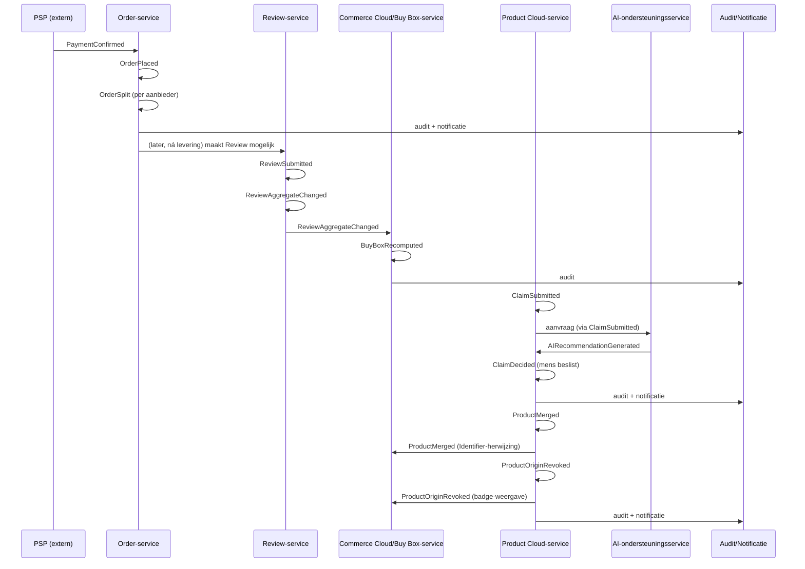

# EuropMade — Event Model (architectuur)

**Status:** Concept v0.1 — vierde technische document van Sprint 2
**Uitgangspunt:** uitsluitend de goedgekeurde documenten `01-domain-model.md` (35 domeinobjecten, na de definitieve Affiliate-scopewijziging), `02-database-model.md` (47 tabellen) en `03-api-model.md` (services, resources, API-principes, bijgewerkt v0.2). Geen enkel nieuw domeinbegrip, geen enkele nieuwe tabel of resource, geen enkele businessregel die daar niet al in staat.
**Bijgewerkt (v0.2):** nieuwe events toegevoegd voor Affiliate/Finance/Messaging — zie sectie 2 hieronder.
**Scope:** het **complete eventmodel** — principes, eventcatalogus, eigenaarschap, producer/consumer-relaties, volgorde, betrouwbaarheid. **Geen code, geen message-broker-keuze (Kafka/RabbitMQ/SQS/e.a.), geen implementatie.** Waar dit document een eventnaam noemt (bijv. `ProductOriginRevoked`), is dat een conceptuele naam voor de eventcatalogus, geen vastgelegd technisch schema.

---

## Leeswijzer

Dit document bouwt rechtstreeks voort op `03-api-model.md` sectie 16 (Events), dat al drie concrete, bevroren voorbeelden gaf (betaling → ordersplitsing; merge → Verified-intrekking; review-wijziging → Buy Box-herberekening) en het achterliggende principe ("Event Driven waar zinvol," TB-01). Dit document maakt die drie voorbeelden compleet: elke plek in `02-database-model.md` waar een businessregel een gevolg in een *andere* service beschrijft, wordt hier als event gemodelleerd. Elke plek waar dit ontwerp een spanning of gat in de drie bronnen blootlegt, staat in "Geconstateerde inconsistenties," niet stilzwijgend opgelost.

---

# 1. Event-principes

| Principe | Toelichting |
|---|---|
| **Events voor cross-service-gevolgen, nooit voor cross-service-berekeningen** | Een event draagt mee wát er gebeurd is (bijv. "Offer X heeft nu voorraad 0"), nooit een verzoek aan een andere service om zelf iets te berekenen namens de producer. De ontvangende service beslist zelf wat zij met het gegeven doet (bijv. de Commerce Cloud/Buy Box-service herberekent zelf de Buy Box na een `InventoryChanged`-event) — consistent met de service-eigenaarschapsgrenzen in `03-api-model.md` sectie 2. |
| **Eén producer per event-type** | Elk event heeft precies één service als bron van waarheid (zie sectie 4, Event-eigenaren) — nooit twee services die hetzelfde event-type onafhankelijk van elkaar mogen uitzenden. |
| **Events zijn feiten, geen commando's** | Een event beschrijft een reeds voltooide statuswijziging (`ProductOriginRevoked`), nooit een instructie (`RevokeProductOrigin`) — consistent met het "nooit stilzwijgend"-principe: het feit is al vastgelegd (in `audit_log`, Datamodel F.2) vóórdat het event verstuurd wordt, niet andersom. |
| **AI-events zijn nooit beslissingen** | Een `AIRecommendationGenerated`-event (zie sectie 2) draagt uitsluitend een aanbeveling; het triggert nooit automatisch een statuswijziging bij de ontvangende service — die blijft, zoals overal in het domein-/datamodel vastgelegd, een menselijke handeling (Blueprint H9.7). |
| **Events zijn nooit de enige plek waar een regel wordt afgedwongen** | Een service die op een event reageert, controleert zelf opnieuw de eigen businessregels (bijv. de Commerce Cloud/Buy Box-service controleert zelf of een Offer nog geldige Inventory/Price heeft vóór ze meetelt in een herberekening) — een event is een trigger, geen vertrouwd, ongecontroleerd bevel. |

---

# 2. Domeinevents

Events die ontstaan uit een statuswijziging **binnen** het domein zelf (in tegenstelling tot integratie-events, sectie 3, die van buiten het domein komen). Per service, direct afgeleid van de businessregels in `02-database-model.md`.

## 2.1 Product Cloud-service

| Event | Ontstaat bij | Bron (Datamodel) |
|---|---|---|
| `ProductVersionPublished` | `product_version.publication_status` → Gepubliceerd | Deel B.3 |
| `ProductLifecycleStatusChanged` | `product.lifecycle_status`-overgang | Deel B.2 |
| `ProductMerged` | Nieuwe rij in `merge_record` | Deel B.12 |
| `ProductSplit` | Nieuwe rij in `split_record` | Deel B.12 |
| `OwnershipTransferred` | Nieuwe rij in `ownership_record` (Beheerder-goedgekeurd) | Deel B.9 |
| `ClaimSubmitted` | Nieuwe rij in `claim` | Deel B.10 |
| `ClaimDecided` | `claim.status` → Goedgekeurd/Afgewezen | Deel B.10 |
| `DisputeOpened` | Nieuwe rij in `dispute` | Deel B.10 |
| `DisputeResolved` | `dispute.status` → Bevestiging/Overdracht/Terugzetting | Deel B.10 |
| `MatchCandidateDetected` | Nieuwe rij in `match_candidate` | Deel B.11 |
| `ModerationCaseOpened` | Nieuwe rij in `moderation_case` | Deel B.13 |
| `ModerationCaseResolved` | `moderation_case.status` → Geen actie/Geëscaleerd | Deel B.13 |
| `ProductOriginRequested` | Nieuwe rij in `product_origin` | Deel B.14 |
| `ProductOriginDecided` | `product_origin.status` → Geverifieerd/Afgewezen | Deel B.14 |
| `ProductOriginRevoked` | `product_origin.status` → Ingetrokken (handmatig of automatisch bij rollback/merge) | Deel B.14 |

## 2.2 Commerce Cloud/Buy Box-service

| Event | Ontstaat bij | Bron (Datamodel) |
|---|---|---|
| `OfferCreated` | Nieuwe rij in `offer` | Deel C.1 |
| `OfferWithdrawn` | `offer.deleted_at` gezet | Deel C.1 |
| `InventoryChanged` | Wijziging in `inventory.quantity_available` | Deel C.2 |
| `PriceChanged` | Wijziging in `price` | Deel C.3 |
| `BuyBoxRecomputed` | Nieuwe/bijgewerkte rij in `buy_box_computation` | Deel C.4 |

## 2.3 Order-service

| Event | Ontstaat bij | Bron (Datamodel) |
|---|---|---|
| `OrderPlaced` | Nieuwe rij in `order_set` (ná geslaagde betaling) | Deel D.1 |
| `OrderSplit` | Nieuwe rij in `order` (per aanbieder) | Deel D.2, al bevroren voorbeeld in `03-api-model.md` §16 |
| `OrderSplitFailed` | `order.exception_status` → Mislukte ordersplitsing | Deel D.2 |
| `OrderExceptionResolved` | `order.exception_status` → Afgehandeld | Deel D.2 |
| `MessageSent` *(nieuw, v0.2)* | Nieuwe rij in `message` | Deel G.9 |

## 2.4 Review-service

| Event | Ontstaat bij | Bron (Datamodel) |
|---|---|---|
| `ReviewSubmitted` | Nieuwe rij in `review` | Deel E.1 |
| `ReviewAggregateChanged` | Herberekende gemiddelde verkopersreview-score per Seller | Deel E.1, al bevroren voorbeeld in `03-api-model.md` §16 |

## 2.5 Partner-service

| Event | Ontstaat bij | Bron (Datamodel) |
|---|---|---|
| `SellerOnboarded` | `seller.onboarding_status` → Goedgekeurd | Deel A.3 |
| `DistributorAuthorizationGranted` | Nieuwe rij in `distributor_authorization` | Deel A.5 |

## 2.6 AI-ondersteuningsservice

| Event | Ontstaat bij | Bron (Datamodel) |
|---|---|---|
| `AIRecommendationGenerated` | Nieuwe rij in `ai_metadata` | Deel F.1 |

## 2.7 Affiliate-service *(nieuw, v0.2 — Affiliate-scopewijziging)*

| Event | Ontstaat bij | Bron (Datamodel) |
|---|---|---|
| `AffiliateOnboarded` | `affiliate.onboarding_status` → Goedgekeurd | Deel G.2 |
| `AffiliateLinkCreated` | Nieuwe rij in `affiliate_link` | Deel G.3 |
| `ClickTracked` | Nieuwe rij in `click` (uitsluitend na geldige `consent_record`) | Deel G.4 |
| `ConversionRecorded` | Nieuwe rij in `conversion` (getriggerd door `OrderSplit`, zie sectie 5) | Deel G.5 |
| `ConversionReversed` | Conversie teruggedraaid bij een gekoppelde Return | Deel G.5, `returns-and-refunds/spec.md` sectie 6 |

## 2.8 Finance-service *(nieuw, v0.2)*

| Event | Ontstaat bij | Bron (Datamodel) |
|---|---|---|
| `CommissionCalculated` | Nieuwe rij in `commission` (getriggerd door `OrderSplit` of `ConversionRecorded`) | Deel G.6 |
| `InvoiceIssued` | Nieuwe rij in `invoice` | Deel G.7 |
| `PayoutProcessed` | `payout.status` → Voltooid | Deel G.8 |

---

# 3. Integratie-events

Events die van **buiten** het domein komen (externe partijen, `03-api-model.md` sectie 17) en het domein binnenkomen als trigger voor een domeinevent.

| Event | Bron (extern) | Triggert intern |
|---|---|---|
| `PaymentConfirmed` | PSP (webhook, `03-api-model.md` §15/17) | `OrderPlaced` → `OrderSplit` |
| `PaymentFailed` | PSP (webhook) | Geen ordersplitsing; Checkout-foutafhandeling (buiten dit eventmodel — Checkout-flow zelf) |
| `ShipmentStatusUpdated` | Verzender (webhook) | Nog niet vastgelegd — Shipment zelf is Status Open (Datamodel §16) |
| `SearchIndexingCompleted` | Externe zoekservice | Geen verder intern gevolg vastgelegd — uitsluitend een bevestiging |

**Nadrukkelijk niet in deze tabel:** een aanroep richting de AI-validatie-API (`AIRecommendationGenerated`, sectie 2.6) is naar zijn aard request/response (het domein vráágt een aanbeveling), geen inkomend, spontaan integratie-event — dat onderscheid is bewust gehouden, consistent met `03-api-model.md` sectie 17 waar de AI-validatie-API als "uitgaand (aanroep) + inkomend (aanbeveling)" wordt omschreven, niet als een losstaande externe gebeurtenis.

---

# 4. Event-eigenaren

Eén producer per event, direct gekoppeld aan het service-eigenaarschap uit `03-api-model.md` sectie 2 (zie ook Bijlage B hieronder voor de volledige producer/consumer-uitwerking):

| Event(groep) | Eigenaar-service |
|---|---|
| Alle events in 2.1 | Product Cloud-service |
| Alle events in 2.2 | Commerce Cloud/Buy Box-service |
| Alle events in 2.3 | Order-service |
| Alle events in 2.4 | Review-service |
| Alle events in 2.5 | Partner-service |
| `AIRecommendationGenerated` | AI-ondersteuningsservice |
| `PaymentConfirmed`, `PaymentFailed` | Externe PSP (het domein is hier consument, geen eigenaar) |
| `ShipmentStatusUpdated` | Externe verzender (idem) |

**Audit- en Notificatie-events zijn bewust geen aparte rij** — zij zijn geen domeineigenaar van een eigen gebeurtenis, maar de **universele consument** van vrijwel elk event hierboven (zie sectie 12).

---

# 5. Producer/Consumer

Per service: welke events zij produceert, en welke zij consumeert van een andere service (uitsluitend cross-service-consumptie; een service die haar eigen events intern verwerkt, staat niet apart vermeld).

| Service | Produceert | Consumeert (van) |
|---|---|---|
| Product Cloud-service | Alle 2.1-events | `AIRecommendationGenerated` (AI-ondersteuningsservice, bij Claim/Dispute/MatchCandidate/ProductOrigin) |
| Commerce Cloud/Buy Box-service | Alle 2.2-events | `ProductMerged`, `ProductSplit` (Product Cloud — Identifier-herwijzing raakt Offer-koppeling), `ProductOriginRevoked` (Product Cloud — Verified-badge-weergave), `ReviewAggregateChanged` (Review-service) |
| Order-service | Alle 2.3-events | `PaymentConfirmed`/`PaymentFailed` (extern, PSP) |
| Review-service | Alle 2.4-events | `OrderSplit` (Order-service — een Review mag pas na een voltooide Order, Domeinmodel §18: "voorkomt niet-kopers-reviews") |
| Partner-service | Alle 2.5-events | *(geen cross-service-consumptie geïdentificeerd)* |
| AI-ondersteuningsservice | `AIRecommendationGenerated` | `ClaimSubmitted`, `MatchCandidateDetected`, `ModerationCaseOpened`, `ProductOriginRequested` (Product Cloud — elk van deze is een mogelijke aanleiding voor een AI-aanroep) |
| Platformbrede gedeelde services (Audit/Notificatie) | `NotificationDispatched` (Notificatie, terminaal — geen verdere consumptie) | **Alle** events uit secties 2 en 3 (universeel, zie sectie 12) |

---

# 6. Eventvolgorde

Geen enkele regel hierover is expliciet vastgelegd in de drie bronnen — wel volgt een aantal ordeningseisen direct en dwingend uit al bevroren businessregels:

- **Binnen één aggregaat (bijv. één Order) moeten events in de volgorde van hun ontstaan verwerkt worden** — een `OrderSplitFailed` mag nooit vóór de bijbehorende `OrderSplit`-poging verwerkt worden, anders ontstaat precies het "geld kwijt zonder product"-scenario dat Checkout expliciet uitsluit.
- **Cross-service-volgorde is doorgaans niet gegarandeerd, en dat is architecturaal geaccepteerd**: de Commerce Cloud/Buy Box-service mag een `InventoryChanged`- en een `PriceChanged`-event in willekeurige volgorde ontvangen zolang beide uiteindelijk verwerkt worden vóór de eerstvolgende `BuyBoxRecomputed` — de herberekening zelf leest de actuele stand, niet de events zelf als bron van waarheid (consistent met Datamodel C.4: "wordt overschreven bij elke herberekening," geen event-sourcing-patroon).
- **`ProductMerged` moet vóór elk daaropvolgend Offer-gerelateerd event voor de betrokken Identifiers verwerkt zijn** — anders zou de Commerce Cloud/Buy Box-service tijdelijk tegen een niet meer bestaand product-ID rekenen. Exact hoe dit technisch gegarandeerd wordt (bijv. een volgorde-garantie per Identifier-sleutel) is nog niet vastgelegd — zie Geconstateerde inconsistenties.

---

# 7. Eventversies

**Geen enkele regel hierover is al vastgelegd** — net als API-versiebeheer (`03-api-model.md` sectie 7, Status Open) is dit architecturaal nieuw terrein. Ter oriëntatie, zonder een keuze te forceren: een eventschema zal onvermijdelijk wijzigen zodra een producer-service een nieuw veld toevoegt; consumenten die een ouder schema verwachten, mogen daar niet stuk op gaan. Dit is een open ontwerpkeuze voor een volgend Sprint 2-document.

---

# 8. Eventbetrouwbaarheid

Direct gekoppeld aan het al bevroren uitgangspunt dat een betaling nooit stilzwijgend verloren mag gaan (Checkout, Order Management Center): voor events die een Order/betaling raken (`OrderPlaced`, `OrderSplit`, `OrderSplitFailed`) is **minimaal at-least-once-aflevering** een architecturaal vereiste — een event dat nooit aankomt bij de Order-service zou het exacte, al uitgesloten scenario "betaling geslaagd, geen order" opnieuw mogelijk maken. Voor events zonder een dergelijke, al bevroren onomkeerbaarheidseis (bijv. `PriceChanged`) is een lagere betrouwbaarheidsgarantie acceptabel, omdat een gemiste `PriceChanged` bij de eerstvolgende wijziging alsnog wordt ingehaald.

---

# 9. Idempotency

Consistent met `03-api-model.md` sectie 10 (Idempotency, daar al voor de API-laag vastgelegd): elke consumer moet een event dat per ongeluk twee keer wordt afgeleverd (het gevolg van at-least-once-aflevering, sectie 8 hierboven) zonder dubbel effect kunnen verwerken. Concreet: een Order-service die tweemaal hetzelfde `OrderSplit`-event ontvangt, mag nooit een tweede, dubbele `order`-rij aanmaken — het tweede event moet herkend en genegeerd worden. Dit vereist dat elk event een uniek, herkenbaar kenmerk draagt (conceptueel, geen technisch schema hier vastgelegd).

---

# 10. Retries

**Geen enkele regel hierover is al vastgelegd** — architecturaal nieuw terrein. Wel volgt uit sectie 8 (Eventbetrouwbaarheid) dat events met een onomkeerbaarheidseis (Order-gerelateerd) een retry-mechanisme behoeven bij een mislukte verwerking, terwijl minder kritieke events (bijv. `PriceChanged`) een mislukte verwerking kunnen laten "verlopen" zonder retry, omdat een volgende wijziging het vanzelf inhaalt. Exacte retry-aantallen/backoff-strategie: nog niet vastgelegd.

---

# 11. Dead-letter-afhandeling

**Geen enkele regel hierover is al vastgelegd** — architecturaal nieuw terrein. Wel is één regel al indirect gegrond: een event dat na uitputting van retries alsnog niet verwerkt kan worden en een Order/betaling raakt, mag nooit stilzwijgend verdwijnen — dit zou opnieuw het uitgesloten "geld kwijt zonder product"-scenario riskeren. Een dead-letter-mechanisme voor dit type event moet daarom altijd resulteren in een zichtbaar, door een Beheerder te behandelen signaal (vergelijkbaar met de al bevroren uitzonderingsqueue in Order Management Center) — niet in een stil, nooit opgemerkt verlies. Voor overige events is een minder streng mechanisme (loggen zonder verplichte Beheerder-actie) voldoende.

---

# 12. Eventual consistency

Expliciet geaccepteerd, niet als tekortkoming maar als bewuste architectuurkeuze, op precies de plekken waar de bronnen dit al impliceren:

- **`buy_box_computation` is uitdrukkelijk een cache, geen bronwaarheid** (Datamodel C.4) — een klant kan dus voor een kort moment een niet-actuele Buy Box-winnaar zien ná een `PriceChanged`-event, totdat de herberekening is verwerkt. Dit is aanvaardbare eventual consistency, geen fout.
- **Externe zoekindexering is event-gedreven, dus per definitie niet direct consistent** (`03-api-model.md` §17) — een zojuist gepubliceerde `ProductVersionPublished` verschijnt niet noodzakelijk onmiddellijk in zoekresultaten.
- **Wat nooit eventual consistent mag zijn:** een betaling en de bijbehorende order (sectie 8/11) — daar is de architecturale eis juist het tegenovergestelde van eventual consistency, namelijk gegarandeerde, uiteindelijke correctheid zonder stil verlies.

---

# 13. Audit-events

**Het sterkst gegronde onderdeel van dit hele document** — rechtstreeks uit Product Cloud Architecture Deel 1.1, letterlijk hergebruikt in `02-database-model.md` F.2: "elke staatswijziging is een gebeurtenis met een eigenaar, een reden en een tijdstip." Praktisch betekent dit voor het eventmodel:

- **Elk event in sectie 2 en 3 heeft een corresponderende `audit_log`-schrijving** — de Audit-consumptie is universeel (sectie 5, laatste rij) en niet optioneel voor geen enkel event.
- **Audit-schrijving gebeurt niet ván het event, maar naast/voorafgaand aan het event** — de gebeurtenis wordt al bij het ontstaan zelf (binnen de producer-service, in dezelfde transactie als de statuswijziging) in `audit_log` vastgelegd; het event dat vervolgens naar andere services gaat, is een aparte, tweede stap. Dit voorkomt dat een event dat nooit aankomt (sectie 8) ook de audit-trail zou missen.
- **Ook een "Geen actie"-uitkomst is een event** (`ModerationCaseResolved` met uitkomst "Geen actie") — consistent met het al bevroren principe dat een bewuste niet-actie zelf een beslissing is die gelogd wordt.

---

# 14. Externe events

Zie sectie 3 (Integratie-events) voor de volledige catalogus. Aanvullend, het architecturale principe: elk extern event wordt bij binnenkomst eerst **vertaald** naar een intern domeinevent (bijv. `PaymentConfirmed` → `OrderPlaced`), nooit rechtstreeks doorgegeven aan interne consumenten in het externe formaat — dit houdt de interne eventcatalogus onafhankelijk van een externe partij se eigen schema-keuzes (bijv. als de PSP van leverancier wisselt, `03-api-model.md` §17, hoeft geen enkele interne consumer te wijzigen, uitsluitend de vertaallaag).

---

# A. Overzicht van alle events

| Event | Type | Producer | Sectie | Bron |
|---|---|---|---|---|
| `ProductVersionPublished` | Domeinevent | Product Cloud-service | 2.1 | Businessregel — `03-api-model.md` §17: "event-gedreven indexering bij relevante statusovergang" |
| `ProductLifecycleStatusChanged` | Domeinevent | Product Cloud-service | 2.1 | Architecturale afleiding — de statusovergang zelf is bevroren (Datamodel B.2), een event hiervoor is nergens expliciet vereist |
| `ProductMerged` | Domeinevent | Product Cloud-service | 2.1 | Businessregel — expliciet bevroren voorbeeld, `03-api-model.md` §16 |
| `ProductSplit` | Domeinevent | Product Cloud-service | 2.1 | Architecturale afleiding — `split_record` is bevroren (Datamodel B.12), een cross-service-event hiervoor is nergens vereist |
| `OwnershipTransferred` | Domeinevent | Product Cloud-service | 2.1 | Architecturale afleiding — `ownership_record` is bevroren (Datamodel B.9), een event is nergens vereist |
| `ClaimSubmitted` | Domeinevent | Product Cloud-service | 2.1 | Architecturale afleiding |
| `ClaimDecided` | Domeinevent | Product Cloud-service | 2.1 | Architecturale afleiding |
| `DisputeOpened` | Domeinevent | Product Cloud-service | 2.1 | Architecturale afleiding |
| `DisputeResolved` | Domeinevent | Product Cloud-service | 2.1 | Architecturale afleiding |
| `MatchCandidateDetected` | Domeinevent | Product Cloud-service | 2.1 | Architecturale afleiding |
| `ModerationCaseOpened` | Domeinevent | Product Cloud-service | 2.1 | Architecturale afleiding |
| `ModerationCaseResolved` | Domeinevent | Product Cloud-service | 2.1 | Architecturale afleiding |
| `ProductOriginRequested` | Domeinevent | Product Cloud-service | 2.1 | Architecturale afleiding |
| `ProductOriginDecided` | Domeinevent | Product Cloud-service | 2.1 | Architecturale afleiding |
| `ProductOriginRevoked` | Domeinevent | Product Cloud-service | 2.1 | Businessregel — Datamodel B.14: rollback/merge "trekt het record automatisch in"; cross-service-effect expliciet bevroren via `03-api-model.md` §16 |
| `OfferCreated` | Domeinevent | Commerce Cloud/Buy Box-service | 2.2 | Architecturale afleiding |
| `OfferWithdrawn` | Domeinevent | Commerce Cloud/Buy Box-service | 2.2 | Architecturale afleiding |
| `InventoryChanged` | Domeinevent | Commerce Cloud/Buy Box-service | 2.2 | Businessregel — Datamodel C.4: "wordt herberekend bij elke relevante wijziging (prijs, **voorraad**, review-score)" |
| `PriceChanged` | Domeinevent | Commerce Cloud/Buy Box-service | 2.2 | Businessregel — Datamodel C.4: "wordt herberekend bij elke relevante wijziging (**prijs**, voorraad, review-score)" |
| `BuyBoxRecomputed` | Domeinevent | Commerce Cloud/Buy Box-service | 2.2 | Businessregel — Datamodel C.4, expliciet herberekeningsmechanisme |
| `OrderPlaced` | Domeinevent | Order-service | 2.3 | Architecturale afleiding — dit document introduceert dit als tussenstap vóór `OrderSplit`; `03-api-model.md` §16 noemt uitsluitend "betaling → ordersplitsing," geen apart tussenliggend event |
| `OrderSplit` | Domeinevent | Order-service | 2.3 | Businessregel — expliciet bevroren voorbeeld, `03-api-model.md` §16 |
| `OrderSplitFailed` | Domeinevent | Order-service | 2.3 | Businessregel — Datamodel D.2, `exception_status = "Mislukte ordersplitsing"` is expliciet bevroren als apart te signaleren geval (Order Management Center) |
| `OrderExceptionResolved` | Domeinevent | Order-service | 2.3 | Architecturale afleiding — de statuswaarde "Afgehandeld" is bevroren (Datamodel D.2), een event hiervoor is nergens expliciet vereist |
| `ReviewSubmitted` | Domeinevent | Review-service | 2.4 | Architecturale afleiding |
| `ReviewAggregateChanged` | Domeinevent | Review-service | 2.4 | Businessregel — expliciet bevroren voorbeeld, `03-api-model.md` §16 (de vraag wíé dit aggregeert blijft niettemin open, zie Geconstateerde inconsistenties #2) |
| `SellerOnboarded` | Domeinevent | Partner-service | 2.5 | Architecturale afleiding |
| `DistributorAuthorizationGranted` | Domeinevent | Partner-service | 2.5 | Architecturale afleiding |
| `AIRecommendationGenerated` | Domeinevent | AI-ondersteuningsservice | 2.6 | Architecturale afleiding — `ai_metadata` en het AI-ondersteunt-mens-beslist-principe zijn bevroren, maar een specifiek, dit-genaamd event richting Product Cloud is nergens vereist |
| `PaymentConfirmed` | Integratie-event | PSP (extern) | 3 | Businessregel — de onderliggende keten "succesvolle betaling → ordersplitsing" is expliciet bevroren (`03-api-model.md` §16); de exacte naam/vorm van dit inkomende event is architecturale invulling |
| `PaymentFailed` | Integratie-event | PSP (extern) | 3 | Architecturale afleiding — expliciet al benoemd als ongegrond, zie Geconstateerde inconsistenties #4 |
| `ShipmentStatusUpdated` | Integratie-event | Verzender (extern) | 3 | Architecturale afleiding — Shipment zelf is Status Open (Datamodel §16) |
| `SearchIndexingCompleted` | Integratie-event | Zoekservice (extern) | 3 | Architecturale afleiding — `03-api-model.md` §17 beschrijft uitsluitend de uitgaande indexeringstrigger, geen inkomende bevestiging |
| `AffiliateOnboarded` | Domeinevent | Affiliate-service | 2.7 | Businessregel — analoog aan `SellerOnboarded`, zelfde statusverloop-patroon (Datamodel §27) |
| `AffiliateLinkCreated` | Domeinevent | Affiliate-service | 2.7 | Architecturale afleiding |
| `ClickTracked` | Domeinevent | Affiliate-service | 2.7 | Architecturale afleiding — vereist wel een geldige `consent_record` (businessregel, Datamodel §29/§35) |
| `ConversionRecorded` | Domeinevent | Affiliate-service | 2.7 | Businessregel — direct gekoppeld aan het al bevroren `OrderSplit`-event |
| `ConversionReversed` | Domeinevent | Affiliate-service | 2.7 | Businessregel — `returns-and-refunds/spec.md` sectie 6 |
| `CommissionCalculated` | Domeinevent | Finance-service | 2.8 | Businessregel — server-side berekening, platformbreed principe |
| `InvoiceIssued` | Domeinevent | Finance-service | 2.8 | Architecturale afleiding |
| `PayoutProcessed` | Domeinevent | Finance-service | 2.8 | Architecturale afleiding — afhankelijk van de nog te kiezen PSP (ADR-01) |
| `MessageSent` | Domeinevent | Order-service | 2.3 | Architecturale afleiding |
| `NotificationDispatched` | Terminaal event | Platformbrede gedeelde services | 12/13 | Architecturale afleiding — Datamodel F.3 ("muteert nooit een ander domeinobject") is bevroren; dat dit een "terminaal event zonder verdere consumptie" is, is een gevolgtrekking van dit document |

**Samenvatting Bron-classificatie:** van de 43 events in deze catalogus (34 oorspronkelijk + 9 nieuw door de Affiliate-scopewijziging, v0.2) zijn er **14 direct herleidbaar tot een businessregel** (10 oorspronkelijk + 4 nieuw: `AffiliateOnboarded`, `ConversionRecorded`, `ConversionReversed`, `CommissionCalculated`); de overige **29 zijn architecturale afleidingen** (24 oorspronkelijk + 5 nieuw: `AffiliateLinkCreated`, `ClickTracked`, `InvoiceIssued`, `PayoutProcessed`, `MessageSent`) — logisch en beargumenteerd voortbouwend op de bronnen, maar nergens letterlijk als event geëist. Dit bevestigt en verscherpt wat de Event-besluitstatus (Bijlage E) al aangaf: "Domeinevents (catalogus)" en "Integratie-events" staan daar terecht op Status Voorlopig, niet Definitief.

**Totaal: 43 events** (38 domeinevents + 4 integratie-events + 1 terminaal event (`NotificationDispatched`, dat als enige geen eigen `## 2.x`-subsectie heeft maar wel in deze catalogus is opgenomen) — geen enkele andere service consumeert `NotificationDispatched` verder). **Bijgewerkt (v0.2):** 9 nieuwe domeinevents toegevoegd door de Affiliate-scopewijziging (`AffiliateOnboarded`, `AffiliateLinkCreated`, `ClickTracked`, `ConversionRecorded`, `ConversionReversed`, `CommissionCalculated`, `InvoiceIssued`, `PayoutProcessed`, `MessageSent`) — 29 → 38. *Eerdere correctie (v0.1→v0.1 herzien) ongewijzigd: "33 events" was destijds een telfout, rechtgezet naar 34 vóór deze v0.2-uitbreiding.*

---

# B. Producer → Consumer-matrix

| Producer | Event | Consumer(s) |
|---|---|---|
| Product Cloud-service | `ProductVersionPublished` | Externe zoekservice (indexering) |
| Product Cloud-service | `ProductMerged` | Commerce Cloud/Buy Box-service (Identifier-herwijzing) |
| Product Cloud-service | `ProductSplit` | Commerce Cloud/Buy Box-service |
| Product Cloud-service | `ProductOriginRevoked` | Commerce Cloud/Buy Box-service (badge-weergave), Notificatie (Seller informeren) |
| Product Cloud-service | `ClaimSubmitted`, `MatchCandidateDetected`, `ModerationCaseOpened`, `ProductOriginRequested` | AI-ondersteuningsservice (mogelijke AI-aanroep) |
| Product Cloud-service | (overige 2.1-events) | Uitsluitend Audit/Notificatie (universeel, sectie 5) |
| Commerce Cloud/Buy Box-service | `InventoryChanged`, `PriceChanged` | (intern, triggert eigen `BuyBoxRecomputed`) |
| Commerce Cloud/Buy Box-service | (2.2-events) | Uitsluitend Audit/Notificatie |
| Order-service | `OrderPlaced` | (intern, triggert eigen `OrderSplit`) |
| Order-service | `OrderSplit` | Review-service (maakt toekomstige Review mogelijk) |
| Order-service | `OrderSplitFailed` | Notificatie (Beheerder-signaal, Order Management Center-uitzonderingsqueue) |
| Review-service | `ReviewAggregateChanged` | Commerce Cloud/Buy Box-service (triggert `BuyBoxRecomputed`) |
| Partner-service | (2.5-events) | Uitsluitend Audit/Notificatie |
| AI-ondersteuningsservice | `AIRecommendationGenerated` | Product Cloud-service (aanvullende context bij de openstaande beoordeling) |
| PSP (extern) | `PaymentConfirmed` | Order-service (→ `OrderPlaced`) |
| PSP (extern) | `PaymentFailed` | Checkout-flow (buiten dit eventmodel) |
| Verzender (extern) | `ShipmentStatusUpdated` | Order-service (nog niet vastgelegd — Shipment Status Open) |
| Zoekservice (extern) | `SearchIndexingCompleted` | *(geen verder intern gevolg)* |
| Alle services | *(elk event)* | **Audit/Notificatie (universeel — zie sectie 5/13)** |

---

# C. Event-flow diagram

---

# D. Geconstateerde inconsistenties

Conform de opdracht: de drie bronnen zijn niet aangepast. Onderstaand elke plek waar het ontwerpen van dit eventmodel een spanning, gat of onbeantwoorde vraag blootlegde.

1. **Eventvolgorde-garanties tussen Product Cloud en Commerce Cloud/Buy Box zijn nergens expliciet vastgelegd.** Sectie 6 stelt dat `ProductMerged` vóór opvolgende Offer-events verwerkt moet zijn, maar geen van de drie bronnen benoemt een mechanisme (bijv. partitionering per Identifier-sleutel) waarmee dit gegarandeerd wordt. **Aanbeveling:** een volgend Sprint 2-document (of een technische ADR) moet vastleggen hoe volgordelijkheid per aggregaat wordt gegarandeerd.

2. **`ReviewAggregateChanged` veronderstelt een "gemiddelde verkopersreview-score per Seller," maar geen van de drie bronnen legt vast wíé of wát deze aggregatie berekent.** `02-database-model.md` modelleert `review` als losse rijen zonder een aggregaat-tabel; `03-api-model.md` noemt de Buy Box-factor "Klantwaardering" zonder een berekeningseigenaar te benoemen. Dit eventmodel moest aannemen dat de Review-service zelf aggregeert (logisch, want zij bezit de brondata), maar dat is een aanname van dit document. **Aanbeveling:** bevestig in een van de brondocumenten of de Review-service, dan wel de Commerce Cloud/Buy Box-service zelf, verantwoordelijk is voor deze aggregatie.

3. **Geen enkele regel legt vast wanneer een Review daadwerkelijk "mag" (na levering, na een bepaalde termijn, direct na Order-plaatsing).** De Producer/Consumer-matrix (Bijlage B) legt `OrderSplit → (mogelijkheid tot) Review` vast als relatie, maar het exacte trigger-moment (`ShipmentStatusUpdated`, dat zelf Status Open is) ontbreekt. **Aanbeveling:** dit hangt samen met inconsistentie #5 in `02-database-model.md` (Return/Shipment Open) en kan pas volledig worden vastgelegd zodra Shipment zelf is uitgewerkt.

4. **`PaymentFailed` heeft geen vastgelegde interne afhandeling in dit eventmodel.** In tegenstelling tot `PaymentConfirmed` (dat expliciet naar `OrderPlaced` leidt) is er geen bevroren regel over wat er met een mislukte betaling gebeurt vanuit event-perspectief — Checkout's eigen, bevroren foutafhandeling behandelt dit al op UI-/flowniveau, maar dit eventmodel introduceert bewust geen nieuw event hiervoor om niet vooruit te lopen op een niet-bevroren regel. **Aanbeveling:** bevestig of `PaymentFailed` binnen dit eventmodel moet vallen, of uitsluitend een Checkout-interne aangelegenheid blijft.

5. **`NotificationDispatched` als "terminaal event" is een aanname van dit document, niet expliciet bevroren.** `02-database-model.md` (F.3) legt vast dat een notificatie "zelf nooit een ander domeinobject muteert," wat dit document heeft doorvertaald naar "geen enkele verdere consumptie" — een redelijke, maar zelfstandige gevolgtrekking. **Aanbeveling:** geen actie strikt noodzakelijk, wel te bevestigen bij een volgende iteratie.

---

# E. Event-besluitstatus

| Onderwerp | Status | Bron | Moet nog gevalideerd worden? |
|---|---|---|---|
| Event-principes | Definitief | Bestaande documentatie (TB-01, "Event Driven waar zinvol") | Nee |
| Domeinevents (catalogus) | Voorlopig | Bestaande documentatie + Nieuw ontwerp Sprint 2 | Ja — elk event is afgeleid van een al bevroren businessregel, maar de eventnamen/-indeling zelf zijn hier voor het eerst samengesteld |
| Integratie-events | Voorlopig | Bestaande documentatie + Nieuw ontwerp Sprint 2 | Ja — PSP/verzender/zoekservice-koppeling is bevroren als concept, de exacte events zijn nieuw ontworpen |
| Event-eigenaren | Definitief | Bestaande documentatie (`03-api-model.md` sectie 2) | Nee — volgt direct uit het al vastgelegde service-eigenaarschap |
| Producer/Consumer | Voorlopig | Bestaande documentatie + Nieuw ontwerp Sprint 2 | Ja — drie relaties waren al bevroren (§16, `03-api-model.md`), de overige zijn hier voor het eerst afgeleid |
| Eventvolgorde | Open | Nieuw ontwerp Sprint 2 | Ja — geen enkel mechanisme vastgelegd (zie Geconstateerde inconsistenties #1) |
| Eventversies | Open | Nieuw ontwerp Sprint 2 | Ja — analoog aan API-versiebeheer, ook daar Open |
| Eventbetrouwbaarheid | Voorlopig | Bestaande documentatie + Nieuw ontwerp Sprint 2 | Ja — het "nooit stilzwijgend verlies"-principe is bevroren, de exacte afleveringsgarantie (at-least-once) is een aanname van dit document |
| Idempotency | Voorlopig | Bestaande documentatie + Nieuw ontwerp Sprint 2 | Ja — het principe is al vastgelegd voor de API-laag (`03-api-model.md` §10), hier doorgetrokken naar events |
| Retries | Open | Nieuw ontwerp Sprint 2 | Ja — geen enkele regel vastgelegd |
| Dead-letter-afhandeling | Open | Nieuw ontwerp Sprint 2 | Ja — geen enkele regel vastgelegd, uitsluitend een principe afgeleid uit het "nooit stilzwijgend"-uitgangspunt |
| Eventual consistency | Voorlopig | Bestaande documentatie + Nieuw ontwerp Sprint 2 | Ja — voor Buy Box/zoekindexering al impliciet aanvaard, hier expliciet benoemd |
| Audit-events | Definitief | Bestaande documentatie (Product Cloud Architecture Deel 1.1, Datamodel F.2) | Nee |
| Externe events | Voorlopig | Bestaande documentatie + Nieuw ontwerp Sprint 2 | Ja — de externe partijen zelf zijn bevroren concepten (`03-api-model.md` §17), de exacte events zijn hier nieuw ontworpen |

**Samenvatting:** 3 van de 14 onderwerpen zijn **Definitief**, 7 zijn **Voorlopig**, 4 zijn **Open**. Consistent met de eerdere Sprint 2-documenten vereist het merendeel nog een expliciet validatiemoment vóórdat dit eventmodel als basis dient voor een concrete message-broker-keuze of implementatie.
