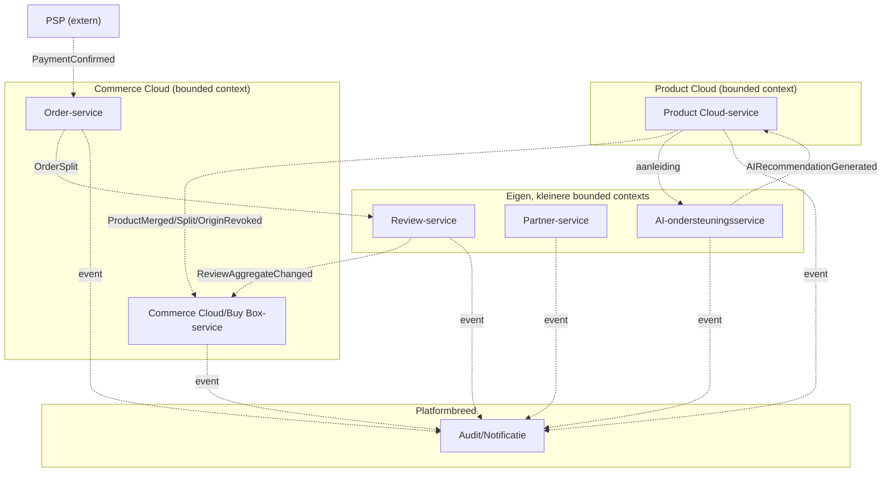

# EuropMade — Service Architecture

**Status:** Concept v0.1 — vijfde technische document van Sprint 2
**Uitgangspunt:** uitsluitend de goedgekeurde documenten `01-domain-model.md` (35 domeinobjecten, na de definitieve Affiliate-scopewijziging), `02-database-model.md` (47 tabellen), `03-api-model.md` (services, resources, API-principes, bijgewerkt v0.2) en `04-event-model.md` (events, bijgewerkt v0.2). Geen enkel nieuw domeinbegrip, geen enkele nieuwe tabel, resource of event die daar niet al in staat.
**Bijgewerkt (v0.2):** een achtste service (Affiliate-service) toegevoegd — zie sectie 1/2 hieronder.
**Scope:** de **service-architectuur** — hoe de al vastgelegde services (`03-api-model.md` sectie 2) zich tot elkaar verhouden als draaiende, samenwerkende systemen. **Geen code, geen implementatie, geen concrete technologiekeuze** (geen message broker, geen specifieke cache-technologie, geen specifiek monitoring-platform).
**Nadrukkelijk:** veel onderwerpen die dit document moet behandelen (schaalbaarheid, beschikbaarheid, failover, circuit breakers, caching, service discovery, configuratiebeheer, secrets, logging, monitoring, tracing, health checks) hebben **geen grondslag** in de vier bronnen — die gaan over domein, data, API's en events, niet over operationele infrastructuur. Waar dat zo is, zegt dit document dat expliciet, in plaats van een keuze te verzinnen.

---

## Leeswijzer

Dit document herhaalt geen enkele tabel, resource of event uit de vier bronnen — het bouwt uitsluitend een architecturale laag daarboven: hoe de zeven al vastgelegde services (`03-api-model.md` sectie 2) operationeel samenwerken. Elke sectie citeert expliciet welk deel van welke bron haar onderbouwt. Waar een gevraagd onderwerp geen enkele grondslag heeft, staat dat als zodanig vermeld, consistent met hoe `03-api-model.md` en `04-event-model.md` dit al deden voor bijvoorbeeld versiebeheer en retries.

---

# 1. Service-overzicht

Rechtstreeks overgenomen uit `03-api-model.md` sectie 2 (v0.2) — geen enkele service hier is nieuw ten opzichte van dat document; twee services (Affiliate, Finance) zijn v0.2-toevoegingen na de definitieve Affiliate-scopewijziging:

| Service | Rol |
|---|---|
| Product Cloud-service | Eigenaar van "wat een product is" — Product, Variant, Category, Attribute, OwnershipRecord, Claim, Dispute, MatchCandidate, ModerationCase, ProductOrigin |
| Commerce Cloud/Buy Box-service | Eigenaar van "wie het verkoopt en tegen welke voorwaarden" — Offer, Inventory, Price, BuyBoxResult |
| Order-service | Eigenaar van geplaatste bestellingen — OrderSet, Order, Shipment (open), Return (open), Message |
| Review-service | Eigenaar van klantwaarderingen — Review |
| Partner-service | Eigenaar van partneridentiteit — Seller, Company, Brand, Manufacturer |
| AI-ondersteuningsservice | Eigenaar van AI-aanbevelingen — AIMetadata |
| Platformbrede gedeelde services | Audit (AuditLogEntry) en Notificatie (Notification) |
| **Affiliate-service** *(nieuw, v0.2)* | Eigenaar van affiliate-marketing — Affiliate, AffiliateLink, Coupon, Click, Conversion, ConsentRecord |
| **Finance-service** *(nieuw, v0.2)* | Eigenaar van geldstromen — Commission, Invoice, Payout |
| *(Gedeelde identiteit, geen eigen service)* | Customer — "te fundamenteel-gedeeld om ooit los te trekken" (`02-database-model.md` sectie 5) |

---

# 2. Verantwoordelijkheden per service

Direct afgeleid van `03-api-model.md` secties 2–4 (Services, Resource-indeling, CRUD-verantwoordelijkheden):

- **Product Cloud-service** is verantwoordelijk voor de volledige levenscyclus van een product (versies, publicatiestatus, levenscyclusstatus), eigendomsketen, en alle moderatie-/matchinggerelateerde beoordelingen. Zij is de enige service die een `product_id` mag laten ontstaan of laten samensmelten (merge/split).
- **Commerce Cloud/Buy Box-service** is verantwoordelijk voor alles wat een Seller "doet" met een product: aanbieden, voorraad, prijs, en de resulterende Buy Box-winnaar. Zij berekent, herberekent, en toont — zij bezit nooit productdata zelf.
- **Order-service** is verantwoordelijk voor wat er ná een geslaagde betaling gebeurt: de server-side splitsing naar losse Orders per aanbieder, en (nog niet uitgewerkt) fulfilment/retour.
- **Review-service** is verantwoordelijk voor klantwaarderingen, met een harde koppeling aan een daadwerkelijke aankoop (`order_line`, voorkomt niet-kopers-reviews).
- **Partner-service** is verantwoordelijk voor wie er mag verkopen/produceren: Seller-rollen, bedrijfsgegevens, merken, fabrikanten, distributeur-autorisaties.
- **AI-ondersteuningsservice** is verantwoordelijk voor het genereren en bewaren van AI-aanbevelingen — nooit voor een uiteindelijke beslissing (`03-api-model.md` sectie 1: "AI ondersteunt, beslist nooit").
- **Platformbrede gedeelde services** zijn verantwoordelijk voor het vastleggen (Audit) en doorgeven (Notificatie) van gebeurtenissen die elders ontstaan — zij produceren zelf geen domeingebeurtenis, zij zijn universeel consument (`04-event-model.md` sectie 4/5).
- **Affiliate-service** *(nieuw, v0.2)* is verantwoordelijk voor registratie, linkgeneratie, click-/coupon-tracking en conversie-attributie — nooit voor de daaropvolgende commissieberekening zelf (dat is Finance-service).
- **Finance-service** *(nieuw, v0.2)* is verantwoordelijk voor commissieberekening, facturatie en uitbetaling — voor zowel Sellers als Affiliates, gedeeld patroon consistent met hoe Review al Product-/Verkopersreview combineert.

---

# 3. Bounded Contexts

De belangrijkste, al meermaals bevroren grens (`01-domain-model.md` domeinobject 8, Product Cloud): **Product Cloud en Commerce Cloud zijn strikt gescheiden bounded contexts**, op geen enkel niveau vermengd. Dit vertaalt zich naar precies twee bounded contexts die meerdere van de negen services omvatten (zeven oorspronkelijk, plus Affiliate-/Finance-service, v0.2):

| Bounded Context | Omvat services | Kernregel |
|---|---|---|
| **Product Cloud** | Product Cloud-service | "Wat een product is" — nooit een prijs-, voorraad- of verkoopgegeven binnen deze context |
| **Commerce Cloud** | Commerce Cloud/Buy Box-service, Order-service | "Wie verkoopt tegen welke voorwaarden" — verwijst naar Product Cloud uitsluitend via een Identifier, nooit rechtstreeks naar een Product |

De overige services (Review, Partner, AI-ondersteuning, Platformbrede gedeelde services) vormen elk hun **eigen, kleinere bounded context** — geen van hen deelt een grens met Product Cloud of Commerce Cloud; zij raken beide uitsluitend via events (`04-event-model.md`) of gerichte, alleen-lezen verwijzingen (zie sectie 6).

---

# 4. Service-grenzen

Elke grens hieronder is al impliciet vastgelegd via de resource-/tabeltoewijzing in de vier bronnen — dit document maakt haar expliciet:

- **Geen enkele service muteert een tabel die een andere service bezit** (`02-database-model.md` Deel A–F, `03-api-model.md` sectie 3). Een Offer-record wordt uitsluitend door de Commerce Cloud/Buy Box-service geschreven, ook al verwijst het naar een `seller_id` en `identifier_id` die door andere services bezeten worden.
- **Elke service is vrij om haar eigen resources verder te structureren** (bijv. de exacte interne opslag van `ai_metadata`), zolang het naar buiten toe zichtbare contract (resources, events) ongewijzigd blijft.
- **Een grens wordt nooit stilzwijgend overschreden via een "snelle" directe database-query op een andere service se tabellen** — elke cross-service-toegang loopt via de in sectie 6 beschreven communicatiepatronen (events of expliciete, alleen-lezen aanroepen), nooit via gedeelde, rechtstreekse databasetoegang.

---

# 5. Afhankelijkheden

Rechtstreeks samengevat uit `04-event-model.md` sectie 5 (Producer/Consumer) en Bijlage B — welke service structureel van welke andere afhankelijk is:

| Service | Afhankelijk van (voor eigen correcte werking) |
|---|---|
| Commerce Cloud/Buy Box-service | Product Cloud-service (`ProductMerged`, `ProductSplit`, `ProductOriginRevoked`), Review-service (`ReviewAggregateChanged`) |
| Order-service | Externe PSP (`PaymentConfirmed`) |
| Review-service | Order-service (`OrderSplit` — een Review vereist een voltooide Order) |
| Product Cloud-service | AI-ondersteuningsservice (`AIRecommendationGenerated`, als aanvullende context — nooit blokkerend, want AI ondersteunt uitsluitend) |
| AI-ondersteuningsservice | Product Cloud-service (de aanleiding: `ClaimSubmitted`, `MatchCandidateDetected`, `ModerationCaseOpened`, `ProductOriginRequested`) |
| Platformbrede gedeelde services | Alle overige services (universele consument, geen van hen is *van* Audit/Notificatie afhankelijk voor hun eigen correctheid) |
| Partner-service | *(geen cross-service-afhankelijkheid geïdentificeerd in `04-event-model.md`)* |
| **Affiliate-service** *(nieuw, v0.2)* | Order-service (`OrderSplit` — een Conversion vereist een voltooide Order) |
| **Finance-service** *(nieuw, v0.2)* | Order-service (`OrderSplit`, Seller-commissie), Affiliate-service (`ConversionRecorded`, Affiliate-commissie), externe PSP (uitbetaling — zelfde afhankelijkheid als Order-service) |

**Belangrijk onderscheid:** een afhankelijkheid hierboven is altijd **eventual consistent**, nooit synchroon-blokkerend (`04-event-model.md` sectie 12) — de Commerce Cloud/Buy Box-service kan tijdelijk met een verouderde Buy Box-uitkomst draaien terwijl een `ReviewAggregateChanged`-event nog onderweg is; zij is nooit *technisch* geblokkeerd door de Review-service.

---

# 6. Synchronisatie

Twee patronen, beide al impliciet aanwezig in de vier bronnen:

1. **Event-gedreven synchronisatie** (dominant patroon) — alle cross-service-gevolgen lopen via events (`04-event-model.md`, volledig). Dit is expliciet het voorkeurspatroon: `03-api-model.md` sectie 16 stelt dat gebeurtenissen die meerdere services raken via events lopen, "niet via directe, synchrone cross-service-aanroepen."
2. **Gerichte, alleen-lezen aanroepen** (uitzondering, voor weergavedoeleinden) — bijvoorbeeld wanneer Order-service een aanbieder-naam uit Partner-service toont. Dit patroon staat **niet letterlijk beschreven** in de vier Sprint 2-bronnen zelf — dit document markeert het daarom als **architecturale afleiding**, niet als een uit deze vier bronnen zelf herleidbare regel.

---

# 7. Communicatiepatronen

| Patroon | Toepassing | Grondslag |
|---|---|---|
| Asynchrone events (fire-and-forget vanuit producer-perspectief) | Alle 43 events uit `04-event-model.md` (v0.2) | `04-event-model.md`, volledig |
| Synchrone, alleen-lezen aanroepen | Weergave-doeleinden tussen services (sectie 6) | Architecturale afleiding — niet expliciet in de vier bronnen |
| Synchrone, schrijvende aanroepen tussen services | **Nergens toegestaan** | Volgt direct uit sectie 4 (Service-grenzen): elke mutatie blijft binnen de eigenaar-service |

---

# 8. Data-eigenaarschap

Reeds volledig vastgelegd in `03-api-model.md` Bijlage B (Service-eigenaarschap per resource) — dit document herhaalt uitsluitend het principe: **elke tabel uit `02-database-model.md` heeft precies één eigenaar-service**, nooit gedeeld eigenaarschap. Waar een andere service een gegeven nodig heeft (bijv. een Seller-naam bij een Order), leest zij dat via een event-bijgewerkte kopie of een gerichte aanroep (sectie 6/7) — zij bezit dat gegeven nooit zelf als bron van waarheid.

---

# 9. Schaalbaarheid

**Geen enkele regel hierover is vastgelegd in de vier bronnen** — wel volgt één concrete eis direct uit `02-database-model.md` sectie 5 en `03-api-model.md` sectie 13 (Paginering): de Product Cloud-service en de Commerce Cloud/Buy Box-service zijn de twee services die volgens het al bevroren schaal-toetsingscriterium (10 miljoen producten, meermaals aangehaald) de grootste belasting zullen dragen — elke schaalbaarheidskeuze (horizontaal schalen, resource-toewijzing) zou daarom voor deze twee services het eerst relevant worden. Concrete schaalstrategieën: niet vastgelegd, open ontwerpkeuze.

Status: Open
Vereist ADR: Ja

---

# 10. Beschikbaarheid

**Geen enkele regel hierover is vastgelegd** in de vier bronnen. Eén indirecte eis is wel af te leiden: omdat Order-service-events een "nooit stilzwijgend verlies"-garantie vereisen (`04-event-model.md` sectie 8, Eventbetrouwbaarheid), moet de Order-service een hogere beschikbaarheidseis hebben dan bijvoorbeeld de AI-ondersteuningsservice, waarvan een tijdelijke onbeschikbaarheid uitsluitend een vertraagde aanbeveling betekent, nooit een verloren transactie. Concrete beschikbaarheidsdoelen (bijv. uptime-percentages): niet vastgelegd.

Status: Open
Vereist ADR: Ja

---

# 11. Failover

**Geen enkele regel hierover is vastgelegd** — architecturaal volledig nieuw terrein, geen enkele indirecte aanwijzing in de vier bronnen. Open ontwerpkeuze.

Status: Open
Vereist ADR: Ja

---

# 12. Circuit breakers

**Geen enkele regel hierover is vastgelegd.** Wel is er een indirecte aanwijzing: de AI-ondersteuningsservice is expliciet nooit blokkerend voor een menselijke beslissing (`01-domain-model.md` domeinobject 22, `03-api-model.md` sectie 1) — een falende AI-ondersteuningsservice mag dus nooit de Product Cloud-service laten vastlopen. Dit pleit architecturaal voor een circuit breaker specifiek op de aanroep richting de AI-ondersteuningsservice, maar dit is een gevolgtrekking van dit document, geen vastgelegde eis.

Status: Open
Vereist ADR: Ja

---

# 13. Caching

**Geen enkele regel hierover is vastgelegd**, met één concrete uitzondering die al expliciet in `02-database-model.md` staat: `buy_box_computation` is zelf al ontworpen als een **cache-tabel** (Deel C.4: "een afgeleide/cache-tabel, geen bronwaarheid"), en `04-event-model.md` sectie 12 (Eventual consistency) bevestigt dit expliciet als aanvaarde architectuurkeuze. Buiten deze ene, al bevroren cache is er geen enkele regel over caching elders in het systeem.

---

# 14. Service Discovery

**Geen enkele regel hierover is vastgelegd** — architecturaal volledig nieuw terrein. Open ontwerpkeuze.

Status: Open
Vereist ADR: Ja

---

# 15. Configuratiebeheer

**Geen enkele regel hierover is vastgelegd** — architecturaal volledig nieuw terrein. Open ontwerpkeuze.

Status: Open
Vereist ADR: Ja

---

# 16. Secrets

**Geen enkele regel hierover is vastgelegd** in deze vier bronnen. Wel is er een indirecte, sterke aanwijzing vanuit de gevoeligheid van bepaalde data: `company.iban` en partnerdocumenten worden in `02-database-model.md` al met verhoogde toegangsbeperking en verplichte auditlogging behandeld (Deel A.2) — een vergelijkbaar streng regime voor technische secrets (API-sleutels naar PSP/AI-validatie-API/e.a.) ligt architecturaal voor de hand, maar is hier geen vastgelegde eis, uitsluitend een parallel.

Status: Open
Vereist ADR: Ja

---

# 17. Logging

Voor het grootste deel al **wél** vastgelegd — niet als "logging" in de technische zin, maar als de functionele Audit-laag: elk event heeft een corresponderende `audit_log`-schrijving (`04-event-model.md` sectie 13, "het sterkst gegronde onderdeel van dit hele document"). Technische, operationele logging (stack traces, performance-logs) is daarentegen **niet vastgelegd** — dit document herhaalt het onderscheid tussen de functionele audit-trail en technische logging als twee gescheiden lagen met een verschillend doel.

---

# 18. Monitoring

**Geen enkele regel hierover is vastgelegd** — architecturaal volledig nieuw terrein, los van de functionele Audit-laag (sectie 17). Open ontwerpkeuze.

Status: Open
Vereist ADR: Ja

---

# 19. Tracing

**Geen enkele regel hierover is vastgelegd.** Wel is er een architecturale noodzaak af te leiden uit het event-gedreven karakter van het systeem (`04-event-model.md`, volledig): omdat een gebruikersactie (bijv. een betaling) een keten van events over meerdere services triggert (Order-service → Review-service → Commerce Cloud/Buy Box-service, zie `04-event-model.md` Bijlage C), is een mechanisme om die keten te kunnen volgen praktisch noodzakelijk voor foutopsporing — maar geen enkele regel legt vast hóe. Open ontwerpkeuze.

Status: Open
Vereist ADR: Ja

---

# 20. Health checks

**Geen enkele regel hierover is vastgelegd** — architecturaal volledig nieuw terrein. Open ontwerpkeuze.

Status: Open
Vereist ADR: Ja

---

# A. Service-overzicht

*(Zie sectie 1 voor de volledige tabel; onderstaand de indeling naar bounded context, sectie 3.)*

| Bounded Context | Services |
|---|---|
| Product Cloud | Product Cloud-service |
| Commerce Cloud | Commerce Cloud/Buy Box-service, Order-service |
| Eigen, kleinere context | Review-service, Partner-service, AI-ondersteuningsservice, Platformbrede gedeelde services |

---

# B. Service-afhankelijkheden

*(Zie sectie 5 voor de volledige toelichting.)*

```
Commerce Cloud/Buy Box-service  → afhankelijk van → Product Cloud-service, Review-service
Order-service                   → afhankelijk van → PSP (extern)
Review-service                  → afhankelijk van → Order-service
Product Cloud-service           → afhankelijk van → AI-ondersteuningsservice (niet-blokkerend)
AI-ondersteuningsservice        → afhankelijk van → Product Cloud-service (aanleiding)
Platformbrede gedeelde services → afhankelijk van → alle overige services (universeel consument)
Partner-service                 → geen cross-service-afhankelijkheid
```

---

# C. Service-communicatiematrix

| Van \ Naar | Product Cloud | Commerce Cloud/Buy Box | Order | Review | Partner | AI-ondersteuning | Audit/Notificatie |
|---|---|---|---|---|---|---|---|
| **Product Cloud** | — | Event (`ProductMerged`, `ProductSplit`, `ProductOriginRevoked`) | — | — | — | Event (aanleiding) | Event (alle) |
| **Commerce Cloud/Buy Box** | — | — | — | — | — | — | Event (alle) |
| **Order** | — | — | — | Event (`OrderSplit`) | — | — | Event (alle) |
| **Review** | — | Event (`ReviewAggregateChanged`) | — | — | — | — | Event (alle) |
| **Partner** | — | — | — | — | — | — | Event (alle) |
| **AI-ondersteuning** | Event (`AIRecommendationGenerated`) | — | — | — | — | — | Event (alle) |
| **Audit/Notificatie** | — | — | — | — | — | — | — (terminaal, geen uitgaande communicatie) |

*(Lege cellen: geen event- of aanroeprelatie vastgelegd in `04-event-model.md`. Alle communicatie is event-gedreven, tenzij anders vermeld — zie sectie 6/7 voor de uitzondering "gerichte, alleen-lezen aanroepen," die niet in deze matrix is opgenomen omdat zij geen event betreft en niet expliciet in de vier bronnen is gespecificeerd.)*

---

# D. Mermaid architectuurdiagram



---

# E. Geconstateerde inconsistenties

Conform de opdracht: de vier bronnen zijn niet aangepast. Onderstaand elke plek waar het ontwerpen van deze service-architectuur een spanning, gat of onbeantwoorde vraag blootlegde.

1. **"Gerichte, alleen-lezen aanroepen" (sectie 6/7) is een patroon dat in geen van de vier Sprint 2-bronnen expliciet wordt genoemd, terwijl het onvermijdelijk is.** `03-api-model.md` beschrijft resources en resourcerelaties (bijv. Order → Seller-naam) die alleen werkbaar zijn als er wél een of andere synchrone leesroute bestaat, maar geen van de vier bronnen legt dit patroon zelf vast — uitsluitend het event-patroon is expliciet beschreven (`03-api-model.md` sectie 16, `04-event-model.md` volledig). **Aanbeveling:** leg het synchrone, alleen-lezen aanroeppatroon expliciet vast in een van de bronnen (bijv. als aanvulling op `03-api-model.md` sectie 1), zodat dit niet langer een aanname van dit document is.

2. **Negen van de twintig gevraagde onderwerpen (schaalbaarheid, beschikbaarheid, failover, circuit breakers, service discovery, configuratiebeheer, monitoring, tracing, health checks) hebben in de vier bronnen geen enkele grondslag.** Dit is geen tekortkoming van de bronnen (zij gaan over domein/data/API/events, niet over operationele infrastructuur), maar het betekent dat dit document voor bijna de helft van haar verplichte onderwerpen uitsluitend "Open, geen regel vastgelegd" kan melden. **Aanbeveling:** een apart, toekomstig document ("Operationele Architectuur" of vergelijkbaar) dat deze negen onderwerpen daadwerkelijk vaststelt.

3. **De Buy Box-cache (`buy_box_computation`) is de enige plek waar caching al is vastgelegd, maar geen enkele bron zegt of dit representatief is voor een breder cachingbeleid.** Onduidelijk of andere, veelgevraagde, weinig-veranderende data (bijv. Category-boomstructuur) eenzelfde cachingpatroon zou moeten volgen. **Aanbeveling:** bevestig of het Buy Box-cachepatroon een precedent is voor de rest van het systeem, of een uitzondering.

4. **De AI-ondersteuningsservice se "niet-blokkerend"-principe (sectie 5/12) is functioneel sterk gegrond (AI beslist nooit), maar heeft geen vastgelegde technische consequentie.** Dit document leidt af dat een circuit breaker hier architecturaal voor de hand ligt, maar geen van de vier bronnen zegt dit letterlijk. **Aanbeveling:** bevestig of deze technische vertaling van het functionele principe correct is.

---

# F. Architectuurbesluitstatus

| Onderwerp | Status | Bron | Moet nog gevalideerd worden? | Vereist ADR |
|---|---|---|---|---|
| Service-overzicht | Definitief | Bestaande documentatie (`03-api-model.md` sectie 2) | Nee | Nee |
| Verantwoordelijkheden per service | Definitief | Bestaande documentatie (`03-api-model.md` secties 2–4) | Nee | Nee |
| Bounded Contexts | Definitief | Bestaande documentatie (`01-domain-model.md` domeinobject 8, Product Cloud ⊥ Commerce Cloud) | Nee | Nee |
| Service-grenzen | Definitief | Bestaande documentatie (`02-database-model.md` Deel A–F, `03-api-model.md` sectie 3) | Nee | Nee |
| Afhankelijkheden | Voorlopig | Bestaande documentatie (`04-event-model.md` sectie 5) | Ja — samenvatting van al bevroren relaties, geen nieuwe afhankelijkheid, maar hier voor het eerst als servicegrafiek samengesteld | Nee |
| Synchronisatie | Voorlopig | Bestaande documentatie + Nieuw ontwerp Sprint 2 | Ja — het event-patroon is bevroren, het alleen-lezen-aanroeppatroon is architecturale afleiding (zie Geconstateerde inconsistenties #1) | Nee |
| Communicatiepatronen | Voorlopig | Bestaande documentatie + Nieuw ontwerp Sprint 2 | Ja — zelfde reden als Synchronisatie | Nee |
| Data-eigenaarschap | Definitief | Bestaande documentatie (`03-api-model.md` Bijlage B) | Nee | Nee |
| Schaalbaarheid | Open | Nieuw ontwerp Sprint 2 | Ja — geen regel vastgelegd | **Ja** |
| Beschikbaarheid | Open | Nieuw ontwerp Sprint 2 | Ja — geen regel vastgelegd | **Ja** |
| Failover | Open | Nieuw ontwerp Sprint 2 | Ja — geen regel vastgelegd | **Ja** |
| Circuit breakers | Open | Nieuw ontwerp Sprint 2 | Ja — geen regel vastgelegd, uitsluitend een gevolgtrekking (Geconstateerde inconsistenties #4) | **Ja** |
| Caching | Voorlopig | Bestaande documentatie | Ja — uitsluitend de Buy Box-cache is bevroren, onduidelijk of dit representatief is (Geconstateerde inconsistenties #3) | Nee |
| Service Discovery | Open | Nieuw ontwerp Sprint 2 | Ja — geen regel vastgelegd | **Ja** |
| Configuratiebeheer | Open | Nieuw ontwerp Sprint 2 | Ja — geen regel vastgelegd | **Ja** |
| Secrets | Open | Nieuw ontwerp Sprint 2 | Ja — geen regel vastgelegd, uitsluitend een parallel met gevoelige domeindata | **Ja** |
| Logging | Voorlopig | Bestaande documentatie (`04-event-model.md` sectie 13, Audit-events) | Ja — de functionele audit-laag is Definitief, technische logging is Open | Nee |
| Monitoring | Open | Nieuw ontwerp Sprint 2 | Ja — geen regel vastgelegd | **Ja** |
| Tracing | Open | Nieuw ontwerp Sprint 2 | Ja — geen regel vastgelegd, uitsluitend een noodzaak afgeleid uit het event-gedreven karakter | **Ja** |
| Health checks | Open | Nieuw ontwerp Sprint 2 | Ja — geen regel vastgelegd | **Ja** |

**Samenvatting:** 5 van de 20 onderwerpen zijn **Definitief**, 5 zijn **Voorlopig**, 10 zijn **Open**. Bijna de helft van de gevraagde onderwerpen betreft operationele infrastructuur waarover de vier bronnen — die over domein, data, API's en events gaan, niet over operations — terecht niets vastleggen. **Alle 10 Open-onderwerpen vereisen een ADR** vóórdat zij als vaststaande architectuur mogen gelden — geen van deze tien mag worden geïmplementeerd op basis van dit document alleen.
