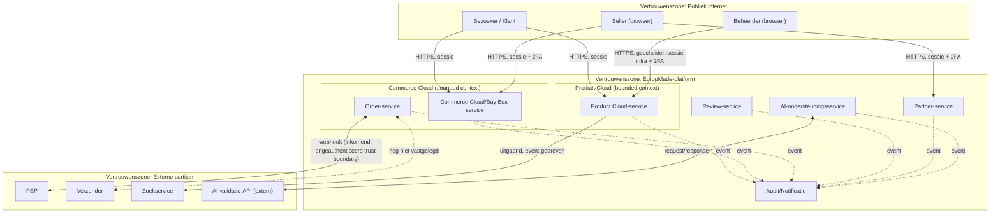

# EuropMade — Security Architecture

**Status:** Concept v0.1 — zesde technische document van Sprint 2
**Uitgangspunt:** uitsluitend de goedgekeurde documenten `01-domain-model.md`, `02-database-model.md`, `03-api-model.md`, `04-event-model.md` en `05-service-architecture.md`. Geen enkel nieuw domeinbegrip, geen enkele nieuwe tabel, resource, event of service die daar niet al in staat.
**Scope:** de **security-architectuur** — principes, dreigingsmodel, vertrouwensgrenzen. **Geen code, geen implementatie, geen concrete technologiekeuze** (geen specifiek IAM-platform, geen specifieke encryptiestandaard, geen specifiek SIEM/monitoring-product).
**Nadrukkelijk:** meerdere onderwerpen die dit document moet behandelen hebben **geen grondslag** in de vijf bronnen. Met name **Encryptie** en **Privacy & AVG** zijn expliciet gecontroleerd: de termen "encryptie," "versleuteld," "AVG" en "GDPR" komen in **geen van de vijf bronnen** voor. Dit document verzint daarom geen beleid op deze punten — het markeert ze als Open, met een vereist ADR, consistent met hoe `05-service-architecture.md` dit al deed voor bijvoorbeeld Secrets Management.

---

## Leeswijzer

Dit document bouwt een security-laag boven de al vastgelegde service-architectuur (`05-service-architecture.md`), het API-model (`03-api-model.md`) en het eventmodel (`04-event-model.md`). Elke sectie citeert expliciet welk deel van welke bron haar onderbouwt. Waar een gevraagd onderwerp geen enkele grondslag heeft, staat dat expliciet vermeld met **Status: Open** en **Vereist ADR: Ja** — direct in de sectie zelf, niet pas achteraf toegevoegd, consistent met de laatste correctie op `05-service-architecture.md`.

---

# 1. Security-principes

Rechtstreeks samengevat uit de vijf bronnen — geen enkel principe hieronder is hier voor het eerst geïntroduceerd:

| Principe | Bron |
|---|---|
| **Server-side autoriteit** — elke prijs-, voorraad- en Buy Box-berekening, elke autorisatiebeslissing, wordt uitsluitend server-side afgedwongen, nooit uitsluitend een UI-restrictie | `03-api-model.md` secties 1 en 6 |
| **Nooit stilzwijgend** — elke ingrijpende statuswijziging wordt gelogd met een reden | `01-domain-model.md` domeinobject 23 (Audit Log), `04-event-model.md` sectie 13 |
| **AI ondersteunt, beslist nooit** | `01-domain-model.md` domeinobject 22, `03-api-model.md` sectie 1 |
| **Least privilege per resource** — autorisatie per resource en per actie, gekoppeld aan het generieke Admin Shell-modulecontract | `03-api-model.md` sectie 1/6 |
| **Eén eigenaar per gegeven** — geen enkele service muteert een tabel die een andere service bezit | `05-service-architecture.md` sectie 4/8 |
| **Privacy-by-design** (als term genoemd, niet verder ingevuld — zie sectie 10) | `03-api-model.md` sectie 8 |

---

# 2. Authenticatie

**Definitief** — volledig overgenomen uit `03-api-model.md` sectie 5:

- Server-side sessiebeheer; nooit een uitsluitend client-side aanname over ingelogd-zijn.
- Verplichte 2FA voor elke Seller-rol en voor Beheerder (`02-database-model.md` Deel A.1: `customer.two_factor_enabled`, "verplicht `true` zodra een `seller`-rol actief is").
- Technisch gescheiden infrastructuur voor de Beheerder-rol.
- Gastentoegang toegestaan voor publieke, leesbare resources en orderplaatsing — niet voor Seller-/Beheerder-resources.
- Wachtwoorden worden "nooit leesbaar opgeslagen" (`02-database-model.md` Deel A.1, `password_hash`) — dit impliceert een hash-mechanisme, zonder dat een specifiek algoritme is vastgelegd.

---

# 3. Autorisatie

**Definitief** — volledig overgenomen uit `03-api-model.md` sectie 6:

- Rolgebaseerd (Bezoeker/Klant, Retailer/Producent-Merkhouder/Distributeur, Beheerder).
- Resource-eigenaarschap als aanvullende laag — een Seller mag uitsluitend eigen resources bewerken.
- Het generieke Admin Shell-modulecontract (`permissie`-veld) is het model voor Beheerder-zijdige autorisatie.
- Gevoelige-gegevenstoegang wordt afzonderlijk gelogd, los van de autorisatiebeslissing zelf.

---

# 4. Identity Management

**Voorlopig.** Het domeinniveau is volledig gegrond: Customer is de enige identiteitstabel, gedeeld door alle services, "te fundamenteel-gedeeld om ooit los te trekken" (`02-database-model.md` sectie 5, `03-api-model.md` sectie 2/3.8). Wat **niet** is vastgelegd: hoe identiteit operationeel wordt beheerd (sessie-uitgifte, token-levensduur, eventuele federatie met een externe identity provider). `05-service-architecture.md` Geconstateerde inconsistenties #4 (bij Partner-service) noemde al dat Customer geen aangewezen eigenaar-service heeft — dat gat werkt hier door: er is geen service die formeel verantwoordelijk is voor identity-management-operaties.

Status: Voorlopig
Vereist ADR: Ja — voor het operationele identity-managementbeleid (sessie-uitgifte, tokenlevensduur, eventuele federatie)

---

# 5. Secrets Management

**Reeds als Open vastgesteld in `05-service-architecture.md` sectie 16** — hier bevestigd, niet opnieuw ter discussie gesteld: geen enkele regel over technische secrets (API-sleutels naar PSP/AI-validatie-API/externe zoekservice) is vastgelegd. De enige parallel is de verhoogde toegangsbeperking en verplichte auditlogging voor `company.iban` en partnerdocumenten (`02-database-model.md` Deel A.2).

Status: Open
Vereist ADR: Ja

---

# 6. Encryptie (at rest / in transit)

**Open — expliciet gecontroleerd, geen enkele grondslag.** De termen "encryptie" en "versleuteld" komen in geen van de vijf bronnen voor. De enige aanpalende regel is dat `password_hash` "nooit leesbaar opgeslagen" wordt (`02-database-model.md` Deel A.1) — dit impliceert hashing van wachtwoorden specifiek, geen platformbreed encryptiebeleid voor overige gevoelige data (IBAN, identiteitsdocumenten, partnerbedrijfsgegevens) of voor data-in-transit.

Status: Open
Vereist ADR: Ja

---

# 7. API Security

**Voorlopig** — een samenvoeging van al elders vastgelegde onderdelen, hier voor het eerst onder één "security"-noemer samengebracht:

- Authenticatie en autorisatie (secties 2/3 hierboven) zijn Definitief.
- Foutafhandeling die geen gevoelige informatie prijsgeeft is Definitief (`03-api-model.md` sectie 8).
- Rate limiting is zelf al Voorlopig in de bron (`03-api-model.md` sectie 9/Bijlage E: "het principe is gegrond... concrete limieten zijn niet vastgelegd").
- Idempotency ter voorkoming van dubbele, mogelijk kwaadaardig herhaalde operaties is Voorlopig (`03-api-model.md` sectie 10, `04-event-model.md` sectie 9).

Status: Voorlopig
Vereist ADR: Nee voor het reeds gegronde deel (authenticatie/autorisatie/foutafhandeling); **Ja** voor de nog niet vastgelegde exacte rate-limiting-drempels

---

# 8. Event Security

**Open.** `04-event-model.md` behandelt eventbetrouwbaarheid, idempotency, volgorde en dead-letter-afhandeling uitgebreid, maar **nergens de beveiliging van het eventkanaal zelf** — geen regel over authenticatie van een event-producer, autorisatie van een event-consumer, of bescherming van eventinhoud (bijv. wanneer een event gevoelige data bevat, zoals een `ProductOriginRevoked` dat een Seller-naam raakt). Dit is een reëel gat: events dragen dezelfde soort gevoelige informatie als de API-laag (sectie 7), maar hebben geen equivalent van de daar wel vastgelegde autorisatieregels.

Status: Open
Vereist ADR: Ja

---

# 9. Audit Logging

**Definitief — het sterkst gegronde onderdeel van dit hele document**, letterlijk zo genoemd in `04-event-model.md` sectie 13: elk event heeft een corresponderende `audit_log`-schrijving (`02-database-model.md` Deel F.2), vastgelegd in dezelfde transactie als de onderliggende statuswijziging, vóórdat het event zelf verstuurd wordt. Ook een "Geen actie"-uitkomst wordt gelogd. `audit_log` is append-only — nooit gewijzigd of verwijderd.

---

# 10. Privacy & AVG

**Open — expliciet gecontroleerd, geen enkele grondslag.** De termen "AVG" en "GDPR" komen in geen van de vijf bronnen voor. Wat wél is vastgelegd, is een aangrenzend, smaller principe: `03-api-model.md` sectie 8 noemt "de al bevroren privacy-by-design-principes" bij foutafhandeling (een geweigerde actie onthult nooit onnodig gevoelige informatie) — maar dit is een verwijzing náár een principe, geen zelfstandige uitwerking ervan binnen deze vijf bronnen. Een volledig privacy-/AVG-beleid (rechtmatige grondslag per gegevensverwerking, bewaartermijnen, recht op inzage/vergetelheid) ontbreekt volledig.

**Aanvulling (v0.2) — verzwaard door de Affiliate-scopewijziging:** de nieuwe `click`-tabel (Datamodel §29, `02-database-model.md` Deel G.4) is zelf een cookietrackingmechanisme en vereist daarmee een expliciet, technisch consent-mechanisme vóórdat het gebouwd kan worden — het nieuwe `consent_record`-domeinobject (Datamodel §35) legt de functionele voorwaarde al vast ("geen `click` zonder geldige toestemming"), maar het technische ADR voor AVG/GDPR moet dit nu ook expliciet als vereiste meenemen, niet uitsluitend als algemeen privacybeginsel. Dit maakt dit Open-punt urgenter, niet nieuw.

Status: Open
Vereist ADR: Ja — **urgentie verhoogd (v0.2):** dit ADR blokkeert nu ook de Affiliate-service (geen `click` mogelijk zonder een besloten consent-mechanisme)

---

# 11. Data-classificatie

**Voorlopig.** `03-api-model.md` Bijlage C ("Publiek / Seller / Intern per resource") is feitelijk al een data-classificatieschema — elke resource is daar ingedeeld naar wie haar mag lezen/schrijven. Dit is een sterke, herbruikbare grondslag. Wat ontbreekt: een formele classificatie naar gevoeligheidsniveau los van toegangsrol (bijv. "zeer gevoelig" voor IBAN/identiteitsdocumenten versus "gevoelig" voor een e-mailadres) — de huidige indeling classificeert naar *wie* toegang heeft, niet naar *hoe gevoelig* het gegeven zelf is.

Status: Voorlopig
Vereist ADR: Ja — voor een gevoeligheidsniveau-classificatie los van de al bestaande rolgebaseerde indeling

---

# 12. Key Management

**Open.** Geen enkele regel over cryptografisch sleutelbeheer in de vijf bronnen — noch voor sessiesleutels, noch voor eventuele versleutelingssleutels (die zelf ook nog niet vastgelegd zijn, zie sectie 6).

Status: Open
Vereist ADR: Ja

---

# 13. Security Monitoring

**Open.** `05-service-architecture.md` sectie 18 (Monitoring) is al generiek Open/Vereist ADR: Ja — dit document past dat toe op het security-specifieke deel daarvan (bijv. detectie van herhaalde mislukte inlogpogingen, ongebruikelijke toegangspatronen tot gevoelige resources). Geen enkele regel hierover bestaat.

Status: Open
Vereist ADR: Ja

---

# 14. Incident Response

**Open.** Geen enkele regel. De enige aanpalende, functionele parallel is de al bevroren uitzonderingsafhandeling voor een mislukte ordersplitsing (`04-event-model.md` secties 8/11: nooit stilzwijgend verlies, altijd een zichtbaar, door een Beheerder te behandelen signaal) — maar dat is businessproces-uitzonderingsafhandeling, geen security-incidentrespons (bijv. bij een datalek of ongeautoriseerde toegang).

Status: Open
Vereist ADR: Ja

---

# 15. Compliance

**Open.** Geen enkele regel over een compliance-raamwerk (bijv. ISO 27001, SOC 2, of enige formele certificeringsdoelstelling) in de vijf bronnen.

Status: Open
Vereist ADR: Ja

---

# 16. Security Threat Model

**Open, met een eerste aanzet in Bijlage C hieronder.** Geen van de vijf bronnen bevat een formeel dreigingsmodel. Bijlage C (Trust Boundaries) van dit document is een eerste, uit de vastgelegde service-/eventarchitectuur afgeleide aanzet — geen vastgesteld, compleet threat model (bijv. geen STRIDE- of vergelijkbare systematische analyse).

Status: Open
Vereist ADR: Ja

---

# A. Security-overzicht

| # | Onderwerp | Status |
|---|---|---|
| 1 | Security-principes | Definitief |
| 2 | Authenticatie | Definitief |
| 3 | Autorisatie | Definitief |
| 4 | Identity Management | Voorlopig |
| 5 | Secrets Management | Open |
| 6 | Encryptie (at rest / in transit) | Open |
| 7 | API Security | Voorlopig |
| 8 | Event Security | Open |
| 9 | Audit Logging | Definitief |
| 10 | Privacy & AVG | Open |
| 11 | Data-classificatie | Voorlopig |
| 12 | Key Management | Open |
| 13 | Security Monitoring | Open |
| 14 | Incident Response | Open |
| 15 | Compliance | Open |
| 16 | Security Threat Model | Open |

---

# B. Security-matrix

Per service (`05-service-architecture.md` sectie 1), welke security-onderwerpen direct relevant zijn en met welke status:

| Service | Authenticatie | Autorisatie | Audit | Gevoelige data | Encryptie/Secrets |
|---|---|---|---|---|---|
| Product Cloud-service | Definitief | Definitief | Definitief | Nee | Open |
| Commerce Cloud/Buy Box-service | Definitief | Definitief | Definitief | Nee | Open |
| Order-service | Definitief | Definitief | Definitief | Adresgegevens | Open |
| Review-service | Definitief | Definitief | Definitief | Nee | Open |
| Partner-service | Definitief | Definitief | Definitief | **Ja — IBAN, KvK, identiteits-/autorisatiedocumenten** (`02-database-model.md` Deel A.2/A.5) | Open |
| AI-ondersteuningsservice | Definitief | Definitief | Definitief | Nee | Open (externe API-sleutel) |
| Platformbrede gedeelde services (Audit/Notificatie) | Definitief | Definitief | N.v.t. (is zelf de audit-laag) | Nee | Open |
| **Affiliate-service** *(nieuw, v0.2)* | Definitief (principe) | Definitief (principe) | Definitief | **Ja — trackingdata vereist cookie-consent** (ADR-53, `gdpr-compliance/spec.md`) | Open |
| **Finance-service** *(nieuw, v0.2)* | Definitief (principe) | Definitief (principe) | Definitief | **Ja — commissie-/uitbetalingsgegevens** | Open |

**Observatie:** de Partner-service draagt verreweg de meeste gevoelige data (IBAN, KvK, identiteitsdocumenten), maar heeft — consistent met `05-service-architecture.md` sectie 16 en dit document se secties 5/6/12 — dezelfde "Open, Vereist ADR"-status voor encryptie/secrets als elke andere service. Dit is een reëel risico-aandachtspunt, zie Geconstateerde inconsistenties. **Aanvulling (v0.2):** de nieuwe Affiliate-service draagt zelf ook gevoelige, AVG-relevante trackingdata — dezelfde observatie geldt nu voor twee services, niet meer voor uitsluitend Partner-service.

---

# C. Trust Boundaries

**Toelichting bij de vertrouwensgrenzen:**
- **Publiek internet ↔ platform:** de enige grens waar authenticatie/2FA al volledig is vastgelegd (secties 2/3).
- **Platform ↔ externe partijen (PSP, verzender, zoekservice, AI-validatie-API):** deze grens is functioneel beschreven (`03-api-model.md` sectie 17, `04-event-model.md` sectie 3/14) maar **niet beveiligingstechnisch** — geen enkele regel legt vast hoe een inkomend PSP-webhook wordt geauthenticeerd, of hoe voorkomen wordt dat een kwaadwillende partij een vervalst `PaymentConfirmed`-event aanbiedt. Dit is het meest kritieke, onbeantwoorde punt in dit hele document — zie Geconstateerde inconsistenties #1.
- **Tussen services onderling (binnen het platform):** geen aparte trust boundary vastgelegd — `05-service-architecture.md` sectie 4 stelt dat services elkaars tabellen nooit direct muteren, maar zegt niets over onderlinge authenticatie van service-tot-service-verkeer (events, alleen-lezen aanroepen).

---

# D. Geconstateerde inconsistenties

Conform de opdracht: de vijf bronnen zijn niet aangepast. Onderstaand elke plek waar het ontwerpen van deze security-architectuur een spanning, gat of onbeantwoorde vraag blootlegde.

1. **De meest kritieke bevinding: inkomende externe webhooks (PSP, verzender) hebben geen enkele vastgelegde authenticatie-/verificatie-eis.** `04-event-model.md` sectie 3 modelleert `PaymentConfirmed` als integratie-event dat rechtstreeks een `OrderPlaced`/`OrderSplit` triggert, maar geen van de vijf bronnen legt vast hoe wordt geverifieerd dat dit event daadwerkelijk van de PSP komt en niet vervalst is. Gegeven dat dit event direct tot een geplaatste order leidt, is dit het punt met het grootste potentiële misbruikrisico in de hele architectuur. **Aanbeveling:** dit verdient het eerste, meest urgente ADR van alle in dit document geïdentificeerde Open-onderwerpen.

2. **Event Security (sectie 8) ontbreekt volledig, terwijl events regelmatig dezelfde gevoelige data dragen als de API-laag.** De API-laag heeft een uitgewerkt autorisatiemodel (`03-api-model.md` sectie 6); events die vergelijkbare of dezelfde data dragen (bijv. `ProductOriginRevoked`, dat een Seller raakt) hebben geen equivalent. **Aanbeveling:** bevestig of het API-autorisatiemodel (rolgebaseerd + resource-eigenaarschap) ook op events van toepassing verklaard moet worden, of dat events een eigen regime nodig hebben.

3. **Partner-service draagt de meeste gevoelige data van alle services (sectie B), maar krijgt geen striktere Encryptie-/Secrets-behandeling dan de overige services.** Dit is geen fout van de vijf bronnen (geen van hen differentieert dit), maar wel een reëel, in dit document zichtbaar geworden risico. **Aanbeveling:** overweeg of het aankomende Encryptie-ADR (sectie 6) een striktere eis voor de Partner-service-data specifiek moet bevatten.

4. **Service-tot-service-authenticatie (binnen het platform, tussen de negen services — zeven oorspronkelijk plus Affiliate-/Finance-service, v0.2) is nergens vastgelegd.** `05-service-architecture.md` sectie 4 (Service-grenzen) legt vast dát services elkaars data nooit direct muteren, maar niet hóe een service bewijst dat zij daadwerkelijk de aangewezen producer/consument van een event is. **Aanbeveling:** een apart ADR voor interne service-tot-service-authenticatie, los van het externe-partijen-ADR (#1).

---

# E. Security-besluitstatus

| Onderwerp | Status | Bron | Vereist ADR |
|---|---|---|---|
| Security-principes | Definitief | Bestaande documentatie (`03-api-model.md`, `01-domain-model.md`) | Nee |
| Authenticatie | Definitief | Bestaande documentatie (`03-api-model.md` sectie 5, `02-database-model.md` Deel A.1) | Nee |
| Autorisatie | Definitief | Bestaande documentatie (`03-api-model.md` sectie 6) | Nee |
| Identity Management | Voorlopig | Bestaande documentatie + Nieuw ontwerp Sprint 2 | **Ja** |
| Secrets Management | Open | Nieuw ontwerp Sprint 2 (reeds Open in `05-service-architecture.md` §16) | **Ja** |
| Encryptie (at rest / in transit) | Open | Geen — expliciet gecontroleerd, geen grondslag | **Ja** |
| API Security | Voorlopig | Bestaande documentatie (`03-api-model.md` secties 5/6/8/9/10) | **Ja** (uitsluitend voor het rate-limiting-deel) |
| Event Security | Open | Geen | **Ja** |
| Audit Logging | Definitief | Bestaande documentatie (`04-event-model.md` sectie 13, `02-database-model.md` Deel F.2) | Nee |
| Privacy & AVG | Open | Geen — expliciet gecontroleerd, geen grondslag | **Ja** |
| Data-classificatie | Voorlopig | Bestaande documentatie (`03-api-model.md` Bijlage C) | **Ja** |
| Key Management | Open | Geen | **Ja** |
| Security Monitoring | Open | Geen (`05-service-architecture.md` §18 generiek Open) | **Ja** |
| Incident Response | Open | Geen | **Ja** |
| Compliance | Open | Geen | **Ja** |
| Security Threat Model | Open | Geen (eerste aanzet in Bijlage C) | **Ja** |

**Samenvatting:** 4 van de 16 onderwerpen zijn **Definitief**, 3 zijn **Voorlopig**, 9 zijn **Open**. Alle 9 Open-onderwerpen én het rate-limiting-deel van API Security en het Identity Management- en Data-classificatie-onderdeel vereisen een ADR — in totaal **12 van de 16 onderwerpen** hebben op zijn minst een deel dat nog niet als vaststaande architectuur mag gelden. De meest urgente daarvan, gegeven het directe financiële risico, is de authenticatie van inkomende PSP-webhooks (Geconstateerde inconsistenties #1).
