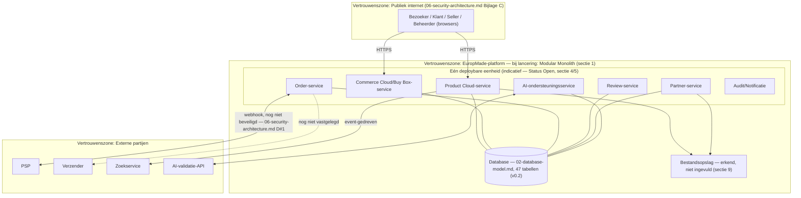

# EuropMade — Deployment Architecture

**Status:** Concept v0.1 — zevende technische document van Sprint 2. **Aantekening (v0.2, na de Affiliate-scopewijziging):** het aantal services binnen de Modular Monolith is gegroeid van zeven naar negen (Affiliate-service, Finance-service toegevoegd, zie `05-service-architecture.md` v0.2). Dit wijzigt geen enkel deploymentprincipe in dit document — de Modular Monolith-aanpak (sectie 1) blijft ongewijzigd van toepassing, ongeacht het exacte aantal interne modules.
**Uitgangspunt:** uitsluitend de goedgekeurde documenten `01-domain-model.md`, `02-database-model.md`, `03-api-model.md`, `04-event-model.md`, `05-service-architecture.md` en `06-security-architecture.md`. Geen enkel nieuw domeinbegrip, geen enkele nieuwe tabel, resource, event, service of security-regel die daar niet al in staat.
**Scope:** de **deployment-architectuur** — hoe de al vastgelegde services operationeel worden uitgerold en draaiend gehouden. **Geen code, geen implementatie, geen concrete technologiekeuze** (geen specifiek cloudplatform, geen specifiek orchestratieplatform, geen specifieke CI/CD-tool).
**Nadrukkelijk, vooraf:** dit is het meest infrastructuur-zware document van Sprint 2 tot nu toe, en de zes bronnen gaan over domein, data, API's, events, services en security — **niet over deployment**. Een expliciete controle op deployment-gerelateerde termen ("omgeving," "CI/CD," "container," "load balancing," "backup," "disaster recovery," e.a.) in de zes bronnen leverde vrijwel uitsluitend valse treffers op (bijv. "rollback" in de zin van een productversie terugzetten, niet een deployment-rollback). Waar dat zo is, markeert dit document het onderwerp expliciet als **Status: Open, Vereist ADR: Ja** — in plaats van een keuze te verzinnen.

---

## Leeswijzer

Twee citaten uit `02-database-model.md` vormen de enige, echte deployment-relevante grondslag die in de zes bronnen bestaat: (1) sectie 5 noemt expliciet "Modular Monolith als MVP" (zelf een citaat van TB-01, hier hergebruikt omdat `02-database-model.md` het al importeerde), en (2) Deel B.15 noemt dat bestandsopslag "buiten dit datamodel" valt, zonder verdere invulling. Dit document bouwt uitsluitend op wat de zes bronnen zelf al zeggen — het gaat niet zelfstandig terug naar TB-01 of andere, niet-opgegeven documenten, ook waar dat verleidelijk zou zijn.

---

# 1. Deployment-principes

**Voorlopig.** Het enige echt gegronde principe: **Modular Monolith als vertrekpunt** (`02-database-model.md` sectie 5: "elke module heeft al een scherp begrensd datamodel, wat een latere uitsplitsing niet blokkeert"). Dit heeft een directe deployment-consequentie: bij lancering is er één deploybare eenheid, geen negen losse, onafhankelijk uit te rollen services (zeven oorspronkelijk, plus Affiliate-/Finance-service, v0.2) — ook al zijn deze negen services (`05-service-architecture.md` sectie 1) logisch/architecturaal wél gescheiden. Elke latere overgang naar onafhankelijk deploybare services is een operationele wijziging, geen architecturale (zelfde redenering als `02-database-model.md` sectie 5 zelf hanteert voor de datalaag).

Status: Voorlopig
Vereist ADR: Ja — voor het exacte moment/de exacte criteria waarop van monolitische naar losse deployment wordt overgegaan

---

# 2. Omgevingen (DEV / TEST / ACCEPT / PROD)

**Open — expliciet gecontroleerd, geen enkele grondslag.** Geen van de zes bronnen benoemt een omgevingsmodel. De term "omgeving" komt uitsluitend voor in de betekenis "Beheerder-omgeving" (een UI-/rolcontext, `03-api-model.md` sectie 1), niet als deployment-omgeving.

Status: Open
Vereist ADR: Ja

---

# 3. CI/CD

**Open.** Geen enkele regel in de zes bronnen.

Status: Open
Vereist ADR: Ja

---

# 4. Containers

**Open.** Geen enkele regel in de zes bronnen. Het Modular Monolith-principe (sectie 1) impliceert wel dat er bij lancering waarschijnlijk sprake is van één of een klein aantal containers (in plaats van zeven separate), maar dit is een gevolgtrekking van dit document, geen vastgelegde eis.

Status: Open
Vereist ADR: Ja

---

# 5. Orchestratie

**Open.** Geen enkele regel. Het Modular Monolith-principe (sectie 1) pleit er architecturaal voor dat volwaardige container-orchestratie (bijv. voor onderlinge service-discovery tussen tientallen instances) bij lancering minder urgent is dan bij een van-begin-af-aan-microservices-architectuur — maar dit is wederom een gevolgtrekking, geen vastgelegde eis. `05-service-architecture.md` sectie 14 (Service Discovery) is zelf al Open/Vereist ADR.

Status: Open
Vereist ADR: Ja

---

# 6. Netwerkarchitectuur

**Voorlopig.** De enige grondslag: `06-security-architecture.md` Bijlage C (Trust Boundaries) definieert drie vertrouwenszones — Publiek internet, EuropMade-platform, Externe partijen — met de bijbehorende grenzen (HTTPS+sessie, HTTPS+sessie+2FA voor Seller/Beheerder, ongeauthenticeerde/niet-gespecificeerde webhook-grens naar PSP/verzender). Dit is een conceptueel netwerkmodel, geen concrete netwerkarchitectuur (geen VPC/subnet-indeling, geen firewall-regels).

Status: Voorlopig
Vereist ADR: Ja — voor de concrete technische invulling van de drie al conceptueel benoemde vertrouwenszones

---

# 7. Load balancing

**Open.** Geen enkele regel in de zes bronnen.

Status: Open
Vereist ADR: Ja

---

# 8. Auto Scaling

**Open.** Rechtstreeks parallel aan `05-service-architecture.md` sectie 9 (Schaalbaarheid), die zelf al Open/Vereist ADR is, met als enige concrete aanwijzing dat de Product Cloud-service en de Commerce Cloud/Buy Box-service de grootste belasting zullen dragen (hetzelfde al bevroren schaal-toetsingscriterium, 10 miljoen producten). Geen enkele concrete auto-scaling-regel.

Status: Open
Vereist ADR: Ja

---

# 9. Storage

**Voorlopig.** `02-database-model.md` Deel B.15 erkent expliciet dat bestandsopslag (voor `media`/`document`, via `storage_reference`) bestaat als concept, maar "buiten dit datamodel" valt — de bronnen bevestigen dus de *noodzaak* van storage, zonder de *architectuur* ervan in te vullen (geen leverancier, geen toegangsmodel, geen scheiding publiek/afgeschermd). `06-security-architecture.md` sectie 6 (Encryptie) is zelf al Open voor data-at-rest, wat mede op deze storage van toepassing zou zijn.

Status: Voorlopig
Vereist ADR: Ja — voor de concrete storage-architectuur (leverancier, toegangsmodel, scheiding publiek/afgeschermd)

---

# 10. Back-ups

**Open.** Geen enkele regel in de zes bronnen.

Status: Open
Vereist ADR: Ja

---

# 11. Disaster Recovery

**Open.** Geen enkele regel. Eén indirecte aanwijzing, parallel aan `04-event-model.md` sectie 8 (Eventbetrouwbaarheid): omdat een betaling nooit stilzwijgend verloren mag gaan, zou een disaster-recovery-plan voor de Order-service een hogere prioriteit moeten hebben dan voor bijvoorbeeld de AI-ondersteuningsservice — maar dit is een gevolgtrekking van dit document, geen vastgelegde eis.

Status: Open
Vereist ADR: Ja

---

# 12. Observability

**Open.** Rechtstreeks parallel aan `05-service-architecture.md` secties 18 (Monitoring), 19 (Tracing) en 20 (Health checks) en `06-security-architecture.md` sectie 13 (Security Monitoring) — stuk voor stuk zelf al Open/Vereist ADR. Dit document voegt geen nieuwe grondslag toe, het bevestigt uitsluitend dat de eerder al geconstateerde gaten ook op deployment-niveau doorwerken.

Status: Open
Vereist ADR: Ja

---

# 13. Release-strategie

**Open.** Geen enkele regel in de zes bronnen.

Status: Open
Vereist ADR: Ja

---

# 14. Rollback-strategie

**Open — met een expliciete begripsverwarring die vermeden moet worden.** De zes bronnen bevatten uitgebreide, wél degelijk bevroren regels over een **business-rollback** (`01-domain-model.md` §7, `02-database-model.md` Deel B.14: het terugzetten van een Product naar een eerdere `ProductVersion`, met automatische intrekking van de Verified-status bij een andere versie dan de geverifieerde). Dit is een functioneel, domeingericht mechanisme — **geen deployment-rollback** (het terugdraaien van een mislukte software-release). Geen van de zes bronnen zegt iets over dat laatste. Dit document waarschuwt hier expliciet voor: de twee begrippen mogen niet worden verward, en de aanwezigheid van een goed-gegronde business-rollback-regel is geen grondslag voor een deployment-rollback-strategie.

Status: Open
Vereist ADR: Ja

---

# 15. Platform-afhankelijkheden

**Voorlopig.** De externe **service**-afhankelijkheden zijn goed gegrond: PSP, verzender, externe zoekservice, AI-validatie-API (`03-api-model.md` sectie 17, `04-event-model.md` sectie 3/14). De **infrastructuurplatform**-afhankelijkheid (cloudprovider, hostingpartij) is daarentegen in geen van de zes bronnen benoemd — dit is een ander soort "platform" dan hierboven, en dit document houdt dat onderscheid bewust apart in plaats van de twee te vermengen.

Status: Voorlopig
Vereist ADR: Ja — uitsluitend voor de infrastructuurplatform-keuze; de externe service-afhankelijkheden zelf zijn al voldoende gegrond

---

# 16. Operationele verantwoordelijkheden

**Voorlopig.** `05-service-architecture.md` sectie 8 (Data-eigenaarschap) legt vast dat elke tabel precies één eigenaar-service heeft — dit impliceert een parallelle, operationele verantwoordelijkheidsverdeling (wie is verantwoordelijk voor het draaiend houden van welke service), maar geen van de zes bronnen legt een expliciet operationeel verantwoordelijkheidsmodel vast (bijv. wie reageert op een storing, wie beheert een specifieke omgeving).

Status: Voorlopig
Vereist ADR: Ja — voor het expliciete operationele verantwoordelijkheidsmodel, los van het al vastgelegde data-eigenaarschap

---

# A. Deployment-overzicht

| # | Onderwerp | Status |
|---|---|---|
| 1 | Deployment-principes | Voorlopig |
| 2 | Omgevingen (DEV/TEST/ACCEPT/PROD) | Open |
| 3 | CI/CD | Open |
| 4 | Containers | Open |
| 5 | Orchestratie | Open |
| 6 | Netwerkarchitectuur | Voorlopig |
| 7 | Load balancing | Open |
| 8 | Auto Scaling | Open |
| 9 | Storage | Voorlopig |
| 10 | Back-ups | Open |
| 11 | Disaster Recovery | Open |
| 12 | Observability | Open |
| 13 | Release-strategie | Open |
| 14 | Rollback-strategie | Open |
| 15 | Platform-afhankelijkheden | Voorlopig |
| 16 | Operationele verantwoordelijkheden | Voorlopig |

**Geen enkel onderwerp is Definitief** — dit is het eerste Sprint 2-document waarvoor dat geldt, en is een directe, eerlijke consequentie van het feit dat geen van de zes bronnen over deployment gaat.

---

# B. Deployment-matrix

Per service (`05-service-architecture.md` sectie 1), welke deployment-eigenschap al enige grondslag heeft:

| Service | Verwachte belasting (sectie 8) | Onomkeerbaarheidseis (sectie 11) | Netwerkzone (sectie 6) |
|---|---|---|---|
| Product Cloud-service | Hoog (10 miljoen producten-criterium) | Laag | Platform |
| Commerce Cloud/Buy Box-service | Hoog (idem) | Middel (Buy Box-cache, eventual consistent) | Platform |
| Order-service | Niet gespecificeerd | **Hoog — nooit stilzwijgend verlies** | Platform ↔ Externe partijen (PSP) |
| Review-service | Niet gespecificeerd | Laag | Platform |
| Partner-service | Niet gespecificeerd | Laag (functioneel), maar draagt de meest gevoelige data (`06-security-architecture.md` Bijlage B) | Platform |
| AI-ondersteuningsservice | Niet gespecificeerd | Geen (nooit blokkerend) | Platform ↔ Externe partijen (AI-validatie-API) |
| Platformbrede gedeelde services | Niet gespecificeerd | Hoog (audit is append-only, nooit verlies) | Platform |

**Observatie:** geen van deze kolommen is een vastgestelde deployment-eis — het zijn indirecte aanwijzingen, afgeleid uit al bevroren functionele/service-regels, die bij een toekomstig deployment-ADR als input kunnen dienen.

---

# C. Deploymentdiagram

*Dit diagram toont uitsluitend wat al elders is vastgelegd (services, database, trust boundaries) plus expliciet gemarkeerde, nog niet ingevulde deployment-elementen — het bevat geen enkele nieuwe, verzonnen infrastructuurkeuze.*

---

# D. Geconstateerde inconsistenties

Conform de opdracht: de zes bronnen zijn niet aangepast. Onderstaand elke plek waar het ontwerpen van deze deployment-architectuur een spanning, gat of onbeantwoorde vraag blootlegde.

1. **Het Modular Monolith-principe (sectie 1) staat in spanning met de al negen, scherp gescheiden services (`03-api-model.md`/`05-service-architecture.md`, v0.2).** Geen van de zes bronnen legt uit hoe "één deploybare eenheid bij lancering" zich verhoudt tot "negen services met elk hun eigen data-eigenaarschap en event-gedreven communicatie" op deployment-niveau — worden zij als losse processen binnen één deployment gedraaid, of als daadwerkelijk één ongedifferentieerd proces? **Aanbeveling:** het eerste deployment-ADR (sectie 1) zou dit expliciet moeten verduidelijken, omdat het de meeste andere deployment-keuzes (containers, orchestratie, auto scaling) beïnvloedt.

2. **Rollback-strategie (sectie 14) loopt risico op begripsverwarring met de al goed-gegronde business-rollback.** Dit document heeft dit expliciet uit elkaar getrokken, maar geen van de zes bronnen maakt dit onderscheid zelf — een toekomstige lezer die "rollback" zoekt in de bronnen, vindt uitsluitend de businessregel, wat ten onrechte de indruk zou kunnen wekken dat deployment-rollback ook is afgedekt. **Aanbeveling:** overweeg in een toekomstig document expliciet te vermelden dat dit twee losse begrippen zijn.

3. **De Order-service heeft de sterkste, meest concrete onomkeerbaarheidseis van alle services (Bijlage B), maar geen enkele bron vertaalt dit naar een verhoogde deployment-prioriteit (bijv. voor Disaster Recovery of Beschikbaarheid).** Dit document leidt dat af (secties 11/12), maar het is een gevolgtrekking, geen vastgelegde eis. **Aanbeveling:** een toekomstig Disaster Recovery-ADR zou expliciet met deze afgeleide prioriteitsstelling moeten beginnen, in plaats van alle services gelijk te behandelen.

4. **Storage (sectie 9) en Encryptie (`06-security-architecture.md` sectie 6, ook Open) overlappen inhoudelijk maar zijn nooit als samenhangend geheel benoemd.** Bestandsopslag bevat potentieel gevoelige documenten (identiteitsbewijzen, partnerdocumenten, `02-database-model.md` Deel B.15/A.2) — een toekomstig Storage-ADR en het al aangekondigde Encryptie-ADR zouden daarom mogelijk gecombineerd moeten worden in plaats van los behandeld.

---

# E. Deployment-besluitstatus

| Onderwerp | Status | Bron | Vereist ADR |
|---|---|---|---|
| Deployment-principes | Voorlopig | Bestaande documentatie (`02-database-model.md` sectie 5) | **Ja** |
| Omgevingen (DEV/TEST/ACCEPT/PROD) | Open | Geen — expliciet gecontroleerd, geen grondslag | **Ja** |
| CI/CD | Open | Geen | **Ja** |
| Containers | Open | Geen | **Ja** |
| Orchestratie | Open | Geen | **Ja** |
| Netwerkarchitectuur | Voorlopig | Bestaande documentatie (`06-security-architecture.md` Bijlage C) | **Ja** |
| Load balancing | Open | Geen | **Ja** |
| Auto Scaling | Open | Geen (parallel aan `05-service-architecture.md` §9, zelf Open) | **Ja** |
| Storage | Voorlopig | Bestaande documentatie (`02-database-model.md` Deel B.15) | **Ja** |
| Back-ups | Open | Geen | **Ja** |
| Disaster Recovery | Open | Geen | **Ja** |
| Observability | Open | Geen (parallel aan `05-service-architecture.md` §18–20, `06-security-architecture.md` §13, alle zelf Open) | **Ja** |
| Release-strategie | Open | Geen | **Ja** |
| Rollback-strategie | Open | Geen (expliciet onderscheiden van de wél gegronde business-rollback) | **Ja** |
| Platform-afhankelijkheden | Voorlopig | Bestaande documentatie (`03-api-model.md` §17, `04-event-model.md` §3/14) | **Ja** (uitsluitend voor het infrastructuurplatform-deel) |
| Operationele verantwoordelijkheden | Voorlopig | Bestaande documentatie (`05-service-architecture.md` §8) | **Ja** |

**Samenvatting:** 0 van de 16 onderwerpen zijn **Definitief**, 5 zijn **Voorlopig**, 11 zijn **Open**. **Alle 16 onderwerpen vereisen een ADR** — dit is het eerste Sprint 2-document waarin geen enkel onderwerp als vaststaande architectuur mag gelden. Dit is een correcte, verwachte uitkomst: de zes bronnen leggen domein, data, API's, events, services en security vast, en bevatten daarmee — terecht — geen enkele deployment-beslissing.
