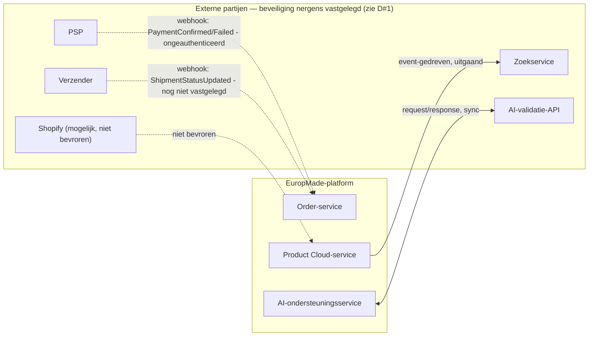

# EuropMade — Integration Architecture

**Status:** Concept v0.1 — achtste technische document van Sprint 2. **Aantekening (v0.2, na de Affiliate-scopewijziging):** expliciet gecontroleerd — de nieuwe Affiliate-/Finance-functionaliteit (`finance/spec.md`, `affiliate-platform/spec.md`) introduceert **geen nieuwe externe partij**. Affiliate-uitbetaling hergebruikt dezelfde, nog te kiezen PSP (ADR-01, ongewijzigd); cookie-consent is een intern domeinconcept (`ConsentRecord`), geen externe integratie. Dit document behoeft daarom geen inhoudelijke uitbreiding.
**Uitgangspunt:** uitsluitend de goedgekeurde documenten `01-domain-model.md`, `02-database-model.md`, `03-api-model.md`, `04-event-model.md`, `05-service-architecture.md`, `06-security-architecture.md` en `07-deployment-architecture.md`. Geen enkel nieuw domeinbegrip, geen enkele nieuwe tabel, resource, event, service, security- of deploymentregel die daar niet al in staat.
**Scope:** de **integratie-architectuur** — hoe EuropMade met externe partijen (PSP, verzenders, AI-validatie-API, externe zoekservice, eventueel Shopify) samenwerkt. **Geen code, geen implementatie, geen concrete technologiekeuze.**
**Nadrukkelijk, vooraf:** dit document bouwt sterker op bestaande grondslag dan Document 07 (Deployment) — externe integraties zijn namelijk al uitgebreid behandeld in `03-api-model.md` sectie 17 en `04-event-model.md` sectie 3/14. Vier onderwerpen hebben echter, expliciet gecontroleerd, **geen enkele grondslag**: Import/Export, Bestandsuitwisseling, Connectorarchitectuur (de term "connector" komt in geen van de zeven bronnen voor) en Time-outs.

---

## Leeswijzer

Dit document herhaalt geen enkele tabel, resource of event — het brengt de al verspreid vastgelegde integratie-gerelateerde onderdelen uit `03-api-model.md` (secties 15/17), `04-event-model.md` (sectie 3/14) en `06-security-architecture.md` (Geconstateerde inconsistenties #1, de PSP-webhook-authenticatiekwestie) samen tot één samenhangend geheel, en vult uitsluitend aan waar dat nog niet gebeurd was.

---

# 1. Integratieprincipes

**Definitief** — direct samengevat uit de zeven bronnen:

- **Elk extern event wordt bij binnenkomst vertaald naar een intern domeinevent**, nooit rechtstreeks doorgegeven in het externe formaat (`04-event-model.md` sectie 14) — dit houdt de interne eventcatalogus onafhankelijk van een externe partij se eigen schema-keuzes.
- **Events voor cross-service-gevolgen, nooit voor cross-service-berekeningen** (`04-event-model.md` sectie 1) geldt evenzeer voor externe integraties: een extern signaal (bijv. een betaalbevestiging) triggert een interne verwerking, het berekent nooit namens EuropMade.
- **Geen enkele mutatie van platformdata gebeurt rechtstreeks vanuit een externe partij** — een extern event triggert altijd een interne, eigen-service-uitgevoerde mutatie (`05-service-architecture.md` sectie 4, Service-grenzen, hier doorgetrokken naar externe integraties).

---

# 2. Synchrone integraties

**Voorlopig.** Twee vormen zijn al benoemd:

- **Request/response naar de AI-validatie-API** — expliciet zo gekwalificeerd: "naar zijn aard request/response... geen inkomend, spontaan integratie-event" (`04-event-model.md` sectie 3).
- **Gerichte, alleen-lezen aanroepen** tussen eigen services (`05-service-architecture.md` sectie 6) zijn zelf al als **architecturale afleiding** gemarkeerd, niet als een uit de bronnen zelf herleidbare regel — dat geldt hier onverkort door.

Status: Voorlopig
Vereist ADR: Ja — voor het exacte synchrone aanroeppatroon (timeouts, foutafhandeling bij een synchrone externe aanroep, zie ook sectie 11)

---

# 3. Asynchrone integraties

**Definitief** — het dominante patroon, volledig uitgewerkt in `04-event-model.md`: alle vier de integratie-events (`PaymentConfirmed`, `PaymentFailed`, `ShipmentStatusUpdated`, `SearchIndexingCompleted`, sectie 3 aldaar) zijn asynchrone, van buiten komende signalen die een interne verwerking triggeren. `03-api-model.md` sectie 16 bevestigt dit als het voorkeurspatroon voor gebeurtenissen die meerdere services raken.

---

# 4. Externe API's

**Definitief** — volledig overgenomen uit `03-api-model.md` sectie 17:

| Externe partij | Aard | Richting | Status (bron) |
|---|---|---|---|
| Shopify (of vergelijkbaar) | Mogelijke assortiment-/voorraadsynchronisatie | Inkomend | Niet bevroren — "architecturale plek gereserveerd, geen besluit dat dit daadwerkelijk gebouwd wordt" |
| PSP | Betaalverwerking | Uitgaand + inkomend (webhook) | Medusa-standaardmodule Payment; leverancier zelf nog niet gekozen |
| Verzenders | Fulfilment/verzendstatus | Uitgaand + inkomend (webhook) | Gekoppeld aan Shipment, zelf Status Open (`01-domain-model.md` §16) |
| AI-validatie-API | AI-ondersteuning | Uitgaand (aanroep) + inkomend (aanbeveling) | Al bevroren, AI beslist nooit |
| Externe zoekservice | Productindexering | Uitgaand (event-gedreven) | Al bevroren |

---

# 5. Webhooks

**Voorlopig.** `03-api-model.md` sectie 15 legt het principe vast (inkomend: PSP/verzenders melden statuswijzigingen; uitgaand: nog geen bevroren functionaliteit). `06-security-architecture.md` Geconstateerde inconsistenties #1 identificeert het kritieke gat: **geen enkele regel legt vast hoe een inkomend webhook wordt geauthenticeerd/geverifieerd** — dit is, letterlijk overgenomen, "het punt met het grootste potentiële misbruikrisico in de hele architectuur."

Status: Voorlopig
Vereist ADR: Ja — dit is het meest urgente ADR van dit hele document (zie Geconstateerde inconsistenties #1 hieronder, dat het reeds in `06-security-architecture.md` geïdentificeerde punt herbevestigt)

---

# 6. Import/Export

**Open — expliciet gecontroleerd, geen enkele grondslag.** De termen "import" en "export" komen in geen van de zeven bronnen voor. Het dichtstbijzijnde, verwante concept — Bulk-operaties (`03-api-model.md` sectie 14) — betreft interne, platform-eigen bulkacties (bijv. Product-publicatiestatuswijzigingen), geen import/export van of naar een externe partij.

Status: Open
Vereist ADR: Ja

---

# 7. Bestandsuitwisseling

**Open — expliciet gecontroleerd, geen enkele grondslag.** De term "bestandsuitwisseling" komt in geen van de zeven bronnen voor. `07-deployment-architecture.md` sectie 9 (Storage) erkent bestandsopslag als concept binnen het platform, maar zegt niets over het uitwisselen van bestanden met externe partijen.

Status: Open
Vereist ADR: Ja

---

# 8. Connectorarchitectuur

**Open — expliciet gecontroleerd, geen enkele grondslag.** De term "connector" komt in geen van de zeven bronnen voor. De enige aanpalende vermelding is Shopify als "architecturale plek gereserveerd" (`03-api-model.md` sectie 17) — dit bevestigt dat een toekomstige connector denkbaar is, zonder enige architectuur ervoor vast te leggen.

Status: Open
Vereist ADR: Ja

---

# 9. Foutafhandeling

**Voorlopig.** De algemene API-foutafhandelingsprincipes zijn Definitief (`03-api-model.md` sectie 8: consistente foutvorm, onderscheid businessfout/technische fout, geen onnodige prijsgave van gevoelige informatie). Specifiek voor **integratie**-foutafhandeling (bijv. wat gebeurt er als een PSP-webhook een onverwerkbare payload stuurt) is er geen aanvullende regel — dit document past het algemene principe toe, zonder dat de zeven bronnen dat zelf al voor integraties specificeren.

Status: Voorlopig
Vereist ADR: Ja — voor integratie-specifieke foutafhandeling

---

# 10. Retry-strategieën

**Open.** `04-event-model.md` sectie 10 (Retries) is zelf al Open: "geen enkele regel... architecturaal nieuw terrein," met uitsluitend het onderscheid dat Order-/betalingsgerelateerde events een retry-mechanisme behoeven terwijl minder kritieke events een mislukte verwerking kunnen laten verlopen. Voor **externe** retries (bijv. een mislukte aanroep naar de AI-validatie-API opnieuw proberen) is er geen aanvullende regel.

Status: Open
Vereist ADR: Ja

---

# 11. Time-outs

**Open — expliciet gecontroleerd, geen enkele grondslag.** De term "time-out" komt in geen van de zeven bronnen voor, ook niet voor de wél als synchroon benoemde aanroepen (sectie 2, AI-validatie-API).

Status: Open
Vereist ADR: Ja

---

# 12. Circuit breakers

**Open.** Reeds vastgesteld in `05-service-architecture.md` sectie 12: geen enkele regel, met als enige indirecte aanwijzing dat de AI-ondersteuningsservice nooit blokkerend mag zijn (`01-domain-model.md` domeinobject 22). Dit geldt onverkort voor de externe AI-validatie-API die deze service aanroept — dezelfde redenering, geen nieuwe grondslag.

Status: Open
Vereist ADR: Ja

---

# 13. Rate limiting

**Voorlopig** — rechtstreeks overgenomen uit `03-api-model.md` sectie 9: het principe is gegrond, concrete limieten zijn niet vastgelegd. Voor **integraties specifiek** is er geen aanvullende regel over rate limiting richting of vanuit externe partijen (bijv. hoeveel PSP-webhook-aanroepen per seconde worden geaccepteerd).

Status: Voorlopig
Vereist ADR: Ja

---

# 14. Integratiemonitoring

**Open.** Parallel aan `05-service-architecture.md` sectie 18 (Monitoring) en `06-security-architecture.md` sectie 13 (Security Monitoring) — beide zelf al Open/Vereist ADR. Voor integratiemonitoring specifiek (bijv. het bijhouden van de beschikbaarheid van de externe AI-validatie-API of PSP) is geen enkele aanvullende regel.

Status: Open
Vereist ADR: Ja

---

# 15. Versiebeheer

**Open.** `03-api-model.md` sectie 7 (Versiebeheer) is zelf al Open voor de interne API-laag. Voor **externe** integraties is de situatie mogelijk nijpender: een externe partij (bijv. de PSP) kan een eigen API-versie wijzigen buiten EuropMade's controle om, zonder dat enige regel vastlegt hoe daarmee wordt omgegaan.

Status: Open
Vereist ADR: Ja

---

# 16. Integratiebeveiliging

**Open — direct gekoppeld aan de meest kritieke, al eerder geïdentificeerde bevinding.** `06-security-architecture.md` sectie 8 (Event Security) en Geconstateerde inconsistenties #1 stellen samen vast dat noch de authenticatie van event-producers, noch specifiek de verificatie van inkomende PSP-webhooks is vastgelegd. Dit document bevestigt dat gat vanuit het integratieperspectief: **geen enkele externe integratie (PSP, verzender, AI-validatie-API, zoekservice) heeft een vastgelegd beveiligingsmechanisme**, ondanks dat één ervan (PSP) direct tot een financiële transactie leidt.

Status: Open
Vereist ADR: Ja — dit ADR dient samen met het reeds in `06-security-architecture.md` aangekondigde ADR (Event Security/PSP-webhook-authenticatie) te worden opgepakt, niet los daarvan

---

# A. Integratie-overzicht

| # | Onderwerp | Status |
|---|---|---|
| 1 | Integratieprincipes | Definitief |
| 2 | Synchrone integraties | Voorlopig |
| 3 | Asynchrone integraties | Definitief |
| 4 | Externe API's | Definitief |
| 5 | Webhooks | Voorlopig |
| 6 | Import/Export | Open |
| 7 | Bestandsuitwisseling | Open |
| 8 | Connectorarchitectuur | Open |
| 9 | Foutafhandeling | Voorlopig |
| 10 | Retry-strategieën | Open |
| 11 | Time-outs | Open |
| 12 | Circuit breakers | Open |
| 13 | Rate limiting | Voorlopig |
| 14 | Integratiemonitoring | Open |
| 15 | Versiebeheer | Open |
| 16 | Integratiebeveiliging | Open |

---

# B. Integratiematrix

| Externe partij | Richting | Sync/Async | Beveiliging vastgelegd? | Status |
|---|---|---|---|---|
| Shopify (mogelijk) | Inkomend | N.v.t. — niet bevroren | Nee | Open |
| PSP | Uit- en inkomend (webhook) | Async (webhook) | **Nee — kritiek gat** | Voorlopig/Open |
| Verzender | Uit- en inkomend (webhook) | Async (webhook) | Nee | Open (Shipment zelf Open) |
| AI-validatie-API | Uitgaand aanroep, inkomend antwoord | Sync (request/response) | Nee | Voorlopig |
| Externe zoekservice | Uitgaand | Async (event-gedreven) | Nee | Definitief (bestaan), Open (beveiliging) |

---

# C. Integratiediagram

---

# D. Geconstateerde inconsistenties

Conform de opdracht: de zeven bronnen zijn niet aangepast. Onderstaand elke plek waar het ontwerpen van deze integratie-architectuur een spanning, gat of onbeantwoorde vraag blootlegde.

1. **De belangrijkste bevinding is geen nieuwe — dit document bevestigt en verscherpt de al in `06-security-architecture.md` geïdentificeerde, meest kritieke inconsistentie: inkomende PSP-webhooks hebben geen vastgelegde authenticatie.** Vanuit integratieperspectief is dit extra opvallend omdat `03-api-model.md` en `04-event-model.md` de PSP-integratie functioneel uitgebreid beschrijven (webhook, `PaymentConfirmed`, directe koppeling aan `OrderPlaced`/`OrderSplit`) zonder ooit de beveiliging ervan te noemen. **Aanbeveling:** dit ADR (sectie 16) moet vóór elke andere integratie-ADR worden opgepakt.

2. **Vier onderwerpen (Import/Export, Bestandsuitwisseling, Connectorarchitectuur, Time-outs) hebben letterlijk geen enkel woord grondslag** in de zeven bronnen — niet eens een indirecte aanwijzing zoals bij andere Open-onderwerpen elders in Sprint 2. Dit is geen tekortkoming van dit document, maar wijst erop dat deze vier onderwerpen mogelijk nooit als relevant zijn overwogen tijdens het opstellen van de eerdere zeven documenten. **Aanbeveling:** bevestig expliciet of deze vier onderwerpen daadwerkelijk relevant zijn voor de MVP (bijv. is een CSV-import voor Sellers een geplande functionaliteit?), vóórdat er een ADR voor wordt opgesteld.

3. **Shopify-integratie (sectie 4) is uitdrukkelijk "geen besluit dat dit daadwerkelijk gebouwd wordt," maar staat wel al in de Externe API-tabel naast drie wél-bevroren integraties.** Dit kan de indruk wekken dat Shopify een gelijkwaardig vastgelegde integratie is. **Aanbeveling:** overweeg Shopify in een toekomstig document duidelijker te scheiden van de overige, wél functioneel bevroren externe partijen.

---

# E. Integratiebesluitstatus

| Onderwerp | Status | Bron | Vereist ADR |
|---|---|---|---|
| Integratieprincipes | Definitief | Bestaande documentatie (`04-event-model.md` §1/14, `03-api-model.md` §16) | Nee |
| Synchrone integraties | Voorlopig | Bestaande documentatie (`04-event-model.md` §3, `05-service-architecture.md` §6) | **Ja** |
| Asynchrone integraties | Definitief | Bestaande documentatie (`04-event-model.md`, volledig) | Nee |
| Externe API's | Definitief | Bestaande documentatie (`03-api-model.md` §17) | Nee |
| Webhooks | Voorlopig | Bestaande documentatie (`03-api-model.md` §15, `06-security-architecture.md` D#1) | **Ja — meest urgent** |
| Import/Export | Open | Geen — expliciet gecontroleerd, geen grondslag | **Ja** |
| Bestandsuitwisseling | Open | Geen — expliciet gecontroleerd, geen grondslag | **Ja** |
| Connectorarchitectuur | Open | Geen — expliciet gecontroleerd, geen grondslag | **Ja** |
| Foutafhandeling | Voorlopig | Bestaande documentatie (`03-api-model.md` §8) | **Ja** |
| Retry-strategieën | Open | Geen (parallel aan `04-event-model.md` §10, zelf Open) | **Ja** |
| Time-outs | Open | Geen — expliciet gecontroleerd, geen grondslag | **Ja** |
| Circuit breakers | Open | Geen (parallel aan `05-service-architecture.md` §12, zelf Open) | **Ja** |
| Rate limiting | Voorlopig | Bestaande documentatie (`03-api-model.md` §9) | **Ja** |
| Integratiemonitoring | Open | Geen (parallel aan `05-service-architecture.md` §18, `06-security-architecture.md` §13, beide Open) | **Ja** |
| Versiebeheer | Open | Geen (parallel aan `03-api-model.md` §7, zelf Open) | **Ja** |
| Integratiebeveiliging | Open | Geen (bevestigt `06-security-architecture.md` D#1) | **Ja — samen met Webhooks het meest urgent** |

**Samenvatting:** 3 van de 16 onderwerpen zijn **Definitief**, 4 zijn **Voorlopig**, 9 zijn **Open**. **13 van de 16 onderwerpen vereisen een ADR.** De twee meest urgente (Webhooks en Integratiebeveiliging) betreffen beide de ongeauthenticeerde PSP-webhook — hetzelfde, reeds in `06-security-architecture.md` geïdentificeerde risico, hier vanuit twee invalshoeken bevestigd.
