# EuropMade — ADR Overview

**Status:** Concept v0.2 — negende technische document van Sprint 2, **volledig herzien** na correctie op v0.1
**Uitgangspunt:** uitsluitend de goedgekeurde documenten `01-domain-model.md` t/m `08-integration-architecture.md`. Geen enkele nieuwe ADR toegevoegd — dit document verzamelt, categoriseert en prioriteert uitsluitend wat in de acht bronnen al als **Open**, **nog niet vastgelegd**, of **expliciet een architectuurbesluit vereisend** stond.
**Scope:** een volledig overzicht van alle nog te nemen architectuurbesluiten, **uit alle acht documenten**. **Geen code, geen implementatie, geen daadwerkelijke ADR-inhoud.**

---

## Correctie ten opzichte van v0.1

De vorige versie beperkte de catalogus ten onrechte tot de vier documenten die letterlijk een "Vereist ADR"-kolom voeren (05–08). Dat was een te enge lezing van de opdracht. Deze versie doorzoekt **alle acht documenten** en neemt elk item op dat voldoet aan minimaal één van drie criteria:
1. **Status: Open** in de eigen besluitstatus-tabel van het document (ongeacht of die tabel een aparte "Vereist ADR"-kolom heeft — 01, 03 en 04 gebruiken uitsluitend "Moet nog gevalideerd worden?", maar hun "Open"-rijen tellen hier evengoed mee).
2. **Nog niet vastgelegd** — een onderwerp waarvoor het document zelf expliciet zegt dat er geen enkele regel bestaat.
3. **Expliciet een architectuurbesluit vereisend** — met name van toepassing op `02-database-model.md`, dat geen besluitstatus-tabel heeft maar wél een hoofdstuk "Geconstateerde inconsistenties" met per punt een "Aanbeveling: bevestig..." — elk zo'n punt is zelf een onbeantwoord architectuurbesluit.

**Geen eigen interpretaties toegevoegd:** elk item hieronder staat letterlijk met die kwalificatie in zijn brondocument. Waar dit document zelf een keuze maakt (categorie-indeling, prioritering, samenvoeging van overduidelijk identieke bevindingen), is dat expliciet gemarkeerd als toevoeging van dít document, niet als overname.

---

## Deduplicatie — vijf samenvoegingen, niet meer

Vijf onderwerpen komen in meerdere bronnen voor met een **expliciete** "dit is dezelfde, elders al geconstateerde bevinding"-formulering in de bron zelf:

1. **Schaalbaarheid** (`05` §9) + **Auto Scaling** (`07`, "parallel aan 05-service-architecture.md §9, zelf Open") → samengevoegd.
2. **Secrets** (`05` §16) + **Secrets Management** (`06`, "reeds Open in 05-service-architecture.md §16") → samengevoegd.
3. **Circuit breakers** (`05` §12) + **Circuit breakers** (`08`, "parallel aan 05-service-architecture.md §12, zelf Open") → samengevoegd.
4. **Event Security** (`06` §8) + **Integratiebeveiliging** (`08` §16, "direct gekoppeld aan... 06-security-architecture.md sectie 8") → samengevoegd.
5. **Retries** (`04` §10) + **Retry-strategieën** (`08` §10, "parallel aan 04-event-model.md §10, zelf Open") → samengevoegd.

**Bewust niet samengevoegd, ondanks een "analoog aan"-verwijzing:** `04-event-model.md`'s **Eventversies** noemt zichzelf "analoog aan API-versiebeheer, ook daar Open" (`03-api-model.md` §7) — dit is een gelijkenis, geen identiteitsverklaring zoals bij de vijf hierboven. Beide blijven daarom als aparte items staan, met een kruisverwijzing in sectie 6.

**Rekensom (v0.1):** 56 ruwe vermeldingen over acht documenten, min 5 samenvoegingen = 51 distincte ADR-kandidaten.

**Rekensom (v0.2, na de Affiliate-scopewijziging):** 51 + 7 nieuwe items (categorie J, uit de nieuwe functionele Sprint-1-specs en de bijgewerkte Sprint 2-documenten) = **58 distincte ADR-kandidaten**. Geen van de zeven nieuwe items is samengevoegd met een bestaand item.

| Document | Ruwe vermeldingen | Herkomst |
|---|---|---|
| `01-domain-model.md` | 5 | Besluitstatus, Status "Open" (Shipment, Return, Advertisement, Subscription, Translation) |
| `02-database-model.md` | 5 | Geconstateerde inconsistenties #1–#5 (geen besluitstatus-tabel; elk punt eindigt in een onbeantwoorde "Aanbeveling") |
| `03-api-model.md` | 3 | API-besluitstatus, Status "Open" (API-versiebeheer, Paginering, Webhooks) |
| `04-event-model.md` | 4 | Event-besluitstatus, Status "Open" (Eventvolgorde, Eventversies, Retries, Dead-letter-afhandeling) — zie Geconstateerde inconsistenties #4 hieronder voor een in dit document ontdekte telfout in de bron zelf |
| `05-service-architecture.md` | 10 | Architectuurbesluitstatus, Status "Open" |
| `06-security-architecture.md` | 9 | Security-besluitstatus, Status "Open" |
| `07-deployment-architecture.md` | 11 | Deployment-besluitstatus, Status "Open" |
| `08-integration-architecture.md` | 9 | Integratiebesluitstatus, Status "Open" |
| **Nieuwe functionele Sprint-1-specs + Sprint 2 v0.2-bijwerkingen** | 7 | Categorie J (ADR-52 t/m ADR-58) — `affiliate-platform/spec.md` §0/§7, `gdpr-compliance/spec.md` §4, `finance/spec.md` §7, `03-api-model.md`/`05-service-architecture.md` v0.2 |
| **Totaal (ruw)** | **63** | — |
| **Na 5 samenvoegingen** | **58** | — |

---

# 1. Inleiding

Sprint 2 heeft acht technische documenten opgeleverd: domeinmodel, datamodel, API-model, eventmodel, service-, security-, deployment- en integratie-architectuur. Elk document heeft, waar een onderwerp geen grondslag had in eerdere, goedgekeurde documenten, dat onderwerp gemarkeerd als **Open** (of, bij `02-database-model.md`, als een onbeantwoorde "Aanbeveling" binnen Geconstateerde inconsistenties). Dit document brengt **alle** van die markeringen samen — uit alle acht bronnen, niet uitsluitend de vier die een eigen "Vereist ADR"-kolom voeren.

---

# 2. Wat is een ADR

Een Architectural Decision Record legt een enkele, specifieke architectuurbeslissing vast: context, overwogen alternatieven, gekozen oplossing, motivatie. Elk item in de catalogus hieronder is een kandidaat-onderwerp voor precies zo'n record — dit document schrijft geen enkele ADR-inhoud, het inventariseert uitsluitend welke nog geschreven moeten worden.

---

# 3. Beslisregels

Een onderwerp is in de catalogus opgenomen wanneer het brondocument zelf, letterlijk, een van de drie criteria uit de sectie "Correctie ten opzichte van v0.1" hierboven toepast. Geen enkel onderwerp is toegevoegd op basis van een eigen inschatting van dit document dat "dit ook wel een ADR zou kunnen gebruiken."

---

# 4. Prioritering

Vier niveaus, toegepast op alle 58 catalogusitems (51 oorspronkelijk + 7 nieuw door de Affiliate-scopewijziging, categorie J) (volledige toewijzing in Bijlage A/B):

| Niveau | Betekenis | Aantal |
|---|---|---|
| **Kritiek** | Direct financieel of juridisch risico bij uitstel | 3 |
| **Hoog** | Nodig vóórdat afhankelijke ADR's zinvol ingevuld kunnen worden, of nodig om te kunnen ontwikkelen/uitrollen | 15 |
| **Middel** | Nodig vóór of rond MVP-lancering, zonder direct risico bij korte vertraging | 24 |
| **Laag** | Relevant bij groei/schaal, of afhankelijk van een nog onbeantwoorde scopevraag | 16 |

---

# 5. ADR-categorieën

**Tien** categorieën — vier meer dan v0.1 (drie uit de eerdere herziening, één nieuw door de Affiliate-scopewijziging):

| Categorie | Aantal | Onderwerpen |
|---|---|---|
| **A — Infrastructuur & Deployment** | 10 | Omgevingen, CI/CD, Containers, Orchestratie, Load balancing, Schaalbaarheid/Auto Scaling, Back-ups, Disaster Recovery, Release-strategie, Rollback-strategie |
| **B — Resilience & Beschikbaarheid** | 4 | Beschikbaarheid, Failover, Circuit breakers, Service Discovery |
| **C — Security** | 8 | Integratiebeveiliging/Event Security, Secrets Management, Encryptie, Privacy & AVG, Key Management, Incident Response, Compliance, Security Threat Model |
| **D — Observability** | 6 | Monitoring, Tracing, Health checks, Security Monitoring, Observability, Integratiemonitoring |
| **E — Integratie (extern)** | 6 | Import/Export, Bestandsuitwisseling, Connectorarchitectuur, Retry-strategieën, Time-outs, Versiebeheer (extern) |
| **F — Configuratie** | 1 | Configuratiebeheer |
| **G — Domeinmodel-scope** | 5 | Shipment, Return, Advertisement, Subscription, Translation |
| **H — Datamodel-verduidelijkingen** | 5 | Manufacturer↔Brand-koppeltabel, Sessiebeheer, Buy Box-cache-persistentie, Return-aggregatie-eigenaarschap, Polymorfe-FK-referentiële-integriteit |
| **I — API- & Event-architectuur** | 6 | API-versiebeheer, Paginering, Webhooks (algemeen protocol), Eventvolgorde, Eventversies, Dead-letter-afhandeling |
| **J — Affiliate & Finance** *(nieuw, v0.2)* | 7 | Creator vs. Affiliate scope-bevestiging, Cookie-consent-mechanisme, Affiliate-commissiepercentage & attributieperiode, Click-fraude-detectie, Coupon-misbruikpreventie, Uitbetalingscadans, Affiliate-/Finance-service-API-contracten |

---

# 6. Afhankelijkheden tussen ADR's

- **Integratiebeveiliging/Event Security (C) ↔ Webhooks-algemeen (I):** ADR-01 (het kritieke PSP-webhook-authenticatievraagstuk) en het algemenere "Webhooks"-protocolvraagstuk uit `03-api-model.md` zijn verwant maar niet identiek — ADR-01 gaat over *authenticatie*, het I-item over het *bestaan van een webhook-protocol* zelf. Beide moeten in samenhang worden opgepakt.
- **API-versiebeheer (I) ↔ Eventversies (I):** expliciet "analoog" genoemd door de bron zelf (`04-event-model.md`), maar bewust niet samengevoegd (zie Deduplicatie hierboven) — wel sterk aan te raden als gezamenlijk ADR-traject.
- **Secrets Management → Encryptie → Key Management (C):** een keten, ongewijzigd t.o.v. v0.1.
- **Sessiebeheer (H) → Authenticatie:** hoewel Authenticatie zelf Definitief is (`03-api-model.md` §5), veronderstelt die regel impliciet een sessieconcept dat nergens een eigen domeinobject of tabel kreeg (`02-database-model.md` Geconstateerde inconsistenties #2) — dit ADR is een voorwaarde om Authenticatie's "server-side sessiebeheer"-principe daadwerkelijk te kunnen bouwen.
- **Omgevingen → CI/CD → Containers → Orchestratie (A):** ongewijzigd t.o.v. v0.1.
- **Observability-cluster (D, 6 items):** ongewijzigd t.o.v. v0.1 — niet samengevoegd, wel als samenhangend cluster te behandelen.
- **Shipment (G) → Return (G) → Return-aggregatie-eigenaarschap (H):** Return's Datamodel-verduidelijking (wie berekent de Buy Box-retourfactor) kan pas beantwoord worden nadat is besloten óf en hoe Shipment/Return als domeinobject worden uitgewerkt.
- **Buy Box-cache-persistentie (H) → Caching (reeds Voorlopig in `05` §13, niet in deze catalogus omdat niet Open):** een aanpalend, maar niet identiek punt — Caching zelf is Voorlopig (er bestaat al één bevroren cache-precedent), terwijl H specifiek de vraag stelt of die ene, bestaande cache-tabel wel de juiste opslagvorm heeft.

---

# 7. Risico's bij uitstel

- **Integratiebeveiliging/Event Security:** direct financieel risico (vervalste betaalbevestiging) — ongewijzigd t.o.v. v0.1, nog altijd het enige item met dit risiconiveau.
- **Privacy & AVG:** juridisch risico — ongewijzigd.
- **Secrets Management/Encryptie/Key Management:** datalek-risico, met name via de Partner-service — ongewijzigd.
- **Sessiebeheer (H, nieuw):** zonder een vastgelegd sessieconcept is niet te bouwen wat Authenticatie (Definitief) al belooft ("een wachtwoordwijziging invalideert alle sessies") — een **implementatie-blokkerend** risico, niet uitsluitend een comfort-kwestie.
- **Shipment/Return (G, nieuw):** uitstel is expliciet al door de bronnen zelf geaccepteerd ("expliciet toekomstige functionaliteit") — laag risico, mits de MVP-lancering daadwerkelijk zonder volledige fulfilment-tracking kan.
- **Advertisement/Subscription (G, nieuw):** geen risico bij uitstel — beide zijn expliciet bewust buiten de MVP gehouden of nog volledig open qua businessmodel.
- **Translation (G, nieuw):** risico is **launch-gebonden**: het Region-model onderstelt een 6-landen-launch; zonder vertaalstrategie is niet duidelijk hoe een Duitse of Franse klant productinformatie te zien krijgt.
- **Import/Export, Bestandsuitwisseling, Connectorarchitectuur:** mogelijk geen risico — ongewijzigd, de relevantie voor MVP staat zelf al ter discussie (`08` D#2).

---

# 8. Aanbevolen volgorde

1. **Integratiebeveiliging + Event Security + Webhooks-algemeen** (C/I) — financieel risico, en het protocolvraagstuk waar de authenticatie-vraag op rust.
2. **Privacy & AVG** (C) — juridisch risico.
3. **Secrets Management → Encryptie → Key Management** (C).
4. **Sessiebeheer** (H) — blokkeert anders de al Definitieve Authenticatie-regel.
5. **Omgevingen → CI/CD → Containers → Orchestratie** (A).
6. **Back-ups + Disaster Recovery** (A).
7. **Translation** (G) — launch-gebonden, gekoppeld aan de 6-landen-scope.
8. **Observability-cluster** (D, alle zes items als één traject).
9. **Resilience-cluster: Beschikbaarheid, Failover, Circuit breakers, Service Discovery** (B).
10. **API-versiebeheer + Eventversies** (I, gezamenlijk, ondanks niet-samenvoeging).
11. **Manufacturer↔Brand-koppeltabel, Buy Box-cache-persistentie, Return-aggregatie-eigenaarschap, Polymorfe-FK-aanpak** (H, resterend).
12. **Paginering, Eventvolgorde, Dead-letter-afhandeling** (I, resterend).
13. **Overige categorie A (Load balancing, Schaalbaarheid/Auto Scaling, Release-/Rollback-strategie), categorie E (Retry-strategieën, Time-outs, Versiebeheer extern)**.
14. **Shipment, Return** (G) — zodra fulfilment daadwerkelijk wordt gepland.
15. **Incident Response, Compliance, Security Threat Model** (C).
16. **Import/Export, Bestandsuitwisseling, Connectorarchitectuur** (E) — na beantwoording van de scope-vraag.
17. **Advertisement, Subscription** (G) — na een businessmodel-beslissing die buiten dit document valt.
18. **Configuratiebeheer** (F) — past logisch bij stap 5.

---

# 9. MVP-kritische ADR's

18 van de 51 items:

| Categorie | MVP-kritische items |
|---|---|
| C — Security | Integratiebeveiliging/Event Security, Privacy & AVG, Secrets Management, Encryptie, Key Management |
| A — Infrastructuur | Omgevingen, CI/CD, Containers, Back-ups, Disaster Recovery |
| F — Configuratie | Configuratiebeheer |
| D — Observability | Monitoring |
| H — Datamodel | Sessiebeheer |
| G — Domeinmodel-scope | Translation |
| I — API/Event | Webhooks (algemeen protocol) |

---

# 10. ADR's die kunnen wachten

33 van de 51 items:

| Categorie | Items die kunnen wachten |
|---|---|
| A | Orchestratie, Load balancing, Schaalbaarheid/Auto Scaling, Release-strategie, Rollback-strategie |
| B | Beschikbaarheid, Failover, Circuit breakers, Service Discovery |
| C | Incident Response, Compliance, Security Threat Model |
| D | Tracing, Health checks, Security Monitoring, Observability, Integratiemonitoring |
| E | Import/Export, Bestandsuitwisseling, Connectorarchitectuur, Retry-strategieën, Time-outs, Versiebeheer (extern) |
| G | Shipment, Return, Advertisement, Subscription |
| H | Manufacturer↔Brand-koppeltabel, Buy Box-cache-persistentie, Return-aggregatie-eigenaarschap, Polymorfe-FK-aanpak |
| I | API-versiebeheer, Paginering, Eventvolgorde, Eventversies, Dead-letter-afhandeling |

---

# A. Volledige ADR-catalogus

| ID | Onderwerp | Categorie | Bron(nen) | Prioriteit |
|---|---|---|---|---|
| ADR-01 | Integratiebeveiliging / Event Security (PSP-webhook-authenticatie) | C | `06` D#1, `08` §16/D#1 | Kritiek |
| ADR-02 | Privacy & AVG | C | `06` §10 | Kritiek |
| ADR-03 | Encryptie (at rest / in transit) | C | `06` §6 | Kritiek |
| ADR-04 | Secrets Management | C | `05` §16, `06` §5 | Hoog |
| ADR-05 | Key Management | C | `06` §12 | Hoog |
| ADR-06 | Omgevingen (DEV/TEST/ACCEPT/PROD) | A | `07` §2 | Hoog |
| ADR-07 | CI/CD | A | `07` §3 | Hoog |
| ADR-08 | Containers | A | `07` §4 | Hoog |
| ADR-09 | Back-ups | A | `07` §10 | Hoog |
| ADR-10 | Disaster Recovery | A | `07` §11 | Hoog |
| ADR-11 | Configuratiebeheer | F | `05` §15 | Hoog |
| ADR-12 | Monitoring | D | `05` §18 | Hoog |
| ADR-13 | Sessiebeheer (Session-domeinobject) | H | `02` Inconsistentie #2 | Hoog |
| ADR-14 | Webhooks (algemeen protocol) | I | `03` §15 | Hoog |
| ADR-15 | Translation | G | `01` §21 | Hoog |
| ADR-16 | Orchestratie | A | `07` §5 | Middel |
| ADR-17 | Load balancing | A | `07` §7 | Middel |
| ADR-18 | Schaalbaarheid / Auto Scaling | A | `05` §9, `07` §8 | Middel |
| ADR-19 | Release-strategie | A | `07` §13 | Middel |
| ADR-20 | Rollback-strategie (deployment) | A | `07` §14 | Middel |
| ADR-21 | Beschikbaarheid | B | `05` §10 | Middel |
| ADR-22 | Failover | B | `05` §11 | Middel |
| ADR-23 | Circuit breakers | B | `05` §12, `08` §12 | Middel |
| ADR-24 | Service Discovery | B | `05` §14 | Middel |
| ADR-25 | Tracing | D | `05` §19 | Middel |
| ADR-26 | Health checks | D | `05` §20 | Middel |
| ADR-27 | Security Monitoring | D | `06` §13 | Middel |
| ADR-28 | Observability | D | `07` §12 | Middel |
| ADR-29 | Integratiemonitoring | D | `08` §14 | Middel |
| ADR-30 | Manufacturer↔Brand-koppeltabel | H | `02` Inconsistentie #1 | Middel |
| ADR-31 | Buy Box-cache-persistentie | H | `02` Inconsistentie #3 | Middel |
| ADR-32 | Return-aggregatie-eigenaarschap | H | `02` Inconsistentie #4 | Middel |
| ADR-33 | Polymorfe-FK-referentiële-integriteit | H | `02` Inconsistentie #5 | Middel |
| ADR-34 | API-versiebeheer | I | `03` §7 | Middel |
| ADR-35 | Eventversies | I | `04` §7 | Middel |
| ADR-36 | Retry-strategieën (incl. event-retries) | E | `04` §10, `08` §10 | Laag |
| ADR-37 | Time-outs | E | `08` §11 | Laag |
| ADR-38 | Versiebeheer (extern) | E | `08` §15 | Laag |
| ADR-39 | Incident Response | C | `06` §14 | Laag |
| ADR-40 | Compliance | C | `06` §15 | Laag |
| ADR-41 | Security Threat Model | C | `06` §16 | Laag |
| ADR-42 | Import/Export | E | `08` §6 | Laag |
| ADR-43 | Bestandsuitwisseling | E | `08` §7 | Laag |
| ADR-44 | Connectorarchitectuur | E | `08` §8 | Laag |
| ADR-45 | Shipment | G | `01` §16 | Laag |
| ADR-46 | Return | G | `01` §17 | Laag |
| ADR-47 | Advertisement | G | `01` §19 | Laag |
| ADR-48 | Subscription | G | `01` §20 | Laag |
| ADR-49 | Paginering | I | `03` §13 | Laag |
| ADR-50 | Eventvolgorde | I | `04` §6 | Laag |
| ADR-51 | Dead-letter-afhandeling | I | `04` §11 | Laag |
| ADR-52 | Creator vs. Affiliate scope-bevestiging | J | `affiliate-platform/spec.md` §0 | **BESLOTEN** — Affiliate Platform = MVP, Creator Platform = Post-MVP (definitief besluit, zie sectie hieronder) |
| ADR-53 | Cookie-consent-mechanisme (technisch) | J/C | `gdpr-compliance/spec.md`, `06` §10 (v0.2) | Hoog — blokkeert de Affiliate-service volledig (geen `click` zonder consent) |
| ADR-54 | Affiliate-commissiepercentage & attributieperiode | J | `affiliate-platform/spec.md` §7 | Hoog — blokkeert Affiliate-lancering |
| ADR-55 | Click-fraude-detectie | J | `affiliate-platform/spec.md` §6 | Middel |
| ADR-56 | Coupon-misbruikpreventie | J | `affiliate-platform/spec.md` §6 | Middel |
| ADR-57 | Uitbetalingscadans (Seller + Affiliate) | J | `finance/spec.md` §7 | Middel |
| ADR-58 | Affiliate-/Finance-service — exacte API-contracten | J | `03` §3.9/3.10 (v0.2) | Middel — de service-indeling zelf staat al vast (`05` v0.2), de precieze contracten niet |

---

## Besluitrecord — ADR-52 (definitief afgesloten)

**Besluit:** Affiliate Platform = MVP. Creator Platform = Post-MVP.

Dit besluit sluit ADR-52 definitief af. Het is geen wijziging van architectuur of scope — het bevestigt uitsluitend de al elders (functioneel) toegepaste aanname die tot nu toe als "Open" stond. Vanaf dit besluit: **57 van de 58 catalogusitems blijven open**, ADR-52 is de eerste die als **Besloten** wordt gemarkeerd. Alle documenten die dit besluit raken (roadmap, functionele specs, UX, MVP-scope) zijn hierop bijgewerkt — zie het bijbehorende correctierapport.

---

# B. Prioriteitenmatrix

| Prioriteit | A | B | C | D | E | F | G | H | I | J |
|---|---|---|---|---|---|---|---|---|---|---|
| **Kritiek** | — | — | ADR-01,02,03 | — | — | — | — | — | — | — |
| **Hoog** | ADR-06,07,08,09,10 | — | ADR-04,05 | ADR-12 | — | ADR-11 | ADR-15 | ADR-13 | ADR-14 | ADR-53,54 *(ADR-52 besloten, zie Besluitrecord hierboven)* |
| **Middel** | ADR-16,17,18,19,20 | ADR-21,22,23,24 | — | ADR-25,26,27,28,29 | — | — | — | ADR-30,31,32,33 | ADR-34,35 | ADR-55,56,57,58 |
| **Laag** | — | — | ADR-39,40,41 | — | ADR-36,37,38,42,43,44 | — | ADR-45,46,47,48 | — | ADR-49,50,51 | — |

---

# C. Afhankelijkheidsdiagram

```mermaid
graph TB
    ADR01["ADR-01: Integratiebeveiliging/Event Security (KRITIEK)"]
    ADR02["ADR-02: Privacy & AVG (KRITIEK)"]
    ADR03["ADR-03: Encryptie (KRITIEK)"]
    ADR04["ADR-04: Secrets Management (HOOG)"]
    ADR05["ADR-05: Key Management (HOOG)"]
    ADR06["ADR-06: Omgevingen (HOOG)"]
    ADR07["ADR-07: CI/CD (HOOG)"]
    ADR08["ADR-08: Containers (HOOG)"]
    ADR16["ADR-16: Orchestratie (MIDDEL)"]
    ADR09["ADR-09: Back-ups (HOOG)"]
    ADR10["ADR-10: Disaster Recovery (HOOG)"]
    ADR12["ADR-12: Monitoring (HOOG)"]
    ADR13["ADR-13: Sessiebeheer (HOOG)"]
    ADR14["ADR-14: Webhooks-algemeen (HOOG)"]
    ADR15["ADR-15: Translation (HOOG)"]
    ADR34["ADR-34: API-versiebeheer (MIDDEL)"]
    ADR35["ADR-35: Eventversies (MIDDEL)"]
    ADR45["ADR-45: Shipment (LAAG)"]
    ADR46["ADR-46: Return (LAAG)"]
    ADR32["ADR-32: Return-aggregatie-eigenaarschap (MIDDEL)"]
    ADR52["ADR-52: Creator vs. Affiliate scope (BESLOTEN)"]
    ADR53["ADR-53: Cookie-consent-mechanisme (HOOG)"]
    ADR54["ADR-54: Affiliate-commissie & attributieperiode (HOOG)"]
    ADR55["ADR-55: Click-fraude-detectie (MIDDEL)"]
    ADR56["ADR-56: Coupon-misbruikpreventie (MIDDEL)"]
    ADR57["ADR-57: Uitbetalingscadans (MIDDEL)"]
    ADR58["ADR-58: Affiliate-/Finance-API-contracten (MIDDEL)"]

    ADR03 --> ADR04
    ADR04 --> ADR05
    ADR06 --> ADR07
    ADR07 --> ADR08
    ADR08 --> ADR16
    ADR09 --> ADR10
    ADR13 -.blokkeert Authenticatie-implementatie.-> ADR04
    ADR01 -.verwant, niet identiek.-> ADR14
    ADR34 -.analoog, niet samengevoegd.-> ADR35
    ADR45 --> ADR46
    ADR46 --> ADR32
    ADR02 -.verzwaard door.-> ADR53
    ADR53 --> ADR55
    ADR52 --> ADR54
    ADR54 --> ADR56
    ADR54 --> ADR57
    ADR54 --> ADR58

    style ADR01 fill:#f66,color:#fff
    style ADR02 fill:#f66,color:#fff
    style ADR03 fill:#f66,color:#fff
    style ADR52 fill:#6c6,color:#fff
    style ADR53 fill:#fc6
    style ADR54 fill:#fc6
```

---

# D. Geconstateerde inconsistenties

1. **v0.1 van dit document beperkte de catalogus ten onrechte tot vier documenten** — expliciet gecorrigeerd in deze v0.2. Deze correctie zelf is de belangrijkste inconsistentie die dit document ooit heeft moeten erkennen.

2. **`02-database-model.md` heeft geen besluitstatus-tabel, uitsluitend een "Geconstateerde inconsistenties"-hoofdstuk.** Dit document behandelt elk van die vijf punten als een ADR-kandidaat, omdat elk punt eindigt in een onbeantwoorde "Aanbeveling: bevestig..." — maar dat is een gelijkstelling die dit document maakt (Aanbeveling = onbeantwoord architectuurbesluit), niet een letterlijke "Open"-markering zoals elders. **Aanbeveling:** bevestig of deze gelijkstelling correct is.

3. **Categorieën G, H en I zijn nieuw in deze versie en bevatten onderwerpen van een wezenlijk andere aard dan A–F** (domeinscope-vragen en datamodel-verduidelijkingen in plaats van infrastructuur/security/operations). Het samenvoegen van deze twee soorten "Open"-bevindingen in één catalogus kan de indruk wekken dat ze vergelijkbaar zwaar wegen — dat is uitdrukkelijk niet zo (zie de sterk uiteenlopende prioriteiten binnen G/H/I in Bijlage A).

4. **Destijds gemeld: `04-event-model.md`'s eigen samenvattingsregel bevatte een telfout** ("3 Definitief, 8 Voorlopig, 3 Open" tegenover de daadwerkelijke tabel: 3 Definitief, 7 Voorlopig, 4 Open). **Status: inmiddels opgelost** — `04-event-model.md` is in een latere sessie gecorrigeerd en toont nu correct "7 Voorlopig, 4 Open." Dit punt blijft hier uitsluitend als historisch record staan, niet als openstaande actie.

5. **Nieuw (v0.2) — de Affiliate-scopewijziging zelf leidde tot zeven nieuwe ADR-kandidaten (categorie J) die niet uit een van de acht oorspronkelijke Sprint 2-documenten voortkomen, maar uit de nieuwe functionele Sprint-1-specs** (`affiliate-platform/spec.md`, `gdpr-compliance/spec.md`, `finance/spec.md`) en de v0.2-bijwerkingen van `03-api-model.md`/`05-service-architecture.md`. Dit is een nieuwe bronsoort voor deze catalogus (functionele specs, niet uitsluitend technische Sprint 2-documenten) — een methodologische uitbreiding die hier expliciet wordt benoemd, niet stilzwijgend toegepast.

6. **ADR-53 (Cookie-consent-mechanisme) en ADR-02 (Privacy & AVG) zijn nauw verwant maar bewust niet samengevoegd** — ADR-02 is het bredere, platformbrede AVG-vraagstuk (Kritiek, al vóór de scopewijziging vastgesteld); ADR-53 is de specifieke, door Affiliate-tracking veroorzaakte technische invulling ervan (Hoog). Een toekomstig ADR-traject moet deze in samenhang behandelen — ADR-53 kan niet los van ADR-02 worden beantwoord.

7. **"Webhooks" (I, algemeen protocol) en "Integratiebeveiliging/Event Security" (C, authenticatie) zijn nauw verwant maar bewust niet samengevoegd**, omdat geen enkele bron ze letterlijk als identiek bestempelt (in tegenstelling tot de vijf wél samengevoegde paren). Een toekomstig ADR-traject loopt het risico deze twee als hetzelfde te behandelen of, omgekeerd, twee inconsistente antwoorden te geven op wat feitelijk twee kanten van dezelfde webhook-vraag zijn.

8. **Opgelost (laatste correctieronde): ADR-52 is definitief besloten** — Affiliate Platform = MVP, Creator Platform = Post-MVP (zie Besluitrecord, direct na Bijlage A). Dit punt stond eerder als open aandachtspunt in `10-technical-roadmap.md` Geconstateerde inconsistenties #4; dat punt is daar navenant bijgewerkt.

---

# E. ADR-overzicht per document

| Brondocument | Ruwe vermeldingen | Na deduplicatie | Toelichting |
|---|---|---|---|
| `01-domain-model.md` | 5 | 5 | Geen van deze vijf wordt elders samengevoegd |
| `02-database-model.md` | 5 | 5 | Idem — vijf zelfstandige datamodel-verduidelijkingen |
| `03-api-model.md` | 3 | 3 | Geen samenvoeging (Eventversies is "analoog," niet samengevoegd) |
| `04-event-model.md` | 4 | 3 | Retries samengevoegd met `08`'s Retry-strategieën |
| `05-service-architecture.md` | 10 | 10 | Ontvangende partij bij drie samenvoegingen (Schaalbaarheid, Secrets, Circuit breakers), verliest zelf geen items |
| `06-security-architecture.md` | 9 | 8 | Secrets Management samengevoegd met `05`; Event Security samengevoegd met `08` |
| `07-deployment-architecture.md` | 11 | 10 | Auto Scaling samengevoegd met `05` |
| `08-integration-architecture.md` | 9 | 7 | Circuit breakers samengevoegd met `05`; Integratiebeveiliging samengevoegd met `06`; Retry-strategieën ontvangt `04`'s Retries |
| **Nieuwe functionele Sprint-1-specs (v0.2)** *(nieuw, na de Affiliate-scopewijziging)* | 7 | 7 | `affiliate-platform/spec.md`, `gdpr-compliance/spec.md`, `finance/spec.md`, `03-api-model.md`/`05-service-architecture.md` v0.2 — geen samenvoeging, alle zeven zelfstandig |
| **Totaal (ruw)** | **63** | **58** | 5 samenvoegingen totaal (ongewijzigd — de zeven nieuwe items uit v0.2 kennen geen onderlinge of bestaande duplicaten) |
