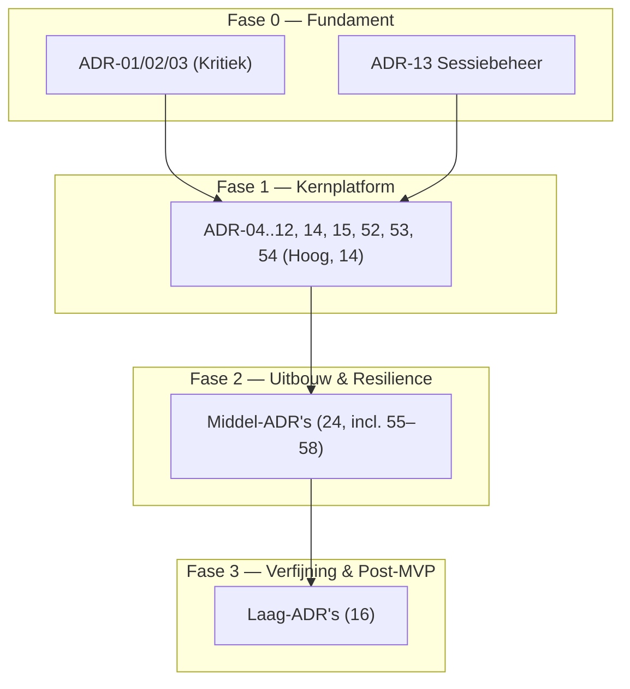

# EuropMade — Technical Roadmap

**Status:** Concept v0.2 — tiende en afsluitende technische document van Sprint 2. **Bijgewerkt na de definitieve Affiliate-scopewijziging:** fasering herzien met de 7 nieuwe categorie-J-ADR's (`09-adr-overview.md` v0.2).
**Uitgangspunt:** uitsluitend de goedgekeurde documenten `01-domain-model.md` t/m `09-adr-overview.md`. Geen enkel nieuw domeinbegrip, geen enkele nieuwe tabel, resource, event, service, security-, deployment-, integratieregel of ADR die daar niet al in staat.
**Scope:** de **technische roadmap** — hoe de negen voorgaande documenten zich vertalen naar een uitvoeringsvolgorde voor Sprint 3 en verder. **Geen code, geen implementatie.** Dit document beslist zelf geen enkele ADR — het plant wanneer en in welke volgorde de 58 ADR-kandidaten uit `09-adr-overview.md` (v0.2, na de definitieve Affiliate-scopewijziging) opgepakt worden.

---

## Leeswijzer

Dit document is het enige van de tien dat zelf **geen nieuwe architectuurinhoud** toevoegt — het herschikt uitsluitend wat de negen voorgaande documenten al vastlegden tot een tijdlijn. Waar dit document een fasering, prioriteit of planningskeuze maakt, is dat een **nieuwe toevoeging van dit document zelf** (net als de prioritering in `09-adr-overview.md`), duidelijk als zodanig gemarkeerd — niet een overname van een elders al vastgelegde regel. Drie gevraagde onderwerpen (Technische schuld, Migraties, Teststrategie) zijn expliciet gecontroleerd: geen van de negen bronnen gebruikt deze termen. Voor Technische schuld bestaat een indirecte, aantoonbare grondslag (het opgetelde aantal "Geconstateerde inconsistenties" over alle documenten); voor Migraties en Teststrategie bestaat geen enkele grondslag.

---

# 1. Doel van de roadmap

Sprint 2 heeft negen documenten opgeleverd: domeinmodel (35 objecten, na de Affiliate-scopewijziging), datamodel (47 tabellen), API-model, eventmodel (43 events), service-, security-, deployment- en integratie-architectuur, en een ADR-overzicht (58 kandidaten). Dit tiende document beantwoordt de vraag die na negen ontwerpdocumenten onvermijdelijk volgt: **in welke volgorde wordt dit daadwerkelijk gebouwd?** Het doel is niet om nieuwe keuzes te maken, maar om de 58 al geïdentificeerde ADR-kandidaten en de al vastgelegde architectuur om te zetten in een uitvoerbare, gefaseerde planning.

---

# 2. Uitgangspunten

Rechtstreeks samengevat uit de negen bronnen, geen enkel uitgangspunt hier voor het eerst geïntroduceerd:

- **Product Cloud ⊥ Commerce Cloud**, de belangrijkste, nooit te doorbreken grens (`01-domain-model.md` domeinobject 8, `05-service-architecture.md` sectie 3).
- **Modular Monolith als vertrekpunt** (`02-database-model.md` sectie 5, `07-deployment-architecture.md` sectie 1) — één deploybare eenheid bij lancering, zeven logisch gescheiden services.
- **Server-side autoriteit, nooit stilzwijgend** — elke prijs-, voorraad-, Buy Box- en autorisatiebeslissing server-side, elke ingrijpende wijziging gelogd met reden (`03-api-model.md` sectie 1, `04-event-model.md` sectie 13).
- **AI ondersteunt, beslist nooit** (`01-domain-model.md` domeinobject 22, platformbreed toegepast).
- **Events voor cross-service-gevolgen, nooit voor cross-service-berekeningen** (`04-event-model.md` sectie 1).
- **Eén eigenaar per gegeven** — geen enkele service muteert een tabel die een andere service bezit (`05-service-architecture.md` sectie 4/8).

---

# 3. Afhankelijkheden

Twee soorten, beide al vastgelegd:

- **Documentafhankelijkheden:** elk document bouwt op het vorige — `02` op `01`, `03` op `01`/`02`, enzovoort, tot `09` op alle acht daarvoor. Deze roadmap (`10`) is daarmee ook afhankelijk van alle negen.
- **ADR-afhankelijkheden:** volledig overgenomen uit `09-adr-overview.md` sectie 6 — met name de ketens Encryptie→Secrets Management→Key Management, Omgevingen→CI/CD→Containers→Orchestratie, en Sessiebeheer die vereist is vóórdat de al Definitieve Authenticatie-regel (`03-api-model.md` sectie 5) daadwerkelijk gebouwd kan worden.

---

# 4. MVP-fases

**Nieuwe toevoeging van dit document** — geen van de negen bronnen kent een fase-indeling; deze is samengesteld uit de prioriteiten en afhankelijkheden die `09-adr-overview.md` al vaststelde. **Bijgewerkt (v0.2, na de Affiliate-scopewijziging):** categorie J (7 nieuwe ADR's) ingepast. **Bijgewerkt (laatste correctieronde):** ADR-52 is definitief besloten (Affiliate Platform = MVP, Creator Platform = Post-MVP) — niet langer een te nemen besluit, uitsluitend nog een te implementeren gevolg daarvan in Fase 1. ADR-53/54 (Hoog) blokkeren de nieuwe Affiliate-service zelf, niet een al Definitieve regel, en volgen daarom de generieke Hoog→Fase 1-regel, niet de uitzondering die voor ADR-13 gold.

| Fase | Inhoud | Gebaseerd op |
|---|---|---|
| **Fase 0 — Fundament** | ADR-01 t/m ADR-03 (Kritiek), plus ADR-13 (Sessiebeheer, blokkeert Authenticatie) | `09` sectie 9, Bijlage A — **ongewijzigd** |
| **Fase 1 — Kernplatform** | Overige Hoog-ADR's: ADR-04 t/m ADR-12, ADR-14, ADR-15, **plus ADR-53/54 (Cookie-consent-mechanisme, Affiliate-commissie & attributieperiode)**. ADR-52 is besloten (zie hierboven) en vereist hier uitsluitend implementatie, geen besluitvorming meer. | `09` Bijlage B |
| **Fase 2 — Uitbouw & Resilience** | Middel-ADR's: categorie A (resterend), B, D, H, I (resterend), **J (resterend: ADR-55/56/57/58)** | `09` sectie 10 |
| **Fase 3 — Verfijning & Post-MVP-scope** | Laag-ADR's: categorie E, G (Shipment/Return/Advertisement/Subscription), overige C | `09` sectie 10 |

---

# 5. Prioriteiten

Volledig overgenomen uit `09-adr-overview.md` Bijlage A/B: 3 Kritiek, 12 Hoog, 20 Middel, 16 Laag, over negen categorieën (A–I). Geen enkele prioriteit is in dit document herzien.

---

# 6. Kritieke architectuurbesluiten

De drie Kritiek-ADR's uit `09-adr-overview.md`, ongewijzigd:

| ADR | Onderwerp | Risico bij uitstel |
|---|---|---|
| ADR-01 | Integratiebeveiliging / Event Security (PSP-webhook-authenticatie) | Direct financieel risico — een vervalste betaalbevestiging kan tot een ongeautoriseerde order leiden |
| ADR-02 | Privacy & AVG | Juridisch risico — lanceren zonder rechtmatige grondslag voor gegevensverwerking |
| ADR-03 | Encryptie (at rest / in transit) | Datalek-risico, met name via de Partner-service (IBAN, KvK, identiteitsdocumenten) |

Daarnaast, **niet Kritiek maar wel blokkerend voor een al Definitieve regel**: ADR-13 (Sessiebeheer) — zonder dit besluit kan de Authenticatie-regel "server-side sessiebeheer" (`03-api-model.md` sectie 5, Definitief) niet daadwerkelijk gebouwd worden.

---

# 7. Technische risico's

Volledig overgenomen uit `09-adr-overview.md` sectie 7, hier samengevat naar risicotype:

| Risicotype | ADR's |
|---|---|
| Financieel | ADR-01 |
| Juridisch | ADR-02 |
| Datalek | ADR-03, ADR-04, ADR-05 |
| Implementatie-blokkerend | ADR-13 |
| Launch-gebonden (6-landen-scope) | ADR-15 (Translation) |
| Operationeel (geen extern risico) | Categorie A/B/D (resterend) |
| Mogelijk geen risico | ADR-42, ADR-43, ADR-44 (Import/Export, Bestandsuitwisseling, Connectorarchitectuur — relevantie voor MVP zelf al ter discussie, `08` D#2) |

---

# 8. Validatiemomenten

Elk van de 58 ADR-kandidaten vertegenwoordigt zelf een validatiemoment (`09-adr-overview.md` sectie 2). Daarnaast bevatten de negen bronnen losse, al bevroren validatiepunten die niet zelf een ADR zijn maar wel bevestiging vereisen — bijvoorbeeld elk "Voorlopig"-onderwerp in de besluitstatus-tabellen van `03` t/m `08`, waar "Moet nog gevalideerd worden? Ja" staat zonder dat het onderwerp volledig Open is. Dit document voegt daar geen nieuw validatiemoment aan toe — het bevestigt uitsluitend dat elke Kritiek/Hoog-ADR (sectie 5/6) vóór Fase 1 afgerond moet zijn.

---

# 9. Opleverstrategie

**Nieuwe toevoeging van dit document, direct afgeleid van de MVP-fases (sectie 4):** ADR's worden per fase opgeleverd, niet allemaal tegelijk — Fase 0 (Kritiek + Sessiebeheer) moet zijn afgerond vóórdat Fase 1 zinvol start, aangezien Fase 1's ADR's (bijv. Omgevingen/CI/CD) zelf weer afhankelijk zijn van elkaar (`09` sectie 6). Geen enkele bron legt een concrete release-cadans vast (`07-deployment-architecture.md` sectie 13, Release-strategie, is zelf Open) — dit document herhaalt die leemte, in plaats van er zelfstandig een release-ritme voor te verzinnen.

---

# 10. Post-MVP roadmap

Overgenomen uit `09-adr-overview.md` sectie 10 (ADR's die kunnen wachten, 33 items) plus de vier domeinmodel-scope-items die zelf al "expliciet toekomstige functionaliteit" zijn (`01-domain-model.md`, Shipment/Return/Advertisement/Subscription — ADR-45/46/47/48). Post-MVP omvat in elk geval: het volledige Resilience-cluster (categorie B), het Observability-cluster (categorie D, op de MVP-kritische Monitoring-basis na), en categorie E (externe integratie-verfijning).

---

# 11. Technische schuld

**Geen van de negen bronnen gebruikt de term "technische schuld."** Wel bestaat een aantoonbare, optelbare grondslag: elk van de acht technische documenten (`02` t/m `09`) bevat een hoofdstuk "Geconstateerde inconsistenties," met in totaal **37 individuele, gedocumenteerde punten** (`02`: 5, `03`: 5, `04`: 5, `05`: 4, `06`: 4, `07`: 4, `08`: 3, `09`: 7 — bijgewerkt van 5 naar 7 in v0.2, na de Affiliate-scopewijziging). Dit document beschouwt deze 37 punten gezamenlijk als het **feitelijke technische-schuld-register** van Sprint 2 — niet als nieuwe bevindingen, maar als de reeds gedocumenteerde optelsom. Veel van deze 37 punten overlappen inhoudelijk met de 58 ADR-kandidaten (bijv. `02`'s vijf inconsistenties zijn letterlijk ADR-30/31/32/33 plus Sessiebeheer/ADR-13 in `09`) — dit is geen dubbele last, maar dezelfde bevindingen bekeken vanuit twee invalshoeken (inconsistentie versus ADR-behoefte).

Status: Open
Vereist ADR: Nee — dit is geen zelfstandig architectuurbesluit, uitsluitend een samenvattend inzicht; de onderliggende 37 punten zijn al (grotendeels) vertegenwoordigd in de 58 ADR-kandidaten van `09-adr-overview.md`

---

# 12. Migraties

**Open — expliciet gecontroleerd, geen enkele grondslag.** De term "migratie" komt in geen van de negen bronnen voor. Dit is een verwachte leemte op dit punt in het traject: er bestaat nog geen draaiend systeem, dus geen databestand of schema om te migreren. Zodra de eerste implementatie bestaat, wordt schemamigratie (bijv. bij toekomstige wijzigingen aan de 47 tabellen uit `02-database-model.md`) onvermijdelijk relevant.

Status: Open
Vereist ADR: Ja — voor de toekomstige migratiestrategie, zodra een eerste implementatie bestaat

---

# 13. Teststrategie

**Open — expliciet gecontroleerd, geen enkele grondslag.** De term "teststrategie" komt in geen van de negen bronnen voor. Wel legt `05-service-architecture.md` sectie 2 (Verantwoordelijkheden per service) impliciet een testbare grens vast: elke service heeft een scherp begrensd verantwoordelijkheidsgebied, wat geïsoleerd testen per service in theorie mogelijk maakt — maar geen enkele bron legt een concrete teststrategie (unit/integratie/end-to-end, dekkingsdoelen) vast.

Status: Open
Vereist ADR: Ja

---

# 14. Documentatiestrategie

**Voorlopig — impliciet aantoonbaar via het patroon dat de negen bronnen zelf al consequent toepassen**, ook al legt geen van hen dit patroon expliciet als "documentatiestrategie" vast: elk document citeert exact welke sectie van welk voorgaand document het onderbouwt, markeert elke eigen toevoeging als "Voorlopig"/"Open" waar grondslag ontbreekt, en sluit af met "Geconstateerde inconsistenties" en een besluitstatus-tabel. Dit document zet dat patroon voort. Een expliciete, los vastgelegde documentatiestrategie (bijv. hoe ADR's ná besluitvorming worden gearchiveerd, hoe versiebeheer van documenten zelf verloopt) ontbreekt.

Status: Voorlopig
Vereist ADR: Ja — voor het formaliseren van het al informeel gehanteerde patroon, en voor documentversiebeheer

---

# 15. Acceptatiecriteria

**Nieuwe toevoeging van dit document**, direct afgeleid van de MVP-kritische ADR's (sectie 6, `09-adr-overview.md` sectie 9): Sprint 3 kan starten zodra de drie Kritiek-ADR's en ADR-13 (Sessiebeheer) zijn vastgesteld — niet noodzakelijk geïmplementeerd, maar besloten. Volledige MVP-lancering vereist daarnaast alle 18 MVP-kritische ADR's uit `09-adr-overview.md` sectie 9.

---

# 16. Gereed voor Sprint 3

Zie Bijlage E (Sprint-3 Readiness Checklist) voor de volledige, toetsbare lijst. Samengevat: Sprint 3 is gereed van start te gaan zodra Fase 0 (sectie 4) is afgerond — de drie Kritiek-ADR's plus Sessiebeheer.

---

# A. Roadmap-overzicht

| Fase | ADR-aantal | Bevat |
|---|---|---|
| Fase 0 — Fundament | 4 | ADR-01, 02, 03, 13 |
| Fase 1 — Kernplatform | 14 | Overige Hoog-ADR's, incl. ADR-53/54 (v0.2) — ADR-52 is besloten, telt nog mee in het aantal maar vereist geen besluitvorming meer |
| Fase 2 — Uitbouw & Resilience | 24 | Middel-ADR's, incl. ADR-55/56/57/58 (v0.2) |
| Fase 3 — Verfijning & Post-MVP | 16 | Laag-ADR's |
| **Totaal** | **58** | Alle ADR-kandidaten uit `09-adr-overview.md` (v0.2) |

---

# B. MVP-planning

| Fase | Categorieën betrokken | Kan starten na |
|---|---|---|
| Fase 0 | C (deels) | Direct — geen ADR-afhankelijkheid vooraf |
| Fase 1 | A, C (deels), D (deels), F, G (deels), I (deels), **J (deels — ADR-53/54, v0.2; ADR-52 besloten)** | Fase 0 |
| Fase 2 | A (rest), B, D (rest), H, I (rest), **J (rest — ADR-55/56/57/58, v0.2)** | Fase 1 |
| Fase 3 | C (rest), E, G (rest), I (rest) | Fase 2, of onafhankelijk waar geen afhankelijkheid bestaat |

---

# C. Afhankelijkheidsdiagram

---

# D. Geconstateerde inconsistenties

1. **MVP-fases (sectie 4) en Opleverstrategie (sectie 9) zijn volledig nieuwe toevoegingen van dit document** — geen van de negen bronnen kent een fase-indeling. De fasering volgt logisch uit de al vastgelegde prioriteiten en afhankelijkheden, maar de indeling in precies vier fases is een keuze van dit document. **Aanbeveling:** laat deze fasering expliciet valideren door wie de daadwerkelijke uitvoering plant.

2. **Technische schuld (sectie 11) overlapt inhoudelijk sterk met de 58 ADR-kandidaten uit `09-adr-overview.md`**, zonder dat de twee lijsten (37 inconsistenties, 58 ADR's) elkaar 1-op-1 dekken — sommige inconsistenties zijn puur informatief (bijv. `02`'s inconsistentie #1 over de Manufacturer↔Brand-koppeltabel is exact ADR-30, maar andere, zoals `05`'s inconsistentie over de "alleen-lezen aanroepen"-aanname, hebben geen eigen ADR-nummer gekregen). **Aanbeveling:** een toekomstig document zou een expliciete 1-op-1-mapping tussen beide lijsten kunnen maken.

3. **Migraties en Teststrategie zijn volledig nieuw terrein — dit is verwacht op dit punt in Sprint 2, maar betekent dat Sprint 3 zonder deze twee ADR's begint aan een testbare, migreerbare codebase te bouwen zonder vastgelegde aanpak.** **Aanbeveling:** overweeg deze twee ADR's vroeg in Fase 0/1 op te pakken, ook al zijn ze hier als "kan wachten"-onderwerp gecategoriseerd puur op basis van het ontbreken van een acuut extern risico.

4. **Nieuw (v0.2) — ADR-53/54 zijn bewust in Fase 1 geplaatst, niet in Fase 0, ondanks hun Hoog-prioriteit en hun blokkerende karakter voor de nieuwe Affiliate-service.** Dit is een expliciete, consistente toepassing van de al bestaande Fase 0-regel (uitsluitend Kritiek, plus uitzonderingen die een al Definitieve regel blokkeren) — de Affiliate-service zelf is geen Definitieve regel, dus kwalificeert niet voor die uitzondering, in tegenstelling tot ADR-13/Sessiebeheer/Authenticatie. **Dit is een keuze van dit document, geen letterlijke regel uit `09-adr-overview.md`.** **Status (laatste correctieronde): ADR-52 is inmiddels definitief besloten** (Affiliate Platform = MVP, Creator Platform = Post-MVP) en uit deze faseringsvraag gehaald — uitsluitend ADR-53/54 blijven hier relevant. **Aanbeveling, resterend:** laat de faseringskeuze voor ADR-53/54 zelf nog expliciet bevestigen.

---

# E. Sprint-3 Readiness Checklist

- [ ] ADR-01 (Integratiebeveiliging/Event Security) besloten
- [ ] ADR-02 (Privacy & AVG) besloten
- [ ] ADR-03 (Encryptie) besloten
- [ ] ADR-13 (Sessiebeheer) besloten
- [ ] Bevestiging dat de negen Sprint 2-documenten (`01`–`09`) door de betrokken stakeholders zijn goedgekeurd
- [ ] Bevestiging dat de MVP-fasering (sectie 4/Bijlage A) is gevalideerd door wie de uitvoering plant
- [ ] Bevestiging dat Migraties (sectie 12) en Teststrategie (sectie 13) — beide Open — minimaal zijn geagendeerd voor een ADR, ook al zijn ze niet Fase-0-kritiek
- [x] **(v0.2, besloten)** ADR-52 (Creator vs. Affiliate scope) besloten: Affiliate Platform = MVP, Creator Platform = Post-MVP
- [ ] **(v0.2)** Bevestiging dat de Fase 1-indeling van ADR-53/54 (Geconstateerde inconsistenties #4) is gevalideerd
