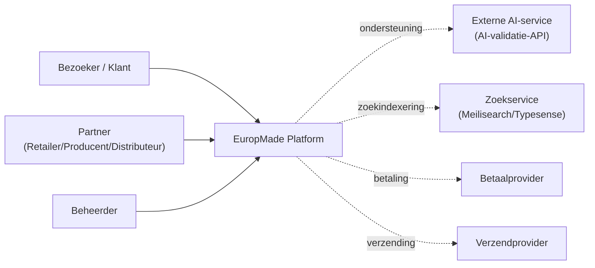
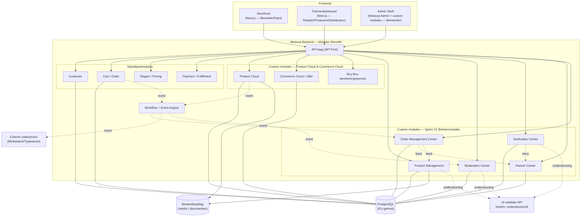

# EuropMade — Technical Blueprint

## TB-01 — System Architecture

**Versie:** 0.2
**Status:** Concept — eerste hoofdstuk van de Technical Blueprint, opgesteld door de Lead Solution Architect
**Doelgroep:** senior software engineers die de reeds ontworpen EuropMade-marketplace daadwerkelijk gaan bouwen
**Basis:** EuropMade Blueprint V2.1 (`blueprint/`), `docs/01-architecture/` (tech-stack.md, standard-vs-custom.md), alle definitief bevroren functionele specificaties in `docs/03-functional-specs/`, ADR 0001–0005 (`docs/04-decisions/`), Design System (`docs/07-design-system/`)
**Nadrukkelijk:** dit document verzint geen nieuwe functionaliteit en wijzigt geen eerder vastgestelde beslissing. Het beschrijft uitsluitend de technische architectuur die nodig is om de reeds ontworpen marketplace — Product Cloud, Commerce Cloud/Buy Box, Winkelwagen, Checkout, Orderbevestiging, Authenticatie, Partner Onboarding, en de zes Sprint 1C-beheermodules (Product Management, Admin Shell, Moderation Center, Verification Center, Partner Center, Order Management Center) — daadwerkelijk te realiseren.

---

## 1. Doel

Dit hoofdstuk legt de technische architectuur vast waarbinnen elke latere Technical Blueprint-sectie (datamodel, API's, events, services, RBAC, integraties, zoek, caching, bestandsopslag — zie Deel 12) wordt uitgewerkt. Het doel is drieledig:

1. **Eén gedeeld technisch referentiekader** voor elk team dat aan EuropMade werkt, zodat elke latere technische beslissing wordt genomen binnen een consistent geheel, in plaats van per feature opnieuw te worden uitgevonden.
2. **De vertaling van de al vastgestelde functionele architectuur** (Product Cloud, Commerce Cloud, Buy Box, en de zes Sprint 1C-beheermodules, allemaal al definitief bevroren in `docs/03-functional-specs/`) naar de infrastructuur- en systeemlaag die deze daadwerkelijk kan dragen.
3. **Een architectuur die vanaf de eerste regel code al rekening houdt met tien jaar groei** — consistent met het uitgangspunt dat al bij de Product Cloud Architecture is vastgelegd (`product-cloud-architecture/spec.md` Deel 1.1: *"Bouw een fundament dat minimaal tien jaar schaalbaar blijft"*), niet een architectuur die later grondig herzien moet worden zodra het platform daadwerkelijk gebruikt wordt.

Dit document beschrijft **uitsluitend het technische fundament** — geen datamodel-details, geen API-contracten, geen concrete services. Die volgen in latere Technical Blueprint-hoofdstukken (zie Deel 12, Open punten).

---

## 2. Architectuurprincipes

Elk principe hieronder is direct herleidbaar tot een al vastgestelde Blueprint- of documentatiekeuze — geen van deze principes is hier voor het eerst geïntroduceerd.

| Principe | Toelichting | Motivatie |
|---|---|---|
| **API First** | Elke functionaliteit is vanaf het begin ontsloten via een API, ook als er (nog) maar één consument is. De storefront, het partnerdashboard en toekomstige integraties spreken allemaal dezelfde, ontkoppelde API-laag aan — geen enkele UI-laag bevat business-logica die niet ook via een API bereikbaar is. | Expliciet Blueprint-architectuurprincipe (H15.2). Medusa is native API-first opgebouwd (`tech-stack.md`) — dit principe vereist dus geen aparte laag, uitsluitend consequente toepassing. |
| **Domain Driven Design** | De grens tussen Product Cloud (wat een product *is*) en Commerce Cloud (wie het *verkoopt en tegen welke voorwaarden*) is de belangrijkste architecturale grens in het platform en wordt op geen enkel niveau (database, API, UI) doorbroken. Elke Sprint 1C-beheermodule (Product Management, Moderation Center, Verification Center, Partner Center, Order Management Center) is zelf ook een eigen, scherp begrensd domein met een expliciet gedocumenteerde scope-grens naar de andere modules. | Rechtstreeks uit `product-cloud-architecture/spec.md` Deel 1.1 ("Alles wat over 'wat het product IS' gaat, leeft in Product Cloud... Alles wat over 'hoe ik het verkoop' gaat, leeft in Commerce Cloud") en consequent doorgevoerd in elke Sprint 1C-module (bijv. Verification Center §1.2: "Verification bevat geen moderatiefunctionaliteit... geen Product Management-functionaliteit"). |
| **Modular Monolith als MVP** | Medusa draait bij lancering als één samenhangende backend-applicatie (custom modules voor Product Cloud, Commerce Cloud/Offer, Buy Box-engine, Verification, Moderation, Order Management, e.a.), niet als losse microservices. Elke module is intern wél scherp gescheiden (eigen datamodel, eigen API-oppervlak, eigen verantwoordelijkheid) zodat een latere uitsplitsing naar afzonderlijke services nooit een architecturale herziening vereist, uitsluitend een operationele. | Consistent met `standard-vs-custom.md`: Medusa's module-architectuur is hier het vertrekpunt; custom modules volgen exact hetzelfde interne scheidingspatroon dat de functionele specificaties al afdwingen (bijv. het generieke Admin Shell-modulecontract, `admin-shell/spec.md` §1.9, is zelf al ontworpen als een microservice-achtige grens binnen de monoliet). |
| **Event Driven waar zinvol** | Gebeurtenissen die meerdere modules raken (bijv. een succesvolle betaling die tot ordersplitsing leidt, Checkout sectie 0; een merge die de Verified-status intrekt, Verification Center §6) worden ontkoppeld via Medusa's ingebouwde workflow-/event-engine, niet via directe, synchrone aanroepen tussen modules. Waar een directe read-only aanroep voldoet (bijv. een deep link vanuit Partner Center naar Product Management), wordt geen onnodige event-laag toegevoegd. | Rechtstreeks passend bij het al vastgelegde principe dat modules elkaar uitsluitend "samenvatten en doorlinken," nooit heimplementeren (bijv. Order Management Center §1.2, Partner Center §1.2) — die grens is het natuurlijkst te bewaken via ontkoppelde events in plaats van een groeiend web van directe, synchrone module-aanroepen. |
| **Cloud Native** | De applicatie wordt containerized gebouwd en gedraaid, met horizontale schaalbaarheid als uitgangspunt vanaf de eerste deployment (zie Deel 7/10) — niet als latere migratie. | Vereist om de in Deel 10 beschreven groei van MVP naar grootschalig Europees platform zonder architecturale trendbreuk te kunnen doorlopen. |
| **Security by Design** | Elke ingrijpende of gevoelige actie (claim-, verificatie-, moderatiebeslissingen, toegang tot partnerdata/persoonsgegevens) is server-side afgedwongen en auditeerbaar vastgelegd — nooit uitsluitend een UI-restrictie. | Dit is geen nieuw principe maar de expliciete bevestiging van een regel die al in vrijwel elke Sprint 1C-module terugkomt (bijv. ADR 0005: "Buy Box wordt uitsluitend server-side berekend"; Product Cloud Architecture Deel 1.1: "elke staat-wijziging is een gebeurtenis met een eigenaar, een reden en een tijdstip"). |
| **Privacy by Design** | Persoonsgegevens (klantadressen, partnerbedrijfsgegevens, identiteitsdocumenten) worden vanaf het datamodel-ontwerp begrensd in toegang, gelogd bij inzage, en met een eindige bewaartermijn — nooit als latere toevoeging. | Al expliciet vastgelegd in Partner Onboarding's beveiligingseisen (versleutelde opslag, malware-scan, uitsluitend geautoriseerde reviewers, audit logging, bewaartermijn, AVG/GDPR-conform) en letterlijk hergebruikt in Partner Center §7 en Order Management Center §7/§8. |
| **EU Hosting** | Hosting en datacenters bevinden zich in Nederland/EU. | Expliciet, al vastgesteld (`tech-stack.md`): "TransIP + NL/EU-datacenters sluiten direct aan op European Data Sovereignty (Blueprint H13.4): bedrijfs- en klantgegevens blijven binnen de EU, onder Europese wetgeving." |
| **Scalability** | De architectuur moet dezelfde structuur behouden bij 10 miljoen producten, miljoenen Offers en duizenden partners als bij de MVP-lancering in 6 landen — expliciet als toetsingscriterium meegenomen bij de Product Cloud Architecture (`product-cloud-architecture/spec.md` Deel 12, Risicoanalyse). | Zie Deel 10 voor de concrete uitwerking. |
| **Testability** | Elke module heeft een scherp begrensd, expliciet gedocumenteerd verantwoordelijkheidsgebied (zie Domain Driven Design hierboven) — dit is de directe voorwaarde voor betrouwbare, geïsoleerde geautomatiseerde tests per module, zonder dat een test van bijvoorbeeld Verification Center kennis moet hebben van Moderation Center's interne logica. | Volgt direct uit de al overal doorgevoerde scope-grenzen tussen de Sprint 1C-modules. |

---

## 3. High Level Architectuur

### 3.1 Hoofdonderdelen

| Onderdeel | Rol | Toelichting |
|---|---|---|
| **Frontend — Storefront** | Publieke marketplace (Bezoeker/Klant) | Next.js, mobile-first (Blueprint H10.11), spreekt uitsluitend de Medusa-API aan — geen directe databasetoegang. |
| **Frontend — Partnerdashboard** | Retailer/Producent/Distributeur-omgeving | Losse Next.js-applicatie (`standard-vs-custom.md`: "Medusa Admin is géén self-service portal voor externe partners"), toont onder meer de eigen productenlijst (Product Management, eigen scope), eigen verificatie-aanvragen (Verification Center, eigen scope), eigen wijzigingsvoorstellen-uitkomsten (Product Management §7). |
| **Frontend — Admin Shell** | Interne Beheerder-omgeving | Medusa Admin, uitgebreid met custom widgets/UI-routes (`standard-vs-custom.md`) — het generieke schil-/registratiecontract dat elke Sprint 1C-beheermodule (Product Management, Moderation Center, Verification Center, Partner Center, Order Management Center) als zelfstandige module opneemt (`admin-shell/spec.md` §1.9). |
| **Backend** | Medusa 2.x, modulaire monoliet | Standaardmodules (Customer, Cart, Order, Region, Pricing, Payment, Fulfillment) plus custom modules voor Product Cloud, Commerce Cloud/Offer, Buy Box-berekeningsservice, en de zes Sprint 1C-beheermodules. |
| **Database** | PostgreSQL | Eén relationele database, EU-gehost (TransIP/NL). Elke custom module krijgt een eigen, scherp begrensd schema binnen dezelfde database-instantie (Modular Monolith-principe, Deel 2). |
| **Storage** | Bestandsopslag voor media en documenten | Productafbeeldingen (publiek), partner-bewijsstukken en verificatie-documenten (streng toegangsbeperkt, conform Partner Onboarding's beveiligingseisen — zie Deel 9). Twee gescheiden opslagcontexten, nooit gedeeld toegangsbeleid. |
| **Search** | Externe zoekservice | `standard-vs-custom.md`: "Zoekfunctie — Standaard integratie (bijv. Meilisearch/Typesense)." Ontsloten via de al benoemde Zoekindexering-API (`marketplace-core/spec.md` §20), event-gedreven bijgewerkt bij statusovergangen (bijv. een product dat de publicatiestatus "Actief" bereikt). |
| **Authentication** | Sessie- en identiteitsbeheer | Server-side sessiebeheer, verplichte 2FA voor Retailer/Producent/Beheerder (Authenticatie-spec, bevroren), technisch gescheiden infrastructuur voor de Beheerder-rol (Medusa Admin) versus Consument/Retailer/Producent. |
| **Queue / Events** | Ontkoppeling tussen modules | Medusa's ingebouwde workflow-/event-engine — het al vastgelegde technische fundament onder bijvoorbeeld de wijzigingsvoorstel-review-flow (`standard-vs-custom.md`: "Wijzigingsvoorstellen + AI-review... Medusa Workflows als technisch fundament"). |
| **Caching** | Prestatie-laag voor veelgevraagde, weinig-veranderende data | Nog niet in detail uitgewerkt — zie Deel 12, Open punten. |
| **Monitoring / Logging** | Operationele zichtbaarheid | Nog niet in detail uitgewerkt — zie Deel 12. De **functionele** audit-trail (AuditLogEntry, wie/wanneer/wat/reden bij elke ingrijpende beslissing) is al volledig vastgelegd in `product-cloud-architecture/spec.md` Deel 3.1/8.5 en is uitdrukkelijk geen vervanging voor technische logging/monitoring — dit zijn twee verschillende lagen met een verschillend doel. |
| **AI Services** | Ondersteuning, nooit beslissing | Extern aangeroepen via de al benoemde AI-validatie-API (`marketplace-core/spec.md` §20), toegepast op precies de punten die de functionele specificaties al vastleggen (matchingskandidaten, claim-/wijzigingsvoorstel-consistentie, laag-risico publicatiereviews, fraude-signalering) — op geen van deze punten neemt AI ooit de uiteindelijke beslissing (Blueprint H9.7, platformbreed principe). |
| **Integraties** | Externe koppelingen | Nog niet in detail uitgewerkt — zie Deel 12 (betaalproviders, verzendproviders, e.a. zijn Medusa-standaardmodules, maar de exacte externe partijen zijn nog niet vastgesteld). |

### 3.2 Samenwerking tussen de onderdelen

Beide frontend-applicaties (storefront, partnerdashboard) en de Admin Shell spreken uitsluitend de Medusa-API aan — nooit de database rechtstreeks (API First, Deel 2). Binnen de Medusa-backend communiceren custom modules met elkaar op twee manieren, afhankelijk van de aard van de interactie:

- **Directe, synchrone, alleen-lezen aanroepen** wanneer een module uitsluitend een samenvatting van een andere module nodig heeft (bijv. Partner Center dat een productenaantal uit Product Management toont, Order Management Center dat een aanbieder-naam uit Partner Center toont) — dit raakt nooit de onderliggende data van de andere module, uitsluitend een leesoperatie.
- **Events via de workflow-/queue-laag** wanneer een gebeurtenis in één module een gevolg heeft in een andere module (bijv. een goedgekeurde merge die de Verified-status intrekt; een mislukte ordersplitsing die een item in Order Management Center's uitzonderingsqueue plaatst).

---

## 4. C4-model & Architectuurdiagrammen

### 4.1 De C4-methodiek

Deze Technical Blueprint volgt de **C4-methodiek** voor het visualiseren van software-architectuur. C4 beschrijft een systeem op vier, steeds verder inzoomende niveaus — TB-01 behandelt de eerste twee niveaus; het derde niveau volgt in een later Technical Blueprint-hoofdstuk (zie Deel 12, Open punten):

- **Context** — het systeem als geheel, en hoe het zich verhoudt tot de mensen en externe systemen eromheen. Geen technische details, uitsluitend "wie/wat praat met wie."
- **Container** — de afzonderlijke, zelfstandig te draaien/deploybare onderdelen binnen het systeem (bijv. de storefront, het partnerdashboard, de Medusa-backend) en hoe die met elkaar communiceren. Dit is het niveau van Deel 5 (Container Architectuur) en het diagram in 4.3 hieronder.
- **Component** — de indeling van elke container in haar eigen, interne bouwstenen (bijv. de exacte module-indeling binnen de Medusa-backend). Dit niveau is bewust nog niet uitgewerkt in TB-01 — het volgt in een later hoofdstuk (Open punten, "Services").
- **Code** — het laagste, klasse-/functieniveau. Buiten de scope van de Technical Blueprint; dit leeft in de codebase zelf.

### 4.2 Context Diagram

Elk extern systeem in dit diagram is al elders in de bestaande documentatie benoemd — dit voegt geen nieuw systeem toe: de externe zoekservice en de AI-validatie-API komen uit `standard-vs-custom.md` en `marketplace-core/spec.md` §20 (zie ook Deel 3/6); betaalprovider en verzendprovider zijn de Medusa-standaardmodules Payment/Fulfillment (Deel 3.1) — de concrete, met naam benoemde leveranciers zijn nog niet vastgesteld (Deel 12, Open punten).

### 4.3 Container Diagram

---

## 5. Container Architectuur

| Container | Doel | Verantwoordelijkheid | Interfaces | Afhankelijkheden |
|---|---|---|---|---|
| **Storefront (Next.js)** | Publieke marketplace-ervaring | Weergave van producten, Buy Box, winkelwagen, checkout, orderbevestiging (Bezoeker/Klant-rollen) | HTTPS naar Medusa-API (publieke endpoints) | Medusa-backend (API), externe zoekservice (via Medusa) |
| **Partnerdashboard (Next.js)** | Zelfbedieningsomgeving voor partners | Eigen producten (Product Management, eigen scope), eigen verificatie-aanvragen (Verification Center, eigen scope), eigen wijzigingsvoorstellen-uitkomsten | HTTPS naar Medusa-API (geauthenticeerde, rol-specifieke endpoints) | Medusa-backend (API), Authentication |
| **Admin Shell (Medusa Admin + custom widgets)** | Interne beheeromgeving | Hostet elke Sprint 1C-beheermodule als zelfstandig geregistreerde module (generiek modulecontract, `admin-shell/spec.md` §1.9) | HTTPS naar Medusa-API (Beheerder-only endpoints) | Medusa-backend (API), Authentication |
| **Medusa Backend (API + modules)** | Kern van de businesslogica | Standaardmodules (Customer/Cart/Order/Region/Pricing/Payment/Fulfillment) + custom modules (Product Cloud, Commerce Cloud/Offer, Buy Box-berekeningsservice, en de zes Sprint 1C-beheermodules) | REST/HTTP-API naar alle drie de frontend-containers; interne module-aanroepen en events binnen de monoliet | PostgreSQL, Bestandsopslag, externe zoekservice, AI-validatie-API |
| **PostgreSQL** | Persistente opslag | Eén database-instantie, per-module gescheiden schema's (Modular Monolith) | Medusa's standaard database-laag (uitsluitend vanuit de Medusa-backend, nooit rechtstreeks vanuit een frontend) | EU-gehoste infrastructuur (TransIP/NL) |
| **Bestandsopslag** | Media en documenten | Twee gescheiden toegangscontexten: publieke productmedia, en streng toegangsbeperkte partner-/verificatiebewijsstukken | Aangeroepen vanuit de Medusa-backend (Product Cloud, Product Management, Partner Onboarding-gerelateerde modules) | EU-gehoste infrastructuur |
| **Externe zoekservice** | Productzoekfunctie | Geïndexeerde productdata, event-gedreven bijgewerkt bij relevante statusovergangen | Aangeroepen via de Zoekindexering-API vanuit de Medusa-backend | Medusa-backend (levert de te indexeren data) |
| **AI-validatie-API (extern)** | Ondersteunende AI-context | Levert aanbevelingen/vergelijkingen aan Moderation Center, Verification Center en Product Management — nooit een beslissing | Aangeroepen vanuit de Medusa-backend | Geen afhankelijkheden richting EuropMade — eenrichtingsverkeer (EuropMade roept aan, ontvangt resultaat) |

---

## 6. Technology Stack

| Technologie | Versie | Waarom gekozen | Alternatieven (overwogen) | Voordelen | Nadelen |
|---|---|---|---|---|---|
| **Next.js** (frontend) | 15 (zoals eerder gehanteerd in de foundation-opzet; exacte patchversie nog niet formeel vastgesteld) | Al vastgesteld (`tech-stack.md`); native ondersteuning voor server-side rendering, past bij API-first en Mobile First | Nuxt, SvelteKit, Remix | Grote ecosysteem, sterke integratie met React, goede SEO-ondersteuning voor een publieke marketplace | Vereist discipline om de scheiding met de Medusa-API strikt te bewaren (geen directe databasetoegang vanuit de frontend) |
| **Medusa** (backend) | 2.x | Al vastgesteld (`tech-stack.md`); native API-first, modulair, ingebouwd Region-model sluit direct aan op de 6-landen-launch | Custom Node.js-backend, Saleor, Vendure | Bespaart aanzienlijke bouwtijd op standaard e-commerce-functionaliteit (Customer/Cart/Order/Region/Payment/Fulfillment); uitbreidbaar module-systeem past bij het "standard where possible, custom where it creates competitive advantage"-principe | Multi-vendor-/Buy Box-model is geen ingebouwd patroon — vereist bewust, aanzienlijk maatwerk (Commerce Cloud/Offer-model, ordersplitsing) |
| **PostgreSQL** (database) | Nog niet formeel vastgesteld — Medusa 2.x vereist een recente, ondersteunde PostgreSQL-major-versie | Al vastgesteld (`tech-stack.md`); Medusa's standaard, bewezen database-keuze | MySQL, MongoDB | Sterke relationele consistentie (belangrijk bij eigendoms-/eigendomsoverdracht-gevoelige data zoals Product Cloud claims en OwnershipRecords), volwassen EU-hostingondersteuning | Vereist zorgvuldig schema-ontwerp bij zeer grote schaal (zie Deel 10) |
| **Node.js** (runtime) | LTS (exacte major-versie nog niet formeel vastgesteld voor dit domein — bij de eerdere foundation-opzet werd Node.js 22 LTS gehanteerd) | Vereist door zowel Next.js als Medusa | — | Voorspelbare ondersteuningstermijn, stabiliteit | Vereist tijdige opvolging naar een volgende LTS-versie zodra de huidige het einde van de ondersteuningstermijn nadert |
| **TransIP, NL/EU-datacenters** (hosting) | N.v.t. (infrastructuurkeuze, geen softwareversie) | Al vastgesteld (`tech-stack.md`); directe match met European Data Sovereignty (Blueprint H13.4) | Internationale cloudproviders (AWS/Azure/GCP, EU-regio's) | Data blijft aantoonbaar binnen de EU, onder Europese wetgeving — sluit direct aan op EuropMade's kernbelofte | Mogelijk minder uitgebreide, kant-en-klare managed-service-opties dan de grote internationale cloudproviders |
| **Externe zoekservice (bijv. Meilisearch/Typesense)** | Nog niet formeel vastgesteld — leverancier zelf nog niet gekozen (zie Deel 12, Open punten) | Al vastgesteld (`standard-vs-custom.md`): "Zoekfunctie — Standaard integratie" | Elasticsearch, Algolia | Snelle, typo-tolerante zoekervaring zonder zelf een zoekengine te moeten onderhouden | Introduceert een externe afhankelijkheid die zelf ook EU-gehost moet zijn om aan Deel 2's EU Hosting-principe te voldoen (aandachtspunt bij leverancierskeuze, zie Deel 12) |
| **AI-validatie-API (extern)** | Nog niet formeel vastgesteld — leverancier zelf nog niet gekozen (zie Deel 12, Open punten) | Al vastgesteld/toegepast in meerdere Sprint 1C-modules als ondersteunende dienst | Zelf gehoste ML-modellen | Snel te integreren, geen eigen ML-infrastructuur nodig in de MVP-fase | Externe afhankelijkheid; vereist zorgvuldige leverancierskeuze met oog op AVG/GDPR en EU Hosting-principe (zie Deel 12) |

---

## 7. Deployment Architectuur

**Vijf, scherp onderscheiden omgevingen:**

| Omgeving | Doel | Kenmerken |
|---|---|---|
| **Local** | Individuele werkplek van één engineer, vóór enige commit | Draait volledig op de eigen machine van de engineer (lokale Medusa-instantie + lokale PostgreSQL, storefront/partnerdashboard/Admin Shell lokaal tegen de lokale backend). Geen gedeelde infrastructuur, geen verbinding met externe zoekservice of AI-validatie-API vereist (mockbaar). Onderscheidt zich van **Development** hieronder doordat Local nooit door een ander teamlid wordt gebruikt of geraadpleegd. |
| **Development** | Gedeelde, doorlopend bijgewerkte integratieomgeving voor het hele team | Gedeelde Medusa-instantie + gedeelde PostgreSQL, bijgewerkt bij elke samengevoegde wijziging; storefront/partnerdashboard/Admin Shell draaien tegen deze gedeelde backend. Geen verbinding met externe zoekservice of AI-validatie-API vereist voor basisontwikkeling (mockbaar). |
| **Test** | Geautomatiseerde tests (unit/integratie) | Geïsoleerde database per testrun, consistent met de per-module scheiding (Deel 2, Testability) — elke Sprint 1C-module afzonderlijk testbaar zonder de volledige stack te moeten opstarten. |
| **Acceptatie** | Handmatige validatie vóór productie | Volledige stack, EU-gehost, representatieve (niet-productie) data; hier wordt voor het eerst tegen de daadwerkelijke externe zoekservice en AI-validatie-API getest. |
| **Productie** | Live platform | Volledige stack, EU-gehost (TransIP/NL, Blueprint H13.4), horizontaal schaalbaar volgens het Cloud Native-principe (Deel 2/10). |

---

## 8. Non Functional Requirements

Dit hoofdstuk beschrijft uitsluitend de architecturale **kwaliteitsdoelen** — geen concrete technische oplossingen. De precieze technische invulling per doelstelling (bijv. de exacte cachingstrategie, het exacte monitoring-platform) hoort bij een later Technical Blueprint-hoofdstuk (zie Deel 12, Open punten).

| Kwaliteitsdoel | Doelstelling / architectuurprincipe |
|---|---|
| **Beschikbaarheid** | Het platform moet doorlopend bereikbaar zijn voor Bezoeker/Klant, Partner en Beheerder — geconsistent met het Cloud Native-principe (Deel 2), dat horizontale schaalbaarheid en herstelbaarheid als uitgangspunt neemt in plaats van een enkel, niet-redundant draaiend systeem. |
| **Performance** | De architectuur mag geen structurele bottleneck introduceren tussen een gebruikersactie en de server-side verwerking daarvan — met name relevant bij de al vastgelegde regel dat de Buy Box en elke andere prijs-/statusgevoelige berekening uitsluitend server-side plaatsvindt (ADR 0005) en dus nooit client-side vertraagd of omzeild mag worden. |
| **Schaalbaarheid** | Zie Deel 10 (Schaalbaarheid) voor de volledige uitwerking — samengevat: de architectuur moet zonder trendbreuk kunnen groeien van de MVP (6 landen) naar het door de Product Cloud Architecture getoetste schaalniveau (10 miljoen producten, miljoenen Offers, duizenden partners). |
| **Betrouwbaarheid** | Elke ingrijpende of gevoelige actie (claim-, verificatie-, moderatiebeslissingen) moet consistent en zonder gegevensverlies worden vastgelegd — rechtstreeks passend bij het al vastgelegde principe dat elke staat-wijziging "een gebeurtenis met een eigenaar, een reden en een tijdstip" is (Product Cloud Architecture Deel 1.1), nooit een stille overschrijving. |
| **Herstelbaarheid (Recovery)** | Het platform moet kunnen herstellen van een storing zonder verlies van reeds vastgelegde, ingrijpende beslissingen (claims, verificaties, ordersplitsingen). Dit is een architecturaal uitgangspunt bij het ontwerp van de opslaglaag (Deel 3, Database/Storage) — de concrete backup-/herstelstrategie zelf is nog niet uitgewerkt (Deel 12, Open punten). |
| **Onderhoudbaarheid** | Direct gevolg van het Domain Driven Design- en Modular Monolith-principe (Deel 2): elke module heeft een scherp begrensd verantwoordelijkheidsgebied, zodat een wijziging aan één module nooit een onvoorziene aanpassing aan een andere module vereist. |
| **Observeerbaarheid** | De architectuur onderscheidt uitdrukkelijk twee lagen die beide nodig zijn om het platform te kunnen begrijpen tijdens gebruik: de al volledig functioneel vastgelegde audit-trail (AuditLogEntry, wie/wanneer/wat/reden) en de nog uit te werken technische logging/monitoring (Deel 9, Security Fundament; Deel 12, Open punten) — beide dragen bij aan observeerbaarheid, met een verschillend doel. |
| **Security** | Zie Deel 9 (Security Fundament) voor de volledige uitwerking — samengevat: elke autorisatiebeslissing wordt server-side afgedwongen, nooit uitsluitend als UI-restrictie (ADR 0005-principe, platformbreed toegepast). |
| **Maximale downtime (doelstelling)** | Nog niet formeel vastgesteld — er is in de bestaande documentatie geen concreet, getalsmatig doel voor maximale downtime vastgelegd. Dit wordt bij een later Technical Blueprint-hoofdstuk bepaald (Deel 12, Open punten), niet hier verzonnen. |
| **Responstijden (globale doelstellingen)** | Nog niet formeel vastgesteld — er is in de bestaande documentatie geen concreet, getalsmatig responstijd-doel vastgelegd. Dit wordt bij een later Technical Blueprint-hoofdstuk bepaald (Deel 12, Open punten), niet hier verzonnen. |

## 9. Security Fundament

| Onderdeel | Beschrijving |
|---|---|
| **Authenticatie** | Server-side sessiebeheer (bevroren Authenticatie-spec); verplichte 2FA voor Retailer/Producent/Beheerder, optioneel en gestimuleerd voor Consument; technisch gescheiden infrastructuur voor de Beheerder-rol. |
| **Autorisatie** | Server-side afgedwongen RBAC, nooit uitsluitend een UI-restrictie (ADR 0005-principe, platformbreed toegepast) — elke Sprint 1C-module registreert een `permissie`-vereiste in het generieke Admin Shell-modulecontract, die de Shell filtert zonder de onderliggende module te kennen (`admin-shell/spec.md` §4.2). |
| **Encryptie** | Versleutelde opslag voor gevoelige documenten (identiteitsbewijzen, productiebewijsstukken) — al vastgelegd als beveiligingseis in Partner Onboarding, hergebruikt in latere modules. |
| **Secrets** | Nog niet in detail uitgewerkt — zie Deel 12. |
| **Logging** | Twee gescheiden lagen: (1) de **functionele** AuditLogEntry (wie/wanneer/wat/reden bij elke ingrijpende beslissing, al volledig vastgelegd in `product-cloud-architecture/spec.md` Deel 3.1/8.5) en (2) **technische** applicatie-/systeemlogging (nog niet in detail uitgewerkt, zie Deel 12) — deze twee lagen dienen een verschillend doel en worden nooit met elkaar verward. |
| **Audit** | Elke toegang tot gevoelige gegevens (partnerdetail, identiteitsdocumenten) wordt gelogd, niet uitsluitend elke mutatie — al toegepast in Partner Center §7 en Order Management Center §7/§8. |
| **Rate Limiting** | Nog niet in detail uitgewerkt — zie Deel 12 (Partner Onboarding noemt dit al wel als openstaand aandachtspunt bij het aanvraagendpoint). |
| **Backups** | Nog niet in detail uitgewerkt — zie Deel 12. |

---

## 10. Schaalbaarheid

De architectuur is ontworpen om zonder trendbreuk te groeien van de MVP (6 landen, Sprint 1A/1B/1C-scope) naar een grootschalig Europees platform:

- **Modular Monolith als vertrekpunt, geen eindpunt** (Deel 2): omdat elke module (Product Cloud, Commerce Cloud/Offer, en elke Sprint 1C-beheermodule) al een eigen, scherp begrensd datamodel en API-oppervlak heeft, kan een module bij toenemende belasting later worden uitgesplitst naar een eigen service zonder dat de functionele grenzen zelf herzien moeten worden — die grenzen liggen al vast in de functionele specificaties.
- **Product Cloud is uitdrukkelijk getoetst op 10 miljoen producten, miljoenen Offers, duizenden partners, meerdere landen** (`product-cloud-architecture/spec.md` Deel 12) — de architecturale keuzes daar (bijv. de deterministisch-vóór-probabilistisch-vóór-menselijk matchingspijplijn, ADR-0010, en de altijd-omkeerbare merge/split-mechaniek, ADR-0011) zijn al met die schaal in gedachten ontworpen, niet als MVP-vereenvoudiging die later moet worden herzien.
- **Region-model (Medusa)** ondersteunt uitbreiding naar nieuwe landen als configuratie, niet als architecturale wijziging — dezelfde structuur die de 6-landen-MVP-lancering al gebruikt.
- **EU Hosting blijft het uitgangspunt bij elke groeifase** — schaalvergroting betekent meer capaciteit binnen dezelfde EU-datacenters, niet een verschuiving naar niet-EU-infrastructuur (Blueprint H13.4, ongewijzigd bij groei).
- **De reviewer-capaciteitsgrens is een bekend, bewust benoemd risico, geen architecturaal op te lossen probleem** — de Product Cloud Architecture benoemt dit zelf expliciet (Deel 12: *"Reviewer-bottleneck... blijft een reëel, niet volledig opgelost risico"*). De architectuur beperkt handmatige beoordeling zoveel mogelijk tot waar het telt (bijv. automatische claimgoedkeuring bij een geldige identifier-match), maar lost de onderliggende operationele schaalvraag (meer Beheerders, prioritering) bewust niet technisch op — dat is een personeelsvraagstuk, niet een architectuurvraagstuk.

---

## 11. Architectuurbeslissingen

| Beslissing | Motivatie | Impact | Risico |
|---|---|---|---|
| **Modular Monolith bij lancering, geen microservices** | Snellere MVP-ontwikkeling; elke module is al intern scherp begrensd, wat een latere uitsplitsing niet blokkeert | Eenvoudigere initiële deployment en operationele last | Bij zeer sterke, ongelijke groei per module kan de monoliet als geheel herschaald moeten worden in plaats van uitsluitend de zwaar belaste module — geaccepteerd risico voor de MVP-fase |
| **Product Cloud en Commerce Cloud strikt gescheiden, op elk niveau** | Fundamentele voorwaarde voor het "1 product = N aanbieders"-Buy Box-model (`standard-vs-custom.md`) | Elke latere functionele uitbreiding moet deze grens respecteren — geen keuzevrijheid meer op dit punt | Nihil bij consequente toepassing; het risico ligt uitsluitend in een toekomstige, onzorgvuldige implementatie die de grens per ongeluk doorbreekt |
| **Elke Sprint 1C-beheermodule registreert zich via één generiek modulecontract** | Voorkomt dat de Admin Shell ooit gewijzigd moet worden om een nieuwe module op te nemen (`admin-shell/spec.md` §1.9) | Nieuwe toekomstige beheermodules (bijv. een Advertentiebeheer-module) sluiten aan zonder Shell-wijziging | Het contract zelf moet stabiel blijven — een latere, onvoorziene wijziging aan het contractformaat zou wél alle aangesloten modules raken |
| **AI ondersteunt, mens beslist — platformbreed, zonder uitzondering** | Blueprint H9.7, al consequent toegepast in elke Sprint 1C-module | Reviewercapaciteit blijft een operationele beperking bij groei (zie Deel 10) | Geaccepteerd, bewust risico — vertrouwen op een marketplace met eigendoms-/verificatiebeslissingen weegt hier zwaarder dan snelheid |
| **EU Hosting als niet-onderhandelbaar uitgangspunt** | Blueprint H13.4, European Data Sovereignty | Beperkt de leverancierskeuze voor elke externe dienst (zoekservice, AI-validatie-API, e.a.) tot EU-gehoste of EU-conforme aanbieders | Mogelijk minder leveranciersopties of hogere kosten dan bij een wereldwijd ongebonden keuze — geaccepteerd risico, kernonderdeel van de merkbelofte |

---

## 12. Open punten

> **Geen enkel vervolgdocument binnen de Technical Blueprint mag de in TB-01 vastgelegde architectuurbeslissingen wijzigen. Vervolgdocumenten werken deze uitsluitend verder technisch uit.**

De volgende onderwerpen zijn bewust **niet** in dit hoofdstuk uitgewerkt — ze volgen in latere hoofdstukken van de Technical Blueprint, elk gebouwd op het hier vastgelegde fundament:

- **Datamodel** — het exacte databaseschema per module (Product Cloud, Commerce Cloud/Offer, en elke Sprint 1C-beheermodule), inclusief hoe de al functioneel gespecificeerde entiteiten (OwnershipRecord, VerificationProductRecord, AuditLogEntry, Dispute, e.a.) zich vertalen naar Medusa-modules en -tabellen.
- **API's** — de concrete contracten (routes, request-/response-schema's) achter elke al functioneel benoemde dienst (Product Cloud API, Commerce Cloud/Offer API, Buy Box-berekeningsservice, Claim-/eigenaarschap-API, Wijzigingsvoorstel-API, AI-validatie-API, Zoekindexering-API, Notificatie-API, Admin-moderatie-API, Order-inzage-API).
- **Events** — het exacte event-schema en de precieze triggers binnen de workflow-/event-engine (Deel 2, Event Driven waar zinvol).
- **Services** — de exacte module-indeling binnen de Medusa-backend en de grens tussen wat een Medusa-standaardmodule blijft versus wat custom wordt gebouwd, per domein verder uitgewerkt dan het overzicht in `standard-vs-custom.md`.
- **RBAC** — de technische implementatie van de al functioneel volledig vastgelegde rechtenmatrices (Authenticatie-spec, Product Cloud Architecture Deel 4/9, elke Sprint 1C-module).
- **Integraties** — de concrete, met naam benoemde externe partijen voor betaling, verzending, zoekservice en AI-validatie (nu uitsluitend functioneel/categorisch benoemd, nog niet leverancier-specifiek).
- **Search** — de concrete keuze en configuratie van de externe zoekservice (Meilisearch/Typesense of vergelijkbaar, `standard-vs-custom.md`).
- **Caching** — welke data op welk niveau wordt gecached, en met welke invalidatiestrategie.
- **Bestandsopslag** — de concrete technische invulling (leverancier, toegangsbeleid-implementatie) van de in Deel 3/5 functioneel al onderscheiden publieke versus streng toegangsbeperkte opslagcontexten.
