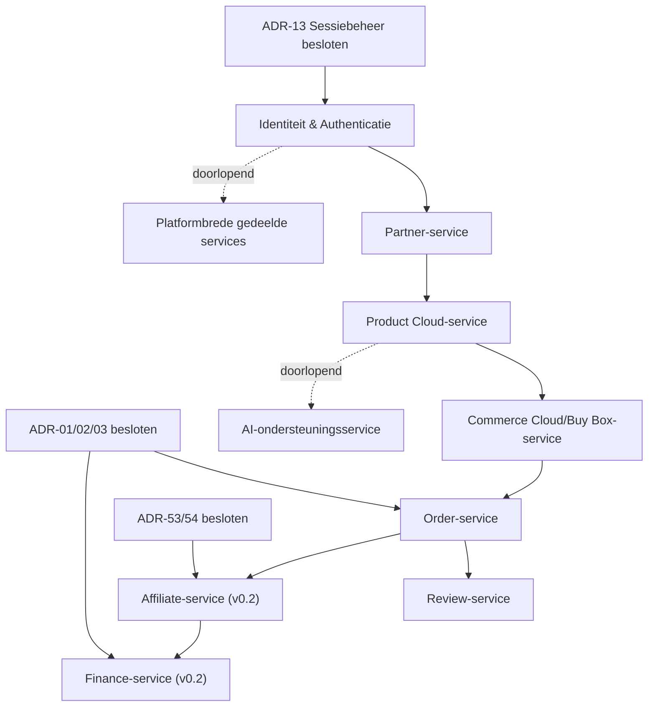

# EuropMade — Implementation Strategy

**Status:** Concept v0.2 — eerste document van Sprint 3. **Bijgewerkt na de definitieve Affiliate-scopewijziging** (Sprint 2 v0.2) en na de definitieve afsluiting van ADR-52 (Affiliate Platform = MVP, Creator Platform = Post-MVP).
**Uitgangspunt:** uitsluitend de elf goedgekeurde documenten in `docs/08-technical-blueprint/` (`TB-01-System-Architecture.md` en de tien Sprint 2-documenten `01`–`10`, alle v0.2). Geen enkel nieuw domeinbegrip, geen enkele nieuwe tabel, resource, event, service, security-, deployment-, integratieregel of ADR die daar niet al in staat. Huidige stand: **35 domeinobjecten, 47 tabellen, 43 events, 58 ADR-kandidaten, 9 services.**
**Scope:** dit document introduceert **geen nieuwe architectuur** — het beschrijft uitsluitend **hoe** de al vastgelegde architectuur gebouwd gaat worden: bouwvolgorde, reviewproces, testproces, Definition of Done, AI-werkwijze. **Geen code, geen implementatie.**
**Nadrukkelijk:** waar dit document een bouwvolgorde, reviewproces of kwaliteitsregel vaststelt, is dat **procesontwerp van dit document zelf** — nieuw, maar geen architectuurbesluit. Sprint 2 legt vast *wat* gebouwd wordt; dit document legt vast *hoe* en *in welke volgorde* — nooit *wat*.

---

## Leeswijzer

Elke sectie hieronder citeert expliciet op welk deel van welk Sprint 2-document zij steunt. Waar dit document een proceskeuze maakt die geen architecturale grondslag heeft (en ook niet kan hebben, omdat Sprint 2 nooit over implementatieproces ging) — reviewproces, testproces, AI-werkwijze, wijzigingsbeheer — staat dat expliciet vermeld als nieuwe toevoeging van dit document, niet als overname. Dit is een fundamenteel ander soort document dan de tien Sprint 2-documenten: het herschikt geen architectuur (zoals `09` en `10` deden), het ontwerpt een **uitvoeringsproces** rond die al vaststaande architectuur.

---

# 1. Doel van Sprint 3

Sprint 2 heeft de architectuur van EuropMade volledig vastgelegd: domeinmodel (35 objecten, na de Affiliate-scopewijziging), datamodel (47 tabellen), API-model, eventmodel (43 events), service-architectuur (9 services, incl. Affiliate- en Finance-service), security-, deployment- en integratie-architectuur, en een geprioriteerde catalogus van 58 nog te nemen architectuurbesluiten (`09-adr-overview.md`, waarvan ADR-52 inmiddels definitief is besloten), afgerond met een technische roadmap (`10-technical-roadmap.md`) die vaststelt dat Sprint 3 kan starten zodra ADR-01, ADR-02, ADR-03 en ADR-13 zijn besloten (Fase 0, `10` sectie 4/16, Bijlage E). Sprint 3's doel is niet om die architectuur te herzien, maar om **de eerste daadwerkelijke bouwstappen** te zetten: de implementatiestrategie, bouwvolgorde en kwaliteitsprocessen vaststellen waarmee de Fase 0–3-indeling uit `10-technical-roadmap.md` daadwerkelijk wordt uitgevoerd.

---

# 2. Uitgangspunten

Rechtstreeks overgenomen uit `10-technical-roadmap.md` sectie 2 en de onderliggende Sprint 2-documenten — geen enkel uitgangspunt hier voor het eerst geïntroduceerd:

- **Product Cloud ⊥ Commerce Cloud** — de belangrijkste, nooit te doorbreken grens (`01-domain-model.md` domeinobject 8).
- **Modular Monolith als vertrekpunt** — één deploybare eenheid bij lancering, negen logisch gescheiden services (zeven oorspronkelijk, plus Affiliate-/Finance-service na de scopewijziging) (`02-database-model.md` sectie 5, `07-deployment-architecture.md` sectie 1).
- **Server-side autoriteit, nooit stilzwijgend** (`03-api-model.md` sectie 1, `04-event-model.md` sectie 13).
- **AI ondersteunt, beslist nooit** (`01-domain-model.md` domeinobject 22) — dit geldt zowel voor het EuropMade-platform zelf als, zoals sectie 11 hieronder toelicht, voor de inzet van AI-hulpmiddelen tijdens het bouwen ervan.
- **Events voor cross-service-gevolgen, nooit voor cross-service-berekeningen** (`04-event-model.md` sectie 1).
- **Eén eigenaar per gegeven** — geen enkele service muteert een tabel die een andere service bezit (`05-service-architecture.md` sectie 4/8).
- **Sprint 2 is definitief.** Dit document wijzigt niets aan de elf brondocumenten — het bouwt uitsluitend een uitvoeringslaag daarboven.

---

# 3. Implementatiestrategie

**Nieuwe procestoevoeging van dit document**, direct afgeleid van de al vastgestelde Modular Monolith-keuze: EuropMade wordt gebouwd als één, samenhangende codebase met negen intern scherp gescheiden modules (overeenkomend met de negen services uit `05-service-architecture.md` sectie 1, v0.2) — niet als negen losse repositories of losse deployments. Elke module wordt gebouwd binnen haar eigen, al vastgelegde grenzen (databasetabellen uit `02-database-model.md` Deel A–F, resources uit `03-api-model.md`, events uit `04-event-model.md`) — nooit een module die de databasetabellen van een andere module rechtstreeks muteert (`05-service-architecture.md` sectie 4).

De strategie volgt de Fase-indeling uit `10-technical-roadmap.md` sectie 4 letterlijk: eerst Fase 0 (de vier blokkerende ADR's), dan Fase 1 (Kernplatform), dan Fase 2 (Uitbouw & Resilience), dan Fase 3 (Verfijning & Post-MVP). Binnen elke fase wordt gebouwd in de volgorde die sectie 4 (Bouwvolgorde) hieronder vaststelt.

---

# 4. Bouwvolgorde

Rechtstreeks gebaseerd op `10-technical-roadmap.md` Bijlage A/C en `09-adr-overview.md` sectie 8 (Aanbevolen volgorde) — dit document herhaalt die volgorde, herziet haar niet:

| Stap | Inhoud | Bron |
|---|---|---|
| 1 | ADR-01 (Integratiebeveiliging/Event Security), ADR-02 (Privacy & AVG), ADR-03 (Encryptie) — besluitvorming, geen implementatie | `10` Fase 0 |
| 2 | ADR-13 (Sessiebeheer) — besluitvorming | `10` Fase 0 |
| 3 | Eerste implementatie: Identiteit & Authenticatie (Customer, Seller, Company — `02-database-model.md` Deel A), zodra Sessiebeheer is besloten | `03-api-model.md` sectie 5 (Definitief), afhankelijk van stap 2 |
| 4 | Product Cloud-service (Deel B) — grootste, meest fundamentele module | `05-service-architecture.md` sectie 9 (verwachte belasting) |
| 5 | Commerce Cloud/Buy Box-service (Deel C) — afhankelijk van Product Cloud (Identifier-koppeling) | `05` sectie 5 (Afhankelijkheden) |
| 6 | Order-service (Deel D) — afhankelijk van Commerce Cloud (Offer-snapshot in Order Line) en de PSP-integratie (ADR-01) | `05` sectie 5, `08-integration-architecture.md` sectie 4 |
| 7 | Review-service (Deel E.1) — afhankelijk van Order-service (`OrderSplit`-event, `04-event-model.md` sectie 5) | `04` sectie 5 |
| 8 | **Affiliate-service (Deel G.1–G.5, v0.2)** — afhankelijk van Order-service (`OrderSplit` triggert `ConversionRecorded`) en van ADR-53/54 (cookie-consent-mechanisme, commissiepercentage & attributieperiode); ADR-52 (Creator vs. Affiliate scope) is al besloten, vereist hier geen besluitvorming meer | `05-service-architecture.md` sectie 5 (v0.2), `09-adr-overview.md` categorie J |
| 9 | **Finance-service (Deel G.6–G.8, v0.2)** — afhankelijk van Order-service (Seller-commissie) én Affiliate-service (`ConversionRecorded` → Affiliate-commissie), en van de PSP-keuze (ADR-01) voor uitbetaling | `05` sectie 5 (v0.2) |
| 10 | AI-ondersteuningsservice en Platformbrede gedeelde services (Audit/Notificatie) — parallel aan stappen 4–9, aangezien beide door vrijwel elke andere module worden geraadpleegd | `05` sectie 1 |

---

# 5. Modulevolgorde

Zelfde volgorde als sectie 4, hier per servicegrens samengevat (`05-service-architecture.md` sectie 1, v0.2): **Partner-service → Product Cloud-service → Commerce Cloud/Buy Box-service → Order-service → Review-service → Affiliate-service → Finance-service**, met AI-ondersteuningsservice en Platformbrede gedeelde services doorlopend meegebouwd vanaf het begin (zij hebben geen eigen "startmoment," aangezien elke andere module al vanaf stap 1 audit-schrijvingen doet, `04-event-model.md` sectie 13).

---

# 6. Afhankelijkheden

Volledig overgenomen uit `05-service-architecture.md` sectie 5 en `09-adr-overview.md` sectie 6 — geen nieuwe afhankelijkheid toegevoegd:

- Commerce Cloud/Buy Box-service is afhankelijk van Product Cloud-service (`ProductMerged`, `ProductSplit`, `ProductOriginRevoked`) en Review-service (`ReviewAggregateChanged`).
- Order-service is afhankelijk van de externe PSP (`PaymentConfirmed`) — en daarmee van ADR-01.
- Review-service is afhankelijk van Order-service (`OrderSplit`).
- Authenticatie (Definitief, `03-api-model.md` sectie 5) is afhankelijk van ADR-13 (Sessiebeheer) — zonder dat besluit kan geen enkele module met een sessie-afhankelijke autorisatiecontrole gebouwd worden.
- **Affiliate-service (v0.2) is afhankelijk van Order-service** (`OrderSplit` → `ConversionRecorded`) **en van ADR-53/54** (cookie-consent-mechanisme, commissiepercentage & attributieperiode) — ADR-52 zelf is al besloten en vormt geen afhankelijkheid meer.
- **Finance-service (v0.2) is afhankelijk van Order-service, Affiliate-service, en de externe PSP** (ADR-01) voor uitbetaling.

---

# 7. Reviewproces

**Nieuwe procestoevoeging van dit document** — Sprint 2 legt geen reviewproces vast. Direct afgeleid van het al bevroren "nooit stilzwijgend"-principe (`04-event-model.md` sectie 13): elke wijziging die een van de elf brondocumenten raakt (bijv. een implementatiedetail dat een aanname uit `02-database-model.md` blijkt tegen te spreken) wordt behandeld als een mogelijke **Geconstateerde inconsistentie** — met dezelfde discipline die Sprint 2 zelf steeds toepaste: gemeld, niet stilzwijgend opgelost, en teruggekoppeld naar het brondocument via het bestaande wijzigingsbeheerproces (sectie 14), nooit door het brondocument zelf tijdens implementatie aan te passen.

---

# 8. Testproces

**Nieuwe procestoevoeging.** `05-service-architecture.md` sectie 2 legt vast dat elke service een scherp begrensd verantwoordelijkheidsgebied heeft — dit maakt geïsoleerd testen per service (unit-niveau) architecturaal mogelijk, zonder dat een test van bijvoorbeeld de Review-service kennis hoeft te hebben van de interne logica van de Commerce Cloud/Buy Box-service. Het testproces volgt de servicegrenzen: elke module wordt getest tegen haar eigen, al vastgelegde contract (tabellen uit `02`, resources uit `03`, events uit `04`) vóórdat zij met een andere module wordt geïntegreerd getest. Een concrete teststrategie (dekkingsdoelen, testpiramide-verhouding) is in Sprint 2 nooit vastgelegd (`10-technical-roadmap.md` sectie 13, Open) — dit document vult dat gat niet zelfstandig in, dat blijft een openstaand punt.

---

# 9. Definition of Done

**Nieuwe procestoevoeging, direct gekoppeld aan de al bevroren besluitstatussen.** Een module-onderdeel is "Done" wanneer: (a) het exact overeenkomt met een als **Definitief** gemarkeerd onderdeel uit de elf bronnen, of (b) het een als **Voorlopig**/**Open** gemarkeerd onderdeel is waarvoor het bijbehorende ADR (uit `09-adr-overview.md`) inmiddels is besloten. Een module-onderdeel is **nooit** Done wanneer het een nog-Open ADR-kandidaat stilzwijgend zelf invult tijdens de bouw — dat zou de "geen nieuwe architectuurbesluiten"-regel van dit document doorbreken.

---

# 10. Acceptatiecriteria

Rechtstreeks overgenomen uit `10-technical-roadmap.md` sectie 15: Sprint 3 kan starten zodra ADR-01, ADR-02, ADR-03 en ADR-13 zijn besloten. Voor elke individuele module (sectie 4/5 hierboven) geldt aanvullend: de module is acceptabel opgeleverd wanneer zij aantoonbaar herleidbaar is naar een specifieke sectie in een van de elf brondocumenten — een implementatiekeuze zonder zo'n herleidbare bron is per definitie niet acceptabel, ongeacht of zij functioneel werkt.

---

# 11. AI-werkwijze (Claude + Cursor)

**Nieuwe procestoevoeging van dit document — geen enkele grondslag in Sprint 2, dat nooit over ontwikkeltools ging.** Consistent met het platformbrede, al bevroren principe "AI ondersteunt, beslist nooit" (`01-domain-model.md` domeinobject 22), wordt dat principe hier doorgetrokken naar de inzet van AI-hulpmiddelen tijdens de bouw zelf:

- AI-ondersteuning (Claude voor architectuur-/documentatiewerk, Cursor voor codegeneratie) **stelt voor, een mens beslist** — exact dezelfde regel die binnen het platform zelf geldt voor claim-beoordelingen, matchingskandidaten en moderatie.
- Elke door AI gegenereerde implementatie wordt getoetst aan de Definition of Done (sectie 9) — met name de herleidbaarheidseis: een AI-voorstel dat geen aanwijsbare bron in de elf documenten heeft, wordt niet geaccepteerd zonder eerst als mogelijke Geconstateerde inconsistentie (sectie 7) te worden behandeld.
- AI-hulpmiddelen krijgen expliciet **niet** de bevoegdheid om zelfstandig een Open ADR-kandidaat (`09-adr-overview.md`) te beantwoorden — dat blijft, net als binnen het platform, een menselijke beslissing.

---

# 12. Documentatie tijdens implementatie

**Voorlopig — impliciet aantoonbaar via het patroon dat de elf bronnen zelf al consequent toepasten** (`10-technical-roadmap.md` sectie 14, Documentatiestrategie, zelf al Voorlopig): elk document citeert exact zijn bron, markeert eigen toevoegingen expliciet, en sluit af met een besluitstatus. Dit document zet dat patroon voort tijdens de implementatiefase: elke implementatiebeslissing die niet letterlijk in een van de elf bronnen staat, wordt gedocumenteerd op dezelfde manier — met bronvermelding of met een expliciete markering dat het een nieuwe procestoevoeging is (zoals dit document dat zelf overal doet).

---

# 13. Risicobeheersing

Zie Bijlage D voor de volledige lijst. Kernprincipe, overgenomen uit `10-technical-roadmap.md` sectie 7: risico's worden behandeld naar het risicotype dat Sprint 2 al vaststelde (financieel, juridisch, datalek, implementatie-blokkerend, launch-gebonden, operationeel) — dit document voegt geen nieuw risicotype toe, het plant uitsluitend wanneer elk risico in de bouwvolgorde wordt geadresseerd.

---

# 14. Wijzigingsbeheer

**Nieuwe procestoevoeging.** Consistent met de regel "Sprint 2 is definitief" (sectie 2): een wijziging aan een van de elf brondocumenten gebeurt nooit tijdens implementatie zelf. Ontdekt de implementatie een fout, gat of tegenstrijdigheid in een brondocument (vergelijkbaar met de telfout die in `04-event-model.md` werd gevonden tijdens het opstellen van `09-adr-overview.md`), dan wordt dat gemeld als Geconstateerde inconsistentie (sectie 7), niet stilzwijgend gecorrigeerd binnen de implementatiecode.

---

# 15. Kwaliteitscontrole

**Nieuwe procestoevoeging, direct gemodelleerd naar de reviewdiscipline die Sprint 2 zelf toonde** (bijv. de integrale eindreview die vóór deze Sprint 3 al op alle tien Sprint 2-documenten is uitgevoerd): elke opgeleverde module wordt gecontroleerd op (a) herleidbaarheid naar de elf bronnen (Definition of Done, sectie 9), (b) consistentie met reeds gebouwde modules, en (c) afwezigheid van stilzwijgend ingevulde Open ADR-kandidaten.

---

# 16. Gereed voor implementatie

Zie Bijlage E (Implementatie Readiness Checklist). Samengevat: implementatie van Stap 3 (sectie 4, Identiteit & Authenticatie) kan starten zodra ADR-01, ADR-02, ADR-03 en ADR-13 zijn besloten — exact de Fase 0-voorwaarde die `10-technical-roadmap.md` al vaststelde.

---

# A. Implementatie-overzicht

| Fase (uit `10`) | Bouwstappen (sectie 4) | Status bij start Sprint 3 |
|---|---|---|
| Fase 0 — Fundament | Stap 1–2 (ADR-besluitvorming) | Vereist vóór elke implementatie |
| Fase 1 — Kernplatform | Stap 3–10 (Identiteit t/m AI/Audit-modules, incl. Affiliate-/Finance-service, v0.2) | Kan starten ná Fase 0 |
| Fase 2 — Uitbouw & Resilience | Niet in dit document uitgewerkt — volgt in een later Sprint 3-document | — |
| Fase 3 — Verfijning & Post-MVP | Niet in dit document uitgewerkt | — |

---

# B. Bouwvolgorde per module

| Module | Bouwstap | Afhankelijk van |
|---|---|---|
| Identiteit & Authenticatie | 3 | ADR-13 |
| Partner-service | 3 (samen met Identiteit) | — |
| Product Cloud-service | 4 | Partner-service (eigenaarschap) |
| Commerce Cloud/Buy Box-service | 5 | Product Cloud-service |
| Order-service | 6 | Commerce Cloud/Buy Box-service, ADR-01 (PSP) |
| Review-service | 7 | Order-service |
| **Affiliate-service** *(v0.2)* | 8 | Order-service, ADR-53/54 |
| **Finance-service** *(v0.2)* | 9 | Order-service, Affiliate-service, ADR-01 (PSP) |
| AI-ondersteuningsservice | Doorlopend vanaf 4 | Product Cloud-service (aanleiding) |
| Platformbrede gedeelde services | Doorlopend vanaf 3 | Alle overige modules (universeel consument) |

---

# C. Afhankelijkheidsdiagram

---

# D. Geconstateerde risico's

Direct overgenomen uit `10-technical-roadmap.md` sectie 7, hier gekoppeld aan de bouwvolgorde:

| Risico | Bouwstap geraakt | Beheersing |
|---|---|---|
| Financieel (ADR-01 nog niet besloten) | Stap 6 (Order-service) | Order-service start pas ná ADR-01 (sectie 6, Afhankelijkheden) |
| Juridisch (ADR-02 nog niet besloten) | Stap 3 (Identiteit — eerste Klant-registratie) | Identiteit start pas ná ADR-02 |
| Datalek (ADR-03/04/05) | Stap 3 (Partner-service, gevoelige data) | Partner-service start pas ná ADR-03 |
| Implementatie-blokkerend (ADR-13) | Stap 3 | Expliciet als voorwaarde in Bouwvolgorde opgenomen |
| **Implementatie-blokkerend (ADR-53, cookie-consent-mechanisme) — v0.2** | Stap 8 (Affiliate-service) | Affiliate-service start pas ná ADR-53 (geen `click` mogelijk zonder consent-mechanisme) |
| Herleidbaarheidsrisico (AI-gegenereerde code zonder bron) | Alle stappen | Definition of Done (sectie 9) + AI-werkwijze (sectie 11) |

---

# E. Implementatie Readiness Checklist

- [ ] ADR-01 (Integratiebeveiliging/Event Security) besloten
- [ ] ADR-02 (Privacy & AVG) besloten
- [ ] ADR-03 (Encryptie) besloten
- [ ] ADR-13 (Sessiebeheer) besloten
- [x] **(v0.2)** ADR-52 (Creator vs. Affiliate scope) — reeds definitief besloten: Affiliate Platform = MVP, Creator Platform = Post-MVP
- [ ] **(v0.2)** ADR-53 (Cookie-consent-mechanisme) besloten — blokkeert Stap 8 (Affiliate-service)
- [ ] **(v0.2)** ADR-54 (Affiliate-commissiepercentage & attributieperiode) besloten — blokkeert Stap 8 (Affiliate-service)
- [ ] Reviewproces (sectie 7) en Wijzigingsbeheer (sectie 14) geaccepteerd door het implementatieteam
- [ ] AI-werkwijze (sectie 11) geaccepteerd — met name de regel dat AI-hulpmiddelen geen Open ADR-kandidaat zelfstandig mogen invullen
- [ ] Definition of Done (sectie 9) geaccepteerd als toetsingskader voor elke module
